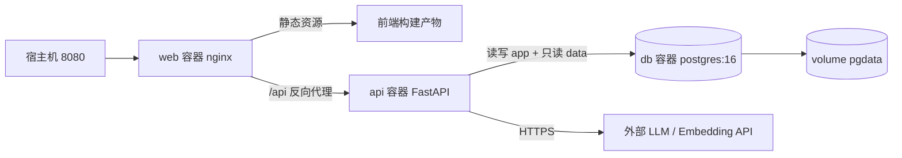

# ChatBI 平台 · SDD 后端技术方案

> 版本 v3.0 ｜ 关联 `docs/PRD.md` v0.6 ｜ 关联 `docs/SDD-总览.md` §3、§9、§10 ｜ 关联 `docs/SDD-算法应用.md` v3.0
> **S1~S8 链路与 QueryRunner 协议以 `docs/SDD-算法应用.md` 为准**，一次问数的返回体 `ChainResult` 由算法 §7.4 写死。本文件只写「怎么调、怎么执行、怎么落库、怎么返回」。
> 接口契约段（§2）是前后端唯一的报文来源；前端文档与本文冲突时以本文为准。**四份 SDD 的修改顺序固定为：算法 → 后端 → 前端 → 总览。**

---

## 1. 服务边界与模块拆分

**【决策】单体后端（模块化），不拆微服务。**

理由：本版只有单用户、单数据源、无高并发要求；拆微服务会带来进程间协议、部署拓扑、联调成本，全部与「一条命令起来能演示」的目标相悖。模块化单体通过目录与导入边界保证可拆分性。

```
backend/app/
├─ main.py       FastAPI 入口
├─ core/         配置、日志、统一异常、依赖注入
├─ api/          HTTP 边界：参数校验、状态码、响应封装
├─ services/     用例编排：会话、报表、问数
├─ agent/        算法编排（S1~S8，内部库，不外露）
│  ├─ graph.py / state.py / llm.py
│  └─ nodes/     understand / template / retrieve / plan / gen_sql(+lint) / execute / present / narrate
├─ resources/    L0 读取（调 query/introspection）/ 口径词典加载（增强包）/ 模板 / 示例检索（retrieval：pgvector 召回 + lexical 降级）
├─ query/        sql_guard / runner / cache_store / introspection
├─ storage/      ORM 模型、数据库会话、仓储
└─ schemas/      Pydantic 入参 / 出参
```

| 模块 | 职责 | 依赖方向 |
| :--- | :--- | :--- |
| `api/` | 路由、Pydantic 入参、统一响应 | → `services/` |
| `services/` | 用例编排（读最近 6 轮历史 → 调算法 → 落库 → 组装响应） | → `agent/`、`storage/`、`query/` |
| `agent/` | 自然语言 → `plan` / `sql` / 表 + `chart_spec` / `narrative` | → `resources/`（资源注入）；`runner` / `cache_store` / `resources` 由 `services/` 注入；**不接数据库** |
| `resources/` | 读 L0 结构、加载口径词典（增强包）、读模板与示例 | → `query/`（只读 introspection）、文件 |
| `query/` | SQL 物理兜底（只读角色 / schema 隔离 / 行数上限 / 超时）与执行；缓存读写；元数据 introspection | → `storage/`（只读连接 / 缓存表） |
| `storage/` | 表模型与 CRUD | 不反向依赖 |
| `core/` | 配置、日志、统一异常、`get_current_user()` | 被 `api/` / `services/` 引用 |
| `schemas/` | Pydantic 入参 / 出参模型 | ← `api/` |

**禁止**：

- `api/` 直接调 `agent/`；必须经 `services/`。
- `agent/` 直接 import 数据库驱动或持有连接串；它只能通过注入的 `runner` 执行 SQL、通过 `cache_store` 读写缓存。
- `agent/` 直接读写业务表（它只返回状态，由 `services/` 落库）。

---

## 2. 接口清单

统一前缀 `/api`。统一响应包：

```json
{ "code": 0, "message": "ok", "data": {}, "trace_id": "..." }
```

`code` 非 0 时 `data` 为 `null`，`message` 为可展示文案。

> `data` 的内容 = `message_id` + `session_id` + `ChainResult`（定义见 `docs/SDD-算法应用.md` §7.4）。后端只做外层包装、加 `message_id` / `session_id`，并把 `trace` 剥离到 `query_logs.trace`；其余字段不改名、不填默认值。

| # | 方法 | 路径 | 用途 | 关联 PRD |
| :- | :--- | :--- | :--- | :--- |
| 1 | POST | `/api/chat/ask` | 一次提问 | F1、F2、F3、F4 |
| 2 | POST | `/api/chat/clarify` | 提交澄清选择 | F2 |
| 3 | GET | `/api/sessions` | 会话列表 | F7 |
| 4 | GET | `/api/sessions/{id}/messages` | 拉取会话消息 | F7 |
| 5 | POST | `/api/reports` | 存为报表 | F5 |
| 6 | GET | `/api/reports` | 报表列表 | F6 |
| 7 | GET | `/api/reports/{id}` | 打开报表（读快照） | F6 |
| 8 | PATCH | `/api/reports/{id}` | 改名 | F6 |
| 9 | DELETE | `/api/reports/{id}` | 删除 | F6 |
| 10 | GET | `/api/health` | 健康检查（Compose 探活） | F8 |
| 11 | DELETE | `/api/sessions/{id}` | 删除会话（连带消息） | F7 |
| 12 | DELETE | `/api/sessions` | 清空全部会话（连带消息） | F7 |

### 2.1 `POST /api/chat/ask`

请求：

```json
{ "session_id": "s_01", "question": "这次双11大促的总GMV是多少？和去年同期比涨了多少？" }
```

`session_id` 缺省时后端新建会话。

响应 `data`（`result` 内部字段与前端 §5.1 一一对应）：

```json
{
  "message_id": "m_01",
  "session_id": "s_01",
  "action": "answer",
  "result": {
    "columns": [
      {"key": "period", "title": "周期", "type": "string"},
      {"key": "gmv", "title": "GMV", "type": "number"}
    ],
    "rows": [{"period": "2026 大促期", "gmv": 12840000}, {"period": "2025 大促期", "gmv": 11210000}],
    "chart": {"type": "bar", "x_field": "period", "series": [{"key": "gmv", "name": "GMV"}]},
    "narrative": "今年大促 GMV 较去年同期上涨 14.5%。",
    "truncated": false
  },
  "clarify": null,
  "reject": null
}
```

`action` 取值与必填分支：

| action | 必有字段 | 必空字段 | 典型场景 |
| :--- | :--- | :--- | :--- |
| `answer` | `result` | `clarify`、`reject` | 正常出数；**rows 为空也属于 answer** |
| `clarify` | `clarify` | `result`、`reject` | 证据表明存在多种解读且结论不同 / 缺关键槽位（不依赖 L1 是否登记） |
| `reject` | `reject` | `result`、`clarify` | 非数据问题；理解失败；SQL 生成 / 执行失败；超时 |

> 序列化层强制校验上表：`clarify` / `reject` 状态下若 `result` 非空，直接抛 500。这是「澄清拒答不出数」的工程保障，不靠调用方自觉。
>
> `reject.reason_code` 区分两类：业务不可答（`out_of_scope` / `detail_export` / `write_op` / `no_data`）与技术失败（`intent_parse_failed` / `sql_generate_failed` / `sql_execute_failed` / `timeout`）。后者 `retryable=true`，前端展示「这次没查出来 + 重试」。

### 2.2 `POST /api/chat/clarify`

```json
{ "session_id": "s_01", "clarify_id": "c_01", "answer": { "value": "gmv" } }
```

- 后端按 `clarify_id` 取出暂存的原始问题与缺失槽位，合成结构化补全后调用算法，**不把答案拼成自然语言再理解一遍**。暂存结构固定为 `clarify_state = {clarify_id, original_question, missing, options, expires_at}`（落 §4.2 `messages.clarify_state`），新提问或会话结束时清空。
- 用户提交的答案落为一条 `user` 消息（`content` 为所选选项的 `label` 或自由文本原文），保证多槽位澄清逐轮收敛、回放可见；调用算法时与 `/api/chat/ask` 一致携带最近 6 轮 `history`。
- 响应同 `/api/chat/ask`。
- `clarify_id` 不存在或已过期（会话被放弃）→ `409 CLARIFY_EXPIRED`。

### 2.3 会话接口

```
GET  /api/sessions?limit=30
→ { "items": [{ "id": "s_01", "title": "双11大促 GMV", "updated_at": "..." }] }

GET  /api/sessions/{id}/messages
→ { "items": [
     { "message_id": "m_01", "session_id": "s_01", "role": "user", "content": "...", "created_at": "..." },
     { "message_id": "m_02", "session_id": "s_01", "role": "assistant", "action": "answer",
       "result": {...}, "clarify": null, "reject": null, "created_at": "..." }
   ] }

DELETE /api/sessions/{id}
→ { "deleted": true }（连带删除该会话下全部消息；会话不存在 → 404 SESSION_NOT_FOUND）

DELETE /api/sessions
→ { "deleted_count": 12 }（清空当前用户全部会话，连带消息）
```

> 消息形状：`user` 消息只有 `message_id / session_id / role / content / created_at`；`assistant` 消息是完整的 `ChatAnswer`（`action` 必有，`result / clarify / reject` 三选一非空）。前端按 `role` 做联合类型。

### 2.4 报表接口

```
POST /api/reports
body: { "message_id": "m_02", "name": "双11 GMV 同比", "chart_type": "bar", "overwrite": false }
→ { "id": "r_01", "name": "双11 GMV 同比" }
```

- `chart_type` 只能覆盖**同类**（`bar` ↔ `line`），不允许改成未支持类型。
- 同名冲突且 `overwrite=false` → `409 REPORT_NAME_EXISTS`；`overwrite=true` 覆盖同名旧记录。
- `message_id` 必须属于一条 `action=answer` 且 `rows` 非空的助手消息，否则 `422 MESSAGE_NOT_QUERYABLE`。
- 保存时把该消息的 `columns` / `rows` / `chart` / `narrative` / `truncated` 分别写入 `snapshot_columns` / `snapshot_rows` / `chart_spec` / `narrative` / `snapshot_truncated`；`chart_type` 只覆盖 `chart_spec.type`，不改快照数据。

```
GET /api/reports?page=1&size=20
→ { "items": [{ "id", "name", "question", "created_at", "updated_at" }], "total": 12 }

GET /api/reports/{id}
→ {
    "id": "r_01", "name": "...", "question": "...",
    "result": { "columns": [...], "rows": [...], "chart": {...}, "narrative": "...", "truncated": false },
    "created_at": "2026-11-09T10:00:00Z"
  }
```

`GET /api/reports/{id}` **只读快照**：直接用存下的 `snapshot_columns` + `snapshot_rows` + `snapshot_truncated` + `chart_spec` + `narrative` 组装 `result` 返回；**不执行 SQL、不调算法、不走降级分支**。存下的 `sql` / `query_spec` 只用于溯源与复现，不作为重开时的执行对象。

```
PATCH  /api/reports/{id}   body: { "name": "新名字" }   → { "id", "name" }
DELETE /api/reports/{id}                               → { "deleted": true }
```

### 2.5 错误码（传输层）

> 这里是 HTTP / 接口层错误；模型或 SQL 失败已经包含在 `action=reject` 里，不再走 HTTP 错误。

| HTTP | code | 场景 |
| :--- | :--- | :--- |
| 400 | `INVALID_ARGUMENT` | 参数缺失或格式错 |
| 404 | `SESSION_NOT_FOUND` / `REPORT_NOT_FOUND` | 资源不存在 |
| 409 | `REPORT_NAME_EXISTS` / `CLARIFY_EXPIRED` | 冲突 |
| 422 | `MESSAGE_NOT_QUERYABLE` | 该消息不可存为报表 |
| 500 | `INTERNAL` | 未预期异常（打 `trace_id`） |

---

## 3. 运行期协议实现：QueryRunner / CacheStore / Introspection

**算法不直连库**：它拿到 SQL 后回调注入的 `runner`，后端在这里完成「物理兜底 → 执行 → 归一化返回」。协议形状由 `docs/SDD-算法应用.md` §9.2 / §9.4 定义，本文只写实现。`cache_store` 与 `resources` 同样由后端实现并注入，算法不 import 数据库模块。

### 3.1 实现签名

```python
# query/runner.py
class PgQueryRunner:
    def run(
        self,
        sql: str,
        *,
        params: dict | None = None,
        timeout_ms: int | None = None,
        max_rows: int | None = None,
    ) -> QueryResult: ...
```

`QueryResult` 字段（与算法 §9.2 完全一致）：

```python
{
  "columns": [{"key": "gmv", "title": "GMV", "type": "number"}],
  "rows": [{"gmv": 12840000}],
  "row_count": 1,
  "truncated": False,
  "elapsed_ms": 42,
  "error_code": None,       # SQL_REJECTED | SQL_FAILED | QUERY_TIMEOUT
  "message": None
}
```

### 3.2 执行前的物理兜底（写死，任何调用方不得绕过）

> 本节**不是链路上的一个判定步骤**（算法 S6 只负责执行）。技术合法性（单条 / 只读 / 表白名单 / 列归属）已由算法 **S5 lint** 在生成侧做过；这里保留同等检查，是为了防止旁路调用（模板快道、手工重放、未来新增调用方）。任一检查不过一律返回 `SQL_REJECTED`，由算法决定回炉还是收口，后端不做业务判断。

| 规则 | 实现 | 定位 |
| :--- | :--- | :--- |
| 只读连接 | 只读角色 `chatbi_ro`（仅 `GRANT SELECT ON data.*`），连接串 `DATABASE_RO_URL` | **物理兜底（必留）** |
| schema 隔离 | 连接 `search_path=data`；SQL 里出现 `app.` / `public.` 直接拒 | **物理兜底（必留）** |
| 强制行数上限 | 外层包 `SELECT * FROM (...) t LIMIT max_rows + 1`，超过 `max_rows` 截断并标记 `truncated=true` | **物理兜底（必留）** |
| 超时 | `SET LOCAL statement_timeout`，默认 `QUERY_TIMEOUT_MS=5000`，超时返回 `QUERY_TIMEOUT` | **物理兜底（必留）** |
| 参数化 | 值走 `params`，不允许把用户输入拼进 SQL 字符串 | **物理兜底（必留）** |
| 只允许单条 `SELECT`（可含 `WITH`） | 解析后判断语句类型；出现多条语句直接拒 | 与 S5 lint 同款，防旁路 |
| 禁止写操作 | 关键字黑名单：`INSERT/UPDATE/DELETE/DROP/ALTER/TRUNCATE/ATTACH/PRAGMA/CREATE/REPLACE/GRANT` | 与 S5 lint 同款，防旁路 |
| 表白名单 | 只允许 `data` schema 下 §5.2 的 14 张表；其他表直接拒 | 与 S5 lint 同款，防旁路 |
| 禁止明细查询 | 逐行返回且无聚合的明细查询由 S1 先拦；执行器作为第二道，按语句特征拒绝 | 与 S1 规则同款，防旁路 |

> 本节只约束 **QueryRunner 执行的业务 SQL**。L0 元数据 introspection 不走这张白名单，见 §3.6。

### 3.3 结果归一化

- 列名转 `key`，`title` 取列注释（无注释则用列名），`type` 由 PG 类型映射到 `number` / `string` / `date`。
- 数值统一转 `float` 或 `int`，日期统一 ISO 字符串，`NULL` 保留为 `null`。
- 只返回 `columns` / `rows` / `row_count` / `truncated` / `elapsed_ms` / `error_code` / `message`，不返回连接、游标、执行计划。

### 3.4 三种失败怎么回

| 情况 | `error_code` | 算法侧行为 |
| :--- | :--- | :--- |
| SQL 不合规（物理兜底拒） | `SQL_REJECTED` | 带错误信息回 S5 重写，仅 1 次；再次被拒 → `sql_execute_failed`（`sql_generate_failed` 只来自 S5 lint 两轮不过） |
| 执行报错 | `SQL_FAILED` + 原始错误 | 回 S5 重写，仅 1 次；再次失败 → `sql_execute_failed` |
| 超时 | `QUERY_TIMEOUT` | 不重试，直接 `action=reject`（`timeout`，`retryable=true`） |
| 空结果 | `error_code=null`、`rows=[]` | `action=answer`，空表正常返回 |

### 3.5 `CacheStore` 实现

```python
# query/cache_store.py
class PgCacheStore:
    def get(self, key: str) -> dict | None: ...   # 未过期返回 {query_spec, sql, chart_spec}，否则 None
    def put(self, key: str, value: dict) -> None: # upsert，写 expires_at
```

- 读写 `app.semantic_cache`（§4.4）；`cache_key` 已含 `inherited / l1_version / schema_version / template_version`（算法 §7.5），澄清回填与版本变化都会让旧键自然不命中。
- 只存 `query_spec / sql / chart_spec`，**不存 rows / narrative**；写回条件由算法控制（仅 `answer` 且 `rows` 非空；`clarify` / `reject` / 空结果不写）。
- 由 `services/chat_service.py` 注入 `graph.invoke(..., config={"configurable": {"runner": ..., "cache_store": ..., "resources": ...}})`；算法不直接访问缓存表。

### 3.6 L0 Introspection 实现

```python
# query/introspection.py
class PgIntrospector:
    def l0(self) -> dict: ...   # {tables, columns, data_range, schema_version}
                                # data_range 键名写死：{"min_date": "YYYY-MM-DD", "max_date": "YYYY-MM-DD"}
```

- 用 `DATABASE_META_URL`（缺省回落 `DATABASE_RO_URL`）建立**独立的只读元数据连接**读取 `information_schema`，**不复用 QueryRunner 的 data 表白名单**；QueryRunner 只执行 `data` 业务表 SQL。
- 只读取表名、列名、类型、注释、可空性、主键 / 外键、行数与每列采样值；`data_range` 取事实表日期列的 min / max（当前为 `dwd_payment.pay_date`），不依赖 `dim_date`，也不读取业务明细。
- 进程内缓存，`schema_version` 变化（列结构哈希变化）时重读；读取失败 → 启动自检失败（L0 是硬依赖）。

---

## 4. 存储设计（`app` schema）

PostgreSQL 单实例，应用数据全部落在 `app` schema。开发环境用 Docker 内置 PG，生产用 Supabase；应用读写走 `DATABASE_URL`，QueryRunner 执行走 `DATABASE_RO_URL`，L0 introspection 走独立的只读元数据连接（`DATABASE_META_URL`，缺省回落到 `DATABASE_RO_URL`）。

### 4.1 `app.sessions`

| 字段 | 类型 | 说明 |
| :--- | :--- | :--- |
| `id` | TEXT PK | `s_` + ulid |
| `title` | TEXT | 首条问题前 24 字，默认「新对话」 |
| `user_id` | TEXT | 本版固定 `demo`（F11 预留） |
| `created_at` / `updated_at` | TIMESTAMPTZ | `updated_at` 用于列表排序 |

### 4.2 `app.messages`

| 字段 | 类型 | 说明 |
| :--- | :--- | :--- |
| `id` | TEXT PK | `m_` + ulid |
| `session_id` | TEXT FK | 索引 |
| `user_id` | TEXT | 本版固定 `demo`（F11 预留），与 session 冗余便于查询 |
| `role` | TEXT | `user` / `assistant` |
| `content` | TEXT | 用户原始问题；助手消息存 `narrative` 或空 |
| `action` | TEXT NULL | 仅 assistant：`answer` / `clarify` / `reject`；user 消息为 NULL |
| `payload` | JSONB | 仅 assistant：`ChainResult`（不含 `trace`；`trace` 剥离到 `query_logs.trace`，见 §4.5） |
| `query_spec` | JSONB | 仅 `answer` 时有值，F5 存报表要用 |
| `sql` | TEXT | 仅 `answer` 时有值，单条只读 SELECT |
| `chart_spec` | JSONB | 仅 `answer` 时有值 |
| `clarify_state` | JSONB | 仅 `clarify` 时有值：`{clarify_id, original_question, missing, options, expires_at}`；确认后清空 |
| `created_at` | TIMESTAMPTZ | |

> 为什么把 `query_spec` / `sql` / `chart_spec` 从 `payload` 里拎出来单独成列：F5 存报表只依赖这三个字段，拎出来避免从大 JSONB 里反复提取，也让「哪些消息可存报表」有明确判据（三列非空）。

### 4.3 `app.reports`

| 字段 | 类型 | 说明 |
| :--- | :--- | :--- |
| `id` | TEXT PK | `r_` + ulid |
| `user_id` | TEXT | 本版固定 `demo`（F11 预留），唯一索引与 `name` 联合 |
| `name` | TEXT | 唯一索引 `(user_id, name)` |
| `source_message_id` | TEXT | 溯源 |
| `question` | TEXT | 来源问题，列表展示 |
| `query_spec` | JSONB | 结构化口径 |
| `sql` | TEXT | 固化只读 SQL，仅溯源 / 复现，重开不执行 |
| `chart_spec` | JSONB | 图表配置 |
| `narrative` | TEXT | 保存时的一句解读（报表展示用） |
| `snapshot_columns` | JSONB | 保存时列结构（报表表头的唯一来源） |
| `snapshot_rows` | JSONB | 保存时结果快照（报表数据的唯一来源） |
| `snapshot_truncated` | BOOLEAN | 保存时是否因 `MAX_ROWS` 截断 |
| `created_at` / `updated_at` | TIMESTAMPTZ | |

**为什么存快照**：报表的语义是「保存那一刻的结果」。重开直接读 `snapshot_columns` + `snapshot_rows` + `chart_spec` + `narrative`，不重查、不重算，保证同一张报表每次打开内容一致。`sql` / `query_spec` 只留作溯源与复现，不参与重开。

### 4.4 `app.semantic_cache`（语义缓存表）

| 字段 | 类型 | 说明 |
| :--- | :--- | :--- |
| `cache_key` | TEXT PK | 见算法 §7.5 的组成 |
| `query_spec` | JSONB | 缓存的口径 |
| `sql` | TEXT | 缓存的 SQL |
| `chart_spec` | JSONB | 缓存的图表配置 |
| `l1_version` | TEXT | 口径词典指纹；字典缺失时为空串，仍参与 `cache_key` |
| `schema_version` | TEXT | L0 结构指纹，变化即失效 |
| `template_version` | TEXT | 模板指纹；也并入 `cache_key`，便于排查 |
| `source` | TEXT | 写入来源：`template`（S2 模板填空）/ `generated`（S5 生成），用于观察快道命中率 |
| `hit_count` | INT | 命中次数，便于观察 |
| `created_at` / `expires_at` | TIMESTAMPTZ | TTL 默认 7 天 |

> 缓存**不存 rows、不存 narrative**：数据会变，数字必须每次重新执行后生成。缓存只复用「口径 + SQL + 图表」，这也是命中后仍要 S6 / S8 的原因。

### 4.5 `app.query_logs`（建议保留）

| 字段 | 说明 |
| :--- | :--- |
| `id` / `message_id` / `sql` / `row_count` / `elapsed_ms` / `error_code` / `cached` / `trace` / `created_at` | 排查口径与性能问题用；`trace` 为算法每步 `{node, elapsed_ms, note}` 的 JSONB，从 `ChainResult` 剥离后落库；F10 评测启用后直接复用 |

### 4.6 `app.exemplar_embeddings`（示例问句向量，可选增强）

| 字段 | 类型 | 说明 |
| :--- | :--- | :--- |
| `exemplar_id` | TEXT | 对应 `semantics/exemplars.yaml` 的 `id`；与 `model` 组成主键 |
| `question` | TEXT | 示例问句原文（只要问句，**不存 SQL**） |
| `embedding` | `vector(EMBED_DIM)` | 维度必须与 `EMBED_DIM` 一致；HNSW 要求 ≤ 2000 |
| `model` | TEXT | 生成该向量的 embedding 模型名 |
| `dim` | INT | 冗余维度，检索时与当前配置比对 |
| `content_hash` | TEXT | 问句摘要，用于增量跳过未变更示例 |
| `updated_at` | TIMESTAMPTZ | 上次摄取时间 |

- 索引：`USING hnsw (embedding vector_cosine_ops)`；
- 摄取入口：`python -m semantics.embed_exemplars`（增量 + `ON CONFLICT` 幂等 + 单批失败重试 1 次）；
- 读取方：`resources/provider.py` 的 `exemplars(question)`；算法只收 `exemplar_id + score` 回填后的完整对象；
- 表缺失或向量调用失败 → 自动降级关键词召回，不阻断主链路。

---

## 5. 数据库结构（`app` + `data`）

### 5.1 两个 schema 的职责

| schema | 内容 | 谁读写 |
| :--- | :--- | :--- |
| `app` | 会话、消息、报表、语义缓存、查询日志、示例问句向量 | 服务层读写（`chatbi` 读写角色）；示例向量由 provider 检索后注入算法 |
| `data` | 第一包数仓 14 张表 | 只读角色 `chatbi_ro` 读取；seed 用管理员写 |
| `public` | pgvector 扩展本体（`CREATE EXTENSION vector` 的默认落点） | 不建业务表 |

`infra/init.sql` 负责建 schema、建只读角色并授权：

```sql
CREATE SCHEMA IF NOT EXISTS app;
CREATE SCHEMA IF NOT EXISTS data;
CREATE ROLE chatbi_ro LOGIN PASSWORD '...';
GRANT USAGE ON SCHEMA data TO chatbi_ro;
GRANT SELECT ON ALL TABLES IN SCHEMA data TO chatbi_ro;
ALTER DEFAULT PRIVILEGES IN SCHEMA data GRANT SELECT TO chatbi_ro;
```

> `infra/init.sql` 建 schema、只读角色与授权，并建 `app.exemplar_embeddings`（`vector` 类型与 HNSW 索引不适合交给 ORM）；`data` 业务表由 `seed/schema.sql` 建，避免两处 DDL 重复；其余 `app` 表由 ORM 迁移建。

### 5.2 第一包数仓（14 张表）

| 表 | 粒度 | 说明 |
| :--- | :--- | :--- |
| `data.dim_channel` | 渠道 | 渠道维度 |
| `data.dim_category` | 类目 | 商品类目维度 |
| `data.dim_product` | 商品 | 商品维度 |
| `data.dim_customer` | 客户 | 客户维度（新老客判定取自 `first_pay_date`） |
| `data.dim_store` | 门店 | 门店维度 |
| `data.dim_promotion` | 档期 | 活动档期（含满减规则） |
| `data.promotion_store` | 档期 × 门店 | 活动参与门店关联 |
| `data.dwd_exposure_daily` | 日 × 渠道 | 曝光 / 访问（下单转化率分母） |
| `data.dwd_order` | 订单 | 下单事实（下单转化率分子 + 支付转化率分母） |
| `data.dwd_order_detail` | 订单明细行 | 明细事实 |
| `data.dwd_payment` | 支付单 | 支付事实（GMV 来源 + 支付转化率分子） |
| `data.dwd_refund` | 退款 / 退货单 | 退货 / 退款事实 |
| `data.dwd_ad_daily` | 日 × 渠道 | 广告投放（区分自然流量 GMV / 广告 GMV，算 ACOS / TCOS） |
| `data.dwd_order_cost` | 支付订单 | 订单成本拆解（GMV = 总成本 + 利润） |

> 不建归因宽表、不建活动效果表（本版非目标）。

**L0 结构来源**：后端 `query/introspection.py` 的 `PgIntrospector` 读取 `information_schema`（表名、列名、类型、注释、可空性、主外键、行数、采样值），经 `resources.l0()` 注入算法；算法不直连库、不手写 DDL 常量。加表、改列只需改数据库与 seed。

### 5.3 口径词典（增强包）大纲（P6 实体文件为 `docs/metrics-dict.md`）

口径词典是**可选增强**：有它，S4 直接用登记公式；没有它，S4 按 L0 列名与注释推断并标 `degraded=true`，**不拒答**。以 `backend/semantics/metrics.yaml` 为准，`docs/metrics-dict.md` 由它生成 / 校验，避免两份口径漂移。大纲：

| 指标 | 口径一句话 | 公式 | 同义词 |
| :--- | :--- | :--- | :--- |
| GMV | 支付成功金额，不含取消与退款 | `SUM(pay_amount) WHERE order_status='paid'` | 成交额、销售额 |
| 支付订单数 | 支付成功的订单数 | `COUNT(DISTINCT order_id)` | 单量 |
| 客单价 AOV | GMV ÷ 支付订单数 | 派生 | 平均订单金额 |
| 转化率 | 支付订单数 ÷ 访客数 | 派生，分母来自 `dwd_exposure_daily.uv` | 成交转化率 |
| 退货率 | 退货单数 ÷ 支付订单数 | 派生：`COUNT(DISTINCT refund_id) WHERE doc_type='return'` ÷ `COUNT(DISTINCT order_id)` | 退货率 |
| 退款率 | 退款单数 ÷ 支付订单数 | 派生：`COUNT(DISTINCT refund_id) WHERE doc_type='refund'` ÷ `COUNT(DISTINCT order_id)` | 退款率 |
| 退款金额占比 | 退款金额 ÷ GMV，按退款发生时间归期 | 派生，`doc_type='refund'` | — |
| 新客 GMV 占比 | 首次支付在本期的客户贡献 GMV ÷ 总 GMV | 派生 | — |

维度：`channel`（渠道）、`category`（类目）、`date`（日 / 周 / 大促期）、`is_new_customer`（新老客）。

### 5.4 数据可重置

`python -m seed.seed` 一条命令：删 `data` schema 表 → 重建 → 导入固定 CSV → 校验行数与 3 个核心指标期望值。两次导入结果必须一致（P6 Done 要求）。`app` schema 不随 seed 清空，避免误删用户会话。

---

## 6. 部署

### 6.1 Compose 拓扑（本地）



| 服务 | 镜像基础 | 端口 | 依赖 |
| :--- | :--- | :--- | :--- |
| `db` | postgres:16 | 内部 5432 | volume `pgdata`、`infra/init.sql` |
| `api` | python:3.11-slim + uvicorn | 内部 8000 | `db` 健康后启动 |
| `web` | nginx:alpine + 前端 `dist` | 8080:80 | `api` |

生产不部署 `db`：`DATABASE_URL` 指向 Supabase，`web` + `api` 两容器即可。

### 6.2 环境变量（`.env.example`）

```
# 数据库（生产换成 Supabase 连接串即可）
DATABASE_URL=postgresql+psycopg://chatbi:chatbi@db:5432/chatbi
DATABASE_RO_URL=postgresql+psycopg://chatbi_ro:chatbi_ro@db:5432/chatbi
# L0 introspection 专用只读串（可选，缺省回落 DATABASE_RO_URL）
DATABASE_META_URL=

# LLM（OpenAI 兼容）：三档模型名，可填同一个
LLM_BASE_URL=
LLM_API_KEY=
MODEL_SMALL=
MODEL_STRONG=
MODEL_MID=

# Embedding（OpenAI 兼容）
EMBEDDING_BASE_URL=
EMBEDDING_API_KEY=
EMBEDDING_MODEL=
EMBED_DIM=1024

# 执行与检索
QUERY_TIMEOUT_MS=5000
MAX_ROWS=1000
CACHE_TTL_SECONDS=604800
PGVECTOR_ENABLED=auto

# 测试开关：true 时算法走 MockLLM，不发真实请求；本地联调与验收必须 false
USE_MOCK_LLM=false
```

规则：

- LLM 与 Embedding 都走 **OpenAI 兼容接口**，切换厂商只改 `*_BASE_URL` / `*_API_KEY` / `*_MODEL` 与 `MODEL_*`。
- `USE_MOCK_LLM` 由后端 `Settings` 读取并在导入算法前回填到 `os.environ`；单测保持 `true`，任何人跑真实问答前必须确认它是 `false`。
- `DATABASE_RO_URL` 必须使用只读角色，与读写串分开；启动时自检权限，失败则拒绝启动。
- `PGVECTOR_ENABLED=auto`：启动探测 `app.exemplar_embeddings` 与 `vector` 扩展，探测不到自动走 lexical，不报错、不阻断启动。
- 向量化在 backend 完成（`retrieval.embed_texts`），算法侧只收资源；维度由 `EMBED_DIM` 固定，必须与建表 `vector(N)` 一致（HNSW 要求 N ≤ 2000）。
- 密钥只走环境变量，仓库与镜像内不得出现真实值。

### 6.3 启动与验收

1. `cp .env.example .env`，填 LLM / Embedding 三元组
2. `docker compose up -d`
3. 访问 `http://localhost:8080`
4. 首次启动若 `data` schema 为空，api 容器执行 `python -m seed.seed`（幂等）
5. 可选：有资源文件时执行 `python -m semantics.bootstrap`，由 L0 introspection 生成 / 更新增强包（模板、示例、别名）；**不跑也能问数**
6. `docker compose down`；`pgdata` volume 保留，`docker compose down -v` 即重置

部署验收：干净环境起服务 → 浏览器打开 → 完成一次问数，即算部署通过。

### 6.4 生产换 Supabase

| 动作 | 说明 |
| :--- | :--- |
| 建项目 | 一个 Supabase 项目 = 一份 Postgres |
| 建 schema | 执行 `infra/init.sql` 建 `app` / `data` schema 与只读角色；再跑 `seed/schema.sql` + `seed/seed.py` 建 `data` 表并灌数（`app` 表由 ORM 迁移建） |
| 开 pgvector | `CREATE EXTENSION vector;`，建 `app.exemplar_embeddings`（`vector(EMBED_DIM)` + HNSW 余弦索引），再跑 `python -m semantics.embed_exemplars` 摄取示例问句 |
| 连接串 | `DATABASE_URL` / `DATABASE_RO_URL` 指向 Supabase（注意用 pooler 端口） |
| 其余 | 不改代码；`PGVECTOR_ENABLED=auto` 自动启用向量召回 |

---

## 7. 鉴权预留（F11 本版暂缓）

| 项 | 本版 |
| :--- | :--- |
| 身份来源 | `core/deps.py` 提供 `get_current_user()`，恒返回 `{"user_id": "demo"}` |
| 数据隔离 | `sessions` / `messages` / `reports` 均已有 `user_id`，查询默认带 `user_id='demo'` |
| 后续接入 | 替换 `get_current_user()` 为 JWT 解析即可，表结构不用改 |

**不做**：注册 / 登录页、角色权限、多租户计费。依赖注入点已就位。

---

## 8. 后端不做的事

- 不做自然语言理解与 SQL 生成（算法层职责）
- **不替算法决定口径**：SQL 由 S5 产出，后端只做物理兜底（只读角色 / 行数上限 / 超时）与执行，不判口径、不改 SQL
- 不在接口层拼 SQL 字符串
- 不做流式响应
- 不做报表可视化编排 / 图表编辑器
- 不做数据源管理界面（连接串写死在 env）
- 不做跨库联邦查询
