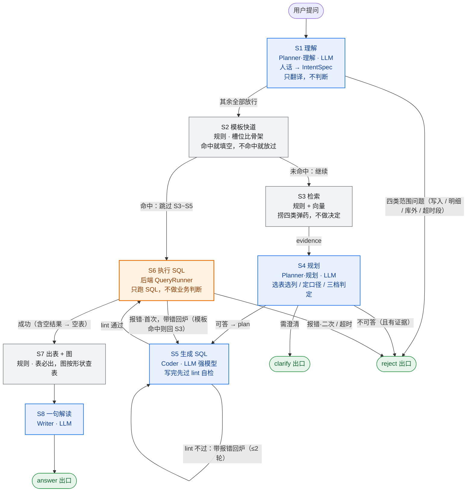

# ChatBI 平台 · SDD 算法应用方案

> **版本**：v3.0（主链路优先版）｜ **日期**：2026-11-10 ｜ **关联**：`docs/PRD.md` v0.6、`docs/测例.md` v1.2、`docs/SDD-总览.md`、`docs/SDD-后端.md`、`docs/SDD-前端.md`
>
> **定位**：算法侧唯一定义文件。S1~S8 的语义、状态字段、三个出口、资源分层与 `QueryRunner` 协议以本文为准；**本文与其它三份冲突时，以本文为准**（同步顺序：算法 → 后端 → 前端 → 总览）。
>
> **本版要点**：
> 1. **零字典也能跑**：唯一硬依赖是 L0 库结构；口径词典 / 实体别名 / 模板库 / 示例库全部是「增强包」，只影响答得多准，不影响能不能跑（§4）。
> 2. **S2 是快道不是闸门**：槽位比模板骨架，命中就填空直接执行，不命中就走主流程（§2.4）。
> 3. **S3 只递弹药**：表字段 / 口径 / 实体别名 / 典型复杂需求四类证据；示例只作为 S5 的 few-shot，不参与结果比对（§2.5）。
> 4. **S4 是唯一拍板者**：可答 / 需澄清 / 不可答只在 Planner·规划 判定，近似可答优先于拒答（§3.0）。
> 5. **S5 写完先自检**：lint 五条（单条 / 只读 / 表白名单 / 列归属 / 强制 LIMIT），不过就带报错回炉，最多 2 轮（§2.7）。
> 6. **S6 只执行 SQL**：算法不碰库，`QueryRunner` 跑完按 `error_code` 分流；空结果照常出空表（§2.8）。
> 7. **S7 表必出、图看形状**：列名换业务名，图只出 `bar` / `line`，不出图不算失败（§2.9、§8）。

## 1. 总链路与执行编队

### 1.1 八步链路（写死）

```
S1 理解 → S2 模板快道 → S3 检索 → S4 规划 → S5 生成 SQL（含 lint 自检）
→ S6 执行 SQL → S7 出表 + 图 → S8 一句解读
```

> 注意 S2 是**快道**（能加速就加速），不是**闸门**（不能因为不命中就拦下）。S6 也不是闸门：它就是执行节点，把 SQL 交给后端跑一次，安全性由 S5 的 lint 与后端的只读账号共同保证。

### 1.2 谁在哪一步（编队一眼图）

> **蓝色 = 智能体（有 LLM）**，**灰色 = 规则节点（无模型）**，**橙色 = 后端执行节点（只读账号 / 超时 / 行数上限是物理兜底，绝不由模型放行）**，**绿色 = 出口**。



### 1.3 编队表

| 执行者 | 类型 | 步骤 | 一句话职责 | 模型档位 |
| :--- | :--- | :--- | :--- | :--- |
| **Planner·理解** | LLM 智能体 | S1 | 把人话翻成结构化意图，**只翻译不判断** | 小模型 |
| **模板快道** | 规则 | S2 | 槽位比骨架，像填空题就填，不像就放过 | 无 |
| **检索器** | 规则 + 向量 | S3 | 捞四类弹药（表字段 / 口径 / 实体 / 示例） | 无（仅 Embedding） |
| **Planner·规划** | LLM 智能体 | S4 | 唯一拍板者：选表选列、定口径、判定可答性，产出 Plan | 小模型 |
| **Coder + lint** | LLM 智能体 + 规则自检 | S5 | 按 Plan + few-shot 写一条只读 SQL，生成后先自检、不过就回炉 | 强模型 |
| **执行节点** | 后端规则 | S6 | 只做一件事：把 SQL 交给后端跑出结果 | 无（**故意不用模型**） |
| **出表 + 图** | 规则 | S7 | 表必出（列名换业务名），图按形状查表 | 无 |
| **Writer** | LLM 智能体 | S8 | 对查出来的数说一句人话 | 中档模型 |

**为什么 Planner·理解 与 Planner·规划 必须拆成两个**：它们在链路上分处 S1 与 S4 两个不相邻阶段，职责完全不同——一个负责"翻译"，一个负责"拍板"。合成一个 Agent（或让 S1 兼职做初判）会带来三个问题：Prompt 同时背两种任务、互相干扰；出了问题分不清是理解错还是判断错；评测指标混在一起，优化无从下手。拆开后各管一段：Planner·理解只看「槽位抽取准确率」，Planner·规划只看「选表选列准确率 + 可答性判定准确率」。

### 1.4 贯穿全图的四条铁律

1. **模型只出现在 S1 / S4 / S5 / S8**；S2 / S3 / S6 / S7 全是规则。模型负责"语言与判断"，规则负责"数据与放行"——Coder 写完的 SQL 在 S5 内部先过 lint（规则），过了才交给 S6 执行。
2. **路由只看枚举字段**（`template_hit` / `action` / `error_code` / `reachable`），不解析自然语言。智能体不决定"下一步找谁"。
3. **智能体之间不对话**：只通过 `ChatState` 交接产物，谁拿不到谁的 Prompt；上下文边界由图的拓扑保证。
4. **增强包只影响质量**：口径词典 / 实体别名 / 模板库 / 示例库缺失时，链路照常走完，不拒答（§4）。

### 1.5 三条硬约束

1. **算法不直连库**：S6 只负责「调 `runner`」，SQL 的执行与只读兜底都在后端（§9.2）。
2. **缓存只复用"怎么算"**：命中后仍要重新执行、重新生成解读，不复用数字。
3. **空结果不是出口**：查询成功但 `rows=[]`，照样 `action=answer`，返回空表。

---

## 2. 一次真实请求的全流程走读

> 本章用一个真实问题把 S1~S8 走一遍，重点讲清「每一步在干什么、吃什么、吐什么、为什么这么设计」。
>
> **阅读约定**：每一步都固定四块——**这步在干什么 / 输入 / 输出 / 为什么这样设计**，出错另起一段。看完本章，§3 的规则表只是把它写成可执行条目。
>
> **本版最重要的一条原则**：主链路不依赖任何行业字典。字典、模板、示例都是「增强包」，只影响答得多准，不影响能不能跑。零资源走读见 §2.14。

### 2.1 先把角色认全

| 角色 | 在这一趟里干什么 | 明确不干什么 |
| :--- | :--- | :--- |
| **Planner·理解**（S1） | 把原话拆成结构化意图 | 不判断能不能答、不查字典、不碰库 |
| **模板快道**（S2，规则） | 拿意图去比模板，像不像"填空题" | 不是闸门：不命中就继续，绝不拒答 |
| **检索器**（S3，规则 + 向量） | 捞四类"弹药"交给下一步 | 不做决定、不判断对错 |
| **Planner·规划**（S4） | 整理弹药、选表选列、判定可答性，产出 Plan | 不写 SQL |
| **Coder**（S5） | 按 Plan 写一条只读 SQL，写完先自检 | 不做业务判断、不选图 |
| **执行节点**（S6，后端 `QueryRunner`） | 把 SQL 跑出结果，原样拿回 | 不做业务判断、不改 SQL、不碰口径 |
| **出表 + 图**（S7，规则） | 表必出（列名换业务名），图按形状查表 | 不用模型、不做智能选图 |
| **Writer**（S8） | 对查出来的数说一句人话 | 看不到库、看不到 SQL |

> 两个 Planner 是**两个独立智能体**：一个只管"翻译"（S1），一个只管"拍板"（S4）。名字相同是因为职责同源，代码、Prompt、评测指标完全分开。

一句话记住：**模型只做四件事——理解、规划、编码、解读；检索和模板只递弹药，S6 只负责把 SQL 跑出结果。**

### 2.2 例题

用户问：**「这次双 11 大促的总 GMV 是多少？和去年同期比涨了多少？」**

- 数据范围：`data` schema 里 `dwd_order` 覆盖 2024-01 至今；
- 口径：本例按 A 档（口径词典里有 `gmv` 定义）走，C 档（零资源）的差异见 §2.14；
- 本例**不走**模板快道（问题里有"同比"，模板库没有对应骨架），走完整主流程。

---

### 2.3 S1 理解问题 —— Planner·理解 把人话翻成意图

#### 这步在干什么

> 人不按表格说话，S1 的活是把混在一起的信息拆成机器能消化的零件。它只做"翻译"，不做"判断"。

#### 输入

- 那句话原文；
- 最近 6 轮历史（只带结构化槽位摘要，不含任何数据行）；
- 本轮无澄清回填；
- 少量「意图解析示例」（别人问过的相似问法怎么拆），只用于稳定输出格式。

#### 输出（IntentSpec 摘要）

```
指标   = GMV
维度   = 无
时间窗 = 2026-11-01 ~ 2026-11-11（大促期）
对比   = 同比（去年同期，2025-11-01 ~ 2025-11-11）
过滤   = 无
排序   = 无
```

#### 为什么这样设计

1. **只理解、不判断**：能不能答、要不要澄清，全部留给 S4。判断一旦掺进理解，出了问题就分不清是「没听懂」还是「判断错」，只能看到一个黑盒结论。
2. **槽位只有五类**（指标 / 维度 / 过滤 / 时间窗 / 对比）：枚举意味着模型只能"填空"不能"作文"，填了枚举之外的东西立刻能发现。
3. **temperature=0**：同一句话永远产出同一份槽位——演示可复现、评测能对答案。
4. **唯一的规则兜底只判"范围"，不判"口径"**：改数（`write_op`）、导明细（`detail_export`）、竞品 / 外部（`out_of_scope`）用关键词硬匹配；超出数据时间范围（`no_data`）**不是年份关键词表**，而是把问题里的显式年份 / 日期与 L0 `data_range` 比对——提到的年份全部早于数据起点、或全部晚于数据终点才拦，未提显式时间不拦（如"去年""最近"一律放行给 S4）。这四类答案是恒定的"不"，规则比模型可靠。除此之外 S1 不做任何拦截。

#### 出错怎么办

分类输出非法枚举 → 重试 1 次，仍非法 → `reject`（`intent_parse_failed`）；槽位缺失（没说看什么）→ 不在这里拦，交给 S4 判断值不值得问。

---

### 2.4 S2 模板快道 —— 规则节点：有现成的「填空题」就直接填

#### 这步在干什么

> 纯规则，不调模型。既然 S1 已经把话拆成了槽位，就先拿槽位去比模板：像填空题一样，架子对得上就把槽位填进去。

#### 输入

- S1 的 IntentSpec；
- 模板库（增强包，可为空）；
- 语义缓存（同一问题精确重复时）。

#### 模板长什么样

```yaml
骨架：{时间}{地区?}{聚合} {指标}
SQL ：SELECT {聚合}({指标列}) AS v
      FROM   {表}
      WHERE  {时间条件} {AND 地区条件?}
```

**匹配过程**（以「昨天华东 GMV」为例）

1. 用 IntentSpec 的槽位签名去比模板签名：时间=有、地区=有、指标=有、聚合=已知；
2. 四个槽位都能落到具体列 → 命中 → 填充 SQL 模板 → **直接跳到 S6 执行**；
3. 抽不齐（缺时间），或出现「模板与词典里都没有的新约束」（如"剔除退款订单"）→ **当作未命中**，老实走 S3 之后的主流程。

#### 输出

- 本例：`template_hit = false`（问题带"同比"，模板库没有双期对比骨架）；
- 命中时：`template_hit = true` + `cached_sql`，跳过 S3 / S4 / S5。

#### 为什么这样设计

1. **它是加速器，不是闸门**：命不中都继续走主流程，**绝不会因为"没命中模板"而拒答**。
2. **用规则不用模型**：槽位已经是枚举值，比对模板是确定性的枚举匹配，比让模型"感觉像不像"更快更稳，也省一次调用。
3. **宁可漏命中，不可错命中**：命中要求「槽位齐全 + 每个槽位能落到具体列 + 口径无歧义」。任一不满足就当未命中——错填模板会**静默给出错数**，代价远大于多走一遍主流程。
4. **失败可回落**：模板填出的 SQL 执行报错 → 回到 S3 重走主流程。模板 SQL 在**加载时**统一过一遍与 S5 同款的 lint（模板是静态文件，不值得每次请求都查）。

---

### 2.5 S3 检索 —— 检索器：先把「弹药」摆上桌

#### 这步在干什么

> 不判断、不拍板，只围绕这个问题去四类资料里捞相关材料，交给 S4 做决定。这一步专门解决「让模型裸猜表和字段」。

#### 四类弹药

| 弹药类别 | 内容 | 本例捞到什么 | 来源 |
| :--- | :--- | :--- | :--- |
| ① 表 / 字段 | 相关表、列、类型、注释、枚举值采样 | `dwd_order.pay_amount`「支付金额」 | L0 全量结构 + 关键词 / 向量召回 |
| ② 口径 | 指标定义、别名、多口径 | `gmv = SUM(pay_amount) WHERE order_status='paid'` | 口径词典（**可选**）；缺则用列注释 |
| ③ 实体 / 维度 | 维度取值、实体别名展开 | 无（本例不带地区） | 维度词典 + 取值采样；如「江浙沪 = 浙江、江苏、上海」 |
| ④ 典型复杂需求 | 相似的问法 → SQL 对 | 2 条"同比怎么写"的示例 | 示例库（**可选**） |

#### 输入

- 归一后的问题 + IntentSpec；
- 各增强包（可为空）。

#### 输出（Evidence 摘要）

- 表候选：`[dwd_order]`
- 列候选：`[pay_amount, order_status, order_date]`
- 口径候选：`[gmv / 唯一]`
- 实体候选：`[]`
- 示例：`[2 条同比写法]`

#### 去哪

表 / 列 / 口径 / 实体 → S4；示例 → S5（few-shot）。

#### 为什么这样设计

1. **检索只提供证据，不替模型拍板**：它把"候选"摆出来，选哪个由 S4 决定。这样检索质量差只会让答案变差，不会让链路断掉。
2. **四类必须分开捞**：模型推理不出「江浙沪是哪三个省」，也推理不出「你们的 GMV 含不含退款」——这些是**知识**，不是推理。
3. **检索为空不报错**：主流程继续，S4 直接基于 L0 全量结构判断（§3.0）。
4. **示例的用途是"喂给生成器"**：④ 的 SQL 对会在 S5 作为 few-shot 塞进 Coder 上下文，**只在生成时起作用**，不参与事后比对答案。

---

### 2.6 S4 规划 —— Planner·规划 把材料整理成「作战方案」

#### 这步在干什么

> Planner·规划 是整条链路里唯一"拍板"的智能体。它把意图和弹药合成一份作战方案，告诉 Coder"打哪里、用什么、怎么算"。

#### 输入

- IntentSpec；
- Evidence（四类弹药）；
- L0 全量结构（表 / 列 / 注释 / 取值）。

#### 做什么

1. 选表选列——**只能从 Evidence 或 L0 里真实存在的对象中选**；
2. 定聚合与公式——优先用口径词典；没有就按列名与注释推断，标 `degraded=true`；
3. 展开约束——把「江浙沪」展开成 `IN ('浙江','江苏','上海')`；
4. 定时间窗与对比期；
5. **判定可答性**（三档：可答 / 需澄清 / 不可答，见 §3.0）；
6. 打包成 Plan —— 这是 Coder 的唯一输入。

#### 输出（Plan 摘要）

```
表      = dwd_order
指标    = gmv：SUM(pay_amount)，过滤 order_status='paid'
时间    = 本期 2026-11-01~11-11；对比期 2025-11-01~11-11
形态    = 单条 SQL 出两行（period + 值），不写两条 SQL 再拼
分组    = 无；排序 = 无
few-shot= [2 条同比示例 SQL]
degraded= false
reachable = answer
```

#### 为什么这样设计

1. **判断与生成分离**：先想清楚"查什么、怎么算"，再写 SQL。混在一起时，模型很容易"边写边想"，写出来能跑但口径不对——这种错最难发现。
2. **拒答门槛设得很高（本版重点）**：只有「检索证据 + L0 全量结构都表明无法表达，且不能用相近字段近似」时才拒答。**能用相近字段表达时，选择回答 + 在解读里说明口径——近似可答优先于拒答。** 没有字典不等于不能用产品。
3. **澄清门槛也收窄**：只有两种情况值得打断用户——① 存在多种解读且会导致结论不同（如 GMV 含税 / 不含税）；② 缺关键槽位，导致根本不知道查什么（如"这次大促表现怎么样"没说看哪个指标）。
4. **澄清候选来自证据**：选项从 Evidence 里取（列、口径、实体取值），**不要求事先登记**；没有字典也能出卡。
5. **输出是 Plan 不是 SQL**：Plan 可以单独评测（选表对不对、公式对不对），SQL 只是 Plan 的一种实现。

---

### 2.7 S5 编码 —— Coder 写 SQL + 自检回炉

#### 这步在干什么

> Coder 把 Plan 翻成**一条**只读 SELECT。写完**不直接交出去**：先在同一个节点里过一遍 lint（规则自检），不过就带着报错回炉重写，最多 2 轮；过了才交给 S6 执行。

#### 输入

- Plan（含选定的表列、公式、时间窗、对比期）；
- S3 ④ 捞到的示例 SQL，作为 few-shot；
- **本次授权表（`plan.tables`）的「表 → 列名清单」**：从 L0 元数据取，按 `表(列, 列, ...)` 直接写进 Coder prompt，并原样作为 lint 规则 4 的列归属依据——prompt 与校验同源，模型看到的列就是它能用的列；取不到 L0 时两者一起降级（prompt 标注「未取到库结构」，lint 跳过列归属校验）。

#### 输出

- `sql`（本例是带 `UNION ALL` 或 `CASE WHEN` 的单条两期查询）：

```sql
WITH cur AS (
    SELECT SUM(pay_amount) AS gmv FROM dwd_order
    WHERE order_status = 'paid' AND order_date >= DATE '2026-11-01' AND order_date < DATE '2026-11-12'
), prev AS (
    SELECT SUM(pay_amount) AS gmv FROM dwd_order
    WHERE order_status = 'paid' AND order_date >= DATE '2025-11-01' AND order_date < DATE '2025-11-12'
)
SELECT '本期' AS period, gmv FROM cur
UNION ALL
SELECT '同期' AS period, gmv FROM prev
```

- `lint_ok=true`、`lint_round`（回炉轮次）。

#### 自检清单（lint，纯规则，五条）

1. **单条语句**：只允许一条 `SELECT` / `WITH`，不许多语句拼接；
2. **只读**：出现 `INSERT / UPDATE / DELETE / DROP / ALTER / TRUNCATE / CREATE` 一律不过；
3. **表白名单**：只能引用 `plan.tables` 里钉死的表，**示例里出现过的表不算授权**；`WITH` 定义的 CTE 名是本语句内部的派生结果，不是对外部表的引用，不占白名单名额（但 CTE 体内引用的真实表仍须全部在白名单内）；
4. **列归属**：列必须真实存在于它所在那张表的 L0 列清单（如 `e.channel_id` 而 `dwd_exposure_daily` 无此列 → 拦下）；表别名按所在 SELECT 作用域解析，指向 CTE / 派生表的别名不按真实表校验（避免同名别名互相干扰）；无前缀列按 SELECT 作用域判定——该作用域的 `FROM/JOIN` 全部来自同一张真实表（含 CTE / 派生表体内的单表查询）时按该表校验，来源含 CTE / 派生表或多表时不强行归属；CTE / 派生表的输出列由语句自身定义，不校验；聚合函数不得套在子查询上；
5. **强制 `LIMIT`**：没有 `LIMIT` 就补到 `max_rows`（默认 1000），防止一把拉全表。

#### 回炉规则

- lint 不过 → 把**lint 报错原文**回填给 Coder，让它只改错的地方 → 重写；
- 最多 **2 轮**；仍不过 → `reject`（`sql_generate_failed`），不把"可能有问题"的 SQL 送到库上。

#### 为什么这样设计

1. **示例是输入，不是裁判**：示例教模型"排名类问题该用 `GROUP BY + ORDER BY`"这套写法，但示例里出现的表**不等于本次授权**——lint 的表白名单永远按本次 `plan.tables` 校验。模型负责"参考写法"，lint 负责"技术合法性"，两件事分开。
2. **自检放在生成侧，比打回数据库便宜**：lint 是字符串 + L0 元数据比对，不过就重写；一旦投到库里才报错，要等一次网络往返和超时。
3. **lint 只判"能不能跑"，不判"算得对不对"**：口径、时间窗、对比期对不对，是 S4 Plan 的职责；S5 只保证这条 SQL 技术上合法、安全、不会拖垮库。
4. **只出一条语句**：多条语句既过不了 lint，也没法保证两期对比用同一口径、同一时点。
5. **最多 2 轮**：次数写死，避免模型陷入"改了又错"的循环；两轮仍不过说明 Plan 或表结构有问题，早收口比硬跑强。

#### 出错怎么办

lint 2 轮仍不过 → `reject`（`sql_generate_failed`，`retryable=true`）。"不准写"和"写错了"都由 lint 拦，S6 不重复做这件事。

---

### 2.8 S6 执行 —— 算法不碰库，只把 SQL 交出去

#### 这步在干什么

> 执行节点只做一件事：把已经通过 lint 的 SQL，交给后端 `QueryRunner` 跑一次，把结果原样拿回来。算法不持有连接串、不 import 数据库驱动、不判断结果好坏。

#### 输入

- `sql`（已过 lint：S5 生成后校验，或 S2 模板在加载时校验）；
- `timeout_ms`（默认 5s）、`max_rows`（默认 1000）。

#### 输出

- `QueryResult`：`columns` / `rows` / `row_count` / `truncated` / `elapsed_ms` / `error_code` / `message`。

#### 按 `error_code` 分流

| 返回 | 去哪 | 说明 |
| :--- | :--- | :--- |
| `error_code=null`、`rows` 非空 | S7 | 正常，往下出表出图 |
| `error_code=null`、`rows=[]` | S7 → `answer` 空表 | **空结果不是错误**：照常出空表 + 一句「该范围无数据」 |
| `SQL_FAILED` / `SQL_REJECTED` | 回 S5 重写一次 | 带 `message` 原文回炉；二次仍失败 → `reject`（`sql_execute_failed`）。**模板快道命中的 SQL 没有 Plan，回 S3 重走主流程**（§2.4） |
| `QUERY_TIMEOUT` | `reject`（`timeout`） | 不重试：慢查询重跑一次往往还是慢 |

#### 为什么这样设计

1. **执行权和库权限都在后端**：算法只拿到一个结果对象，拿不到连接、看不到 schema 权限——这是部署解耦与安全的前提（§9.1）。
2. **空结果不拒答**：`rows=[]` 是"这个范围没数"，不是"这个问题不能答"。用户要的是一张诚实的空表，不是一张拒答卡。
3. **错误不抛异常**：失败通过 `error_code` 返回，链路只看枚举字段，不依赖 try/except 猜分支。
4. **不在这里做业务校验**：列名对不对、两期是不是都有数、数值有没有异常，交给 S7 出表时顺手检查——S6 只保证"SQL 跑过了"。

#### 出错怎么办

首次失败回 S5 改一次（模板快道命中时没有 Plan，直接回 S3 重走主流程）；二次失败 `reject`（`sql_execute_failed`）；超时直接 `reject`（`timeout`）。三者都 `retryable=true`（用户可手动重试），但链路不自动重跑。

---

### 2.9 S7 出表 + 图 —— 规则节点：表必出，图看形状

#### 这步在干什么

> 不调模型。把 S6 查回来的行，按 S4 已经钉死的查询规格，组织成**一张表 + 一份图表描述**（`TableData` + `ChartSpec`）。算法只说"画什么图、X 轴是谁、系列是谁"，ECharts 怎么画由前端翻译。

#### 输入

- `QueryResult`（`columns` / `rows` / `truncated`）；
- `query_spec`（S4 钉死的规格）；
- `plan`（业务名：指标中文名、维度中文名）；
- L0 列注释（业务名兜底）。

#### 做什么

1. **出表（必做）**：列名换成业务名（`gmv` → `GMV`、`channel` → `渠道`），行原样保留；业务名按固定顺序取，取不到再用原 key：
   1. `plan.metrics[].name`（S4 规划时写的中文名）；
   2. `query_spec.metrics`（缓存命中时 `plan` 为空，用它兜底，模板快道也走这条）；
   3. L0 列注释（`columns[].comment`，按列名小写匹配）；
   4. 原 key。
   补充：英文 snake_case 指标名取末段大写（`total_gmv` → `GMV`），列的 `gmv` / `current_gmv` 都能对上；派生列没有业务名时按 key 兜底翻译，且更具体的后缀优先——`*_rate` → `增长率`、`*_ratio` / `*_share` → `占比`、`*_pct` → `百分比`、`*growth*` → `增长`、`*yoy*` → `同比`；
2. **顺手做形状检查**（原 S6.1 的活并入这里）：列与 `query_spec` 是否对得上、对比类是否两期都有数、数值列是否整体为 `NULL` → 记 `validation.warnings[]`，**照常出表，不 reject**；
3. **对比宽表归一化**：`query_spec.comparison` 非空、结果为 1 行宽表、且存在成对列时（`current_*` / `previous_*`，或无前缀的 `x` / `prev_x`，如 `v` 与 `prev_v`），S7 把它摊平成两行 `period` 表——原行若自带 `period`（如「本期」），本期用它、上期按 `comparison.type` 写「去年同期 / 上一周期」；否则两期都用 S4 写死的 `comparison.current_period` / `previous_period` 日期窗，缺失时同比按去年同期、环比按等长上期推算。每个成对指标合成一列，`prev_*` 列不再单独出现；不成对的派生列（如 `growth_rate`）只填在本期那一行。归一化在判定形状之前做，之后按「两期对比」出 `bar`。S5 仍只写一条 SQL，不拆成两条；
4. **查表定图**（见下表）。

#### 图类型对照表（只看规格形态，不看数好不好看）

| 规格里的形态 | 怎么判断 | 出什么图 |
| :--- | :--- | :--- |
| 排名 / TopN | 有维度 + 有排序 | `bar`，X 轴 = 维度 |
| 趋势 | 有日期列（`granularity=day` 或列类型为 `date`） | `line`，X 轴 = 日期 |
| 对比 | `comparison` 非空（结果两行 `period`） | `bar`，X 轴 = `period` |
| 单标量 | 1 行、1 个数值列、无维度 | `bar` + `x_field=null`，前端按固定类目「当前值」渲染 |
| 空结果 | `rows=[]` | `chart=null`，只出空表 |
| 占比类 | 指标名含 `_ratio` / `_share` | 仍用 `bar`（本版不引饼图） |

判定顺序写死：空结果 → 两期对比 → 时间序列 → 类别维度（含排名 / TopN） → 单标量；命中即停，避免一条数据同时命中多条。

#### 输出

- `columns`（业务名）/ `rows` / `truncated`；
- `chart_spec = {type, x_field, series[]}`，或 `null`；`series[].name` 用业务名，不出现 `gmv` 这类机器名；
- `validation = {ok, warnings[]}`。

本例：两行 `period` 对比 → `bar`，`x_field=period`，一个 series。

#### 为什么这样设计

1. **表是主产物，图是加分项**：数据查出来了就必须给用户看，"图没选对"不能变成"这题答不了"——所以图出不了也照常 `answer`。
2. **只认 `bar` / `line`**：前端 ECharts 按需只引入了这两个（前端 §2），饼图、雷达图要多打一个包、多一套配色规则，收益不大。占比类用柱状 + 解读说明，已经够用。
3. **不问模型**：图类型是「数据形状 → 图表类型」的确定性映射，交给模型只会引入随机性，前端还得猜后端为什么这么选。
4. **列名换业务名在这里做**：`SELECT SUM(pay_amount) AS gmv` 出来的列名是给机器看的，用户要看到「GMV」——这是展示层的事，不该让 S5 去拼中文别名。

#### 出错怎么办

没有匹配规则 → 默认 `bar`，系列取第一个数值列；只剩非数值列 → `chart=null`，只出表。**任何情况下都不因为"图不好画"而失败。**

---

### 2.10 S8 解读 —— Writer 只说一句人话

#### 这步在干什么

> 拿着「问题 + 查出来的数」，说一句不超过 60 字的话。它看不到库、看不到 SQL、看不到链路过程——物理上断绝编数据的可能。

#### 输入

`normalized_question`、`query_spec`、`rows` 摘要（最多 20 行）、`chart_spec`、`validation.warnings`（S7 出表时的形状检查）、`plan.degraded`。

#### 输出

`narrative`，本例为 `本期 GMV 1.23 亿，较去年同期增长 14.5%。`

#### 为什么这样设计

解读只对结果负责；没有库结构、没有连接，它想编也编不出来。`degraded=true` 时（口径按列名推断），它必须多补一句"按某列统计"，不能说谎。

---

### 2.11 出口之后 —— 落库、写缓存、渲染

#### 输出链条

后端补 `message_id` / `session_id` → 把 `trace` 剥离到 `query_logs` → `action=answer` 且 `rows` 非空时才写缓存（只存 `query_spec` / `sql` / `chart_spec`，不存数字）→ 前端按 `action` 渲染表 + 图 + 一句话。

---

### 2.12 同一个问题再问一次 —— 走快道

第二次问「这次双 11 大促总 GMV 多少，同比涨多少」：

- S1 产出同样的 IntentSpec；
- **S2 模板快道**：这次已是已知骨架，槽位一一对上 → 命中 → 直接跳到 S6；
- 跳过 S3 / S4 / S5，省掉两次模型调用；数字仍然重新执行、解读仍然重新生成。

#### 为什么这样设计

数字每天在变，口径和 SQL 相对稳定。**缓存只复用"怎么算"，不复用"算出来是多少"**，是最安全也最省的做法。

---

### 2.13 三条岔路：澄清、近似、拒答

| 岔路 | 什么时候走 | 例子 | 出口表现 |
| :--- | :--- | :--- | :--- |
| **澄清** | 多种解读会导致结论不同，或缺关键槽位 | 「这次大促表现怎么样？」（没说看哪个指标） | 出卡，选项来自检索证据；用户点选后继续 |
| **近似可答** | 没有完全对应的字段 / 口径，但有可近似的 | 问"客单价"，库里只有 `pay_amount` 与 `order_id`，用两者相除并说明 | **照常 answer**，`degraded=true`，解读说明口径 |
| **拒答** | 数据里确实没有可表达的对象，且无法近似 | 问"竞品在抖音卖了多少"（库外数据） | 出拒答卡 + 原因码 + 建议 |

> **拒答是最后手段，不是第一道关**：任何"字典里没登记"都不构成拒答理由。拒答只发生在「问的东西不在你的数据里」。

---

### 2.14 零资源走读（C 档：什么增强包都没有）

同一道题，`semantics/`、模板库、示例库全空。逐步骤差异：

| 步骤 | A 档（有增强包） | C 档（零资源）实际怎么走 |
| :--- | :--- | :--- |
| S1 理解 | 用词典别名提升识别率 | 照样拆出五类槽位，依据是问题本身 |
| S2 模板快道 | 可能命中模板 | 模板库为空 → 直接未命中，继续 |
| S3 检索 | 四类弹药齐全 | ①表字段照常（L0 永远在）；②口径为空，靠列注释；③实体为空；④示例为空 |
| S4 规划 | 「GMV」按词典公式 | 按 `pay_amount` 注释「支付金额」+ `order_status` 注释推断 → `degraded=true`；**照常判定可答**；遇到"江浙沪"这类未登记实体 → 走**澄清**问是哪几个省，而不是拒答 |
| S5 编码 | 有 few-shot，写法稳 | 无示例，写法靠模型，lint 回炉次数可能变多，但能出 |
| S6 执行 / S7 出表出图 | — | **完全不变**（执行、出表、选图与资源无关） |
| S8 解读 | 可直接说结论 | `degraded=true` → 补一句「按支付金额列统计」 |

#### 结论

零资源下，简单聚合照样答得准，派生指标口径可能偏（会如实标注），复杂写法成功率下降，**但链路不拒答、不中断**。这就是「字典是附加步骤」的具体含义。

---

### 2.15 全程回顾

| 步骤 | 执行者 | 用模型吗 | 一句话作用 | 关键产出 |
| :--- | :--- | :--- | :--- | :--- |
| S1 理解 | Planner·理解 | 是（小模型） | 人话 → 结构化意图 | IntentSpec |
| S2 模板快道 | 规则 | 否 | 像填空题就填，不像就放过 | 命中 / 未命中 |
| S3 检索 | 规则 + 向量 | 否 | 给智能体发四类弹药 | Evidence |
| S4 规划 | Planner·规划 | 是（小模型） | 拍板：查什么、怎么算、能不能答 | Plan |
| S5 编码 | Coder | 是（强模型） | 按 Plan 写一条 SQL，自检回炉 | SQL（lint 通过） |
| S6 执行 | 后端 QueryRunner | 否 | 把 SQL 跑出结果 | QueryResult |
| S7 出表 + 图 | 规则 | 否 | 表必出，图按形状查表 | TableData + ChartSpec |
| S8 解读 | Writer | 是（中档） | 一句人话 | narrative |

贯穿全程的机制：**模型负责"语言与判断"，规则负责"数据与放行"，增强包只负责"更准"。** 任何一步的模型产出，下一步都有确定性校验兜着。

---

## 3. 每一步的输入 / 输出 / 去向

### 3.0 判定原则：只有 Planner·规划 拍板

| 步骤 | 判不判 | 说明 |
| :--- | :--- | :--- |
| S1 理解 | **不判** | 只做翻译；唯一例外是四类范围问题的关键词硬拦截 |
| S2 模板快道 | **不判** | 只做填空匹配；不命中就放过，绝不拒答 |
| S3 检索 | **不判** | 只捞证据，给候选，不给结论 |
| S4 规划 | **唯一拍板** | 只有这里决定：可答 / 需澄清 / 不可答 |

判定三档与门槛：

| 档位 | 触发条件 | 出口 |
| :--- | :--- | :--- |
| **可答** | 能选到表列并算出结果 | `answer`（含"近似可答"，见下） |
| **需澄清** | ① 多种解读会导致**结论不同**；② 缺关键槽位导致**不知道查什么** | `clarify` |
| **不可答** | 检索证据 + L0 全量结构都表明无法表达，**且不能近似** | `reject`（`out_of_scope`） |

三条硬规矩：

1. **判定归 Planner·规划，放行归规则**：Planner·规划选出的每个表 / 列 / 指标都要过 L0 存在性校验，不存在就驳回重选——判定可以模糊，放行必须确定。
2. **近似可答优先于拒答**：有可近似的字段 / 口径时（如客单价 = GMV ÷ 订单数），**回答 + 标注口径**，而不是拒答。
3. **"字典里没登记"不构成拒答理由**：只有「问的东西不在你的数据里」才拒答。这条决定了零资源档的拒答率不会爆炸。

### S1 理解

| 项 | 内容 |
| :--- | :--- |
| **谁做** | Planner·理解：LLM 语义理解为主 + 范围类硬拦截规则 |
| **输入** | `question`、`clarify_answer`（澄清回填时传）、最近 6 轮 `history`（问题 + 槽位摘要，不含 rows）、少量意图解析示例（只为稳定输出格式）；L1 别名（**可选**） |
| **做什么** | ① 归一问题（补指代、拆多问）；② 判定意图；③ 抽取五类槽位（指标 / 维度 / 过滤 / 时间窗 / 对比）；④ 从上一轮继承缺失槽位；**⑤ 到此为止，不判断能不能答** |
| **输出** | `normalized_question`、`intent`、`intent_spec`（五类槽位）、`inherited` |
| **规则兜底（只兜范围）** | 写操作 → `write_op`；导出明细 → `detail_export`；竞品 / 外部 → `out_of_scope`（以上关键词硬匹配）；问题显式年份全部落在 L0 `data_range` 之外 → `no_data`（动态比对数据范围，**禁止维护年份关键词表**） |
| **成功去哪** | S2 |
| **失败去哪** | 仅上述四类 → `action=reject`；其余一律继续 |
| **模型参数** | `temperature=0`，结构化输出（JSON schema 约束），只允许枚举值 |

> 为什么 S1 不做判定：判断一旦掺进理解，出问题就分不清是"没听懂"还是"判断错"。理解、判定、生成由三个不同执行者负责，才能分段定位、分段评测。

> 槽位继承分两半：LLM 只判定「要不要继承」（输出 `inherited` 槽位名清单，指标 / 对比不继承）；槽位值由规则从最近一轮 `answer` 的 `query_spec` 确定性复制，不经过模型，防止模型复述错窗口与维度。上一轮无 `answer` 或对应槽位为空时，保持缺失走澄清。

### S2 模板快道

| 项 | 内容 |
| :--- | :--- |
| **谁做** | 规则（纯代码），不调模型 |
| **输入** | `intent_spec` + 模板库（可选）+ 语义缓存（`CacheStore`） |
| **两条路径** | ① **同一问题再问**：`cache_key` 命中 → 取回 `query_spec` / `sql` / `chart_spec`；② **同骨架不同槽位**：拿槽位签名比模板骨架，对得上就填 SQL 模板 |
| **命中条件** | 三者全满足：槽位齐全 / 每个槽位能落到具体列 / 口径无歧义。任一不满足 → 按未命中处理 |
| **命中输出** | `template_hit=true`，产出 `query_spec` + `sql`，**直接跳到 S6**（跳过 S3 / S4 / S5） |
| **未命中输出** | `template_hit=false`，继续 S3。**未命中绝不拒答** |
| **失败回落** | 模板填出的 SQL 执行失败 → 回到 S3 走主流程 |
| **写回时机** | 仅 `action=answer` 且 `rows` 非空时写回，只存 `query_spec` / `sql` / `chart_spec`，不存 rows / narrative |
| **失效条件** | TTL 7 天；`l1_version` / `schema_version` / `template_version` 任一变化 |

**模板示例**：

```yaml
- id: tpl_gmv_single_period
  name: 单期单指标聚合
  required_slots: [metrics, time_range]
  metric_columns:
    GMV: dwd_payment.pay_amount
  sql_template: |
    SELECT SUM({metric_col}) AS v
    FROM data.dwd_payment
    WHERE pay_status = 'success'
      AND pay_date BETWEEN '{start_date}' AND '{end_date}'
  verified: true
  notes: 仅覆盖单指标、无维度、无对比；有维度或对比时不要命中
```

「昨天华东 GMV」→ 骨架 `{时间}{地区} {指标}`，槽位「昨天 / 华东 / GMV」→ 命中 → 填充即得 SQL。

**为什么用规则不用模型**：槽位已经是枚举值，比对模板是确定性匹配；命中与否可解释、可复现，还省一次调用。宁可漏命中，不可错命中——错填模板会静默给出错数。

### S3 检索

| 项 | 内容 |
| :--- | :--- |
| **谁做** | 检索器：规则 + 向量（生产）/ 关键词（本地降级） |
| **输入** | `normalized_question` + `intent_spec` + 各增强包（可为空） |
| **四类弹药** | ① **表 / 字段**：相关表、列、类型、注释、取值采样；② **口径**：指标定义、别名、多口径；③ **实体 / 维度**：维度取值与别名展开（江浙沪 = 浙江、江苏、上海）；④ **典型复杂需求**：相似问法 → SQL 对 |
| **输出** | `evidence`：`tables[]` / `columns[]` / `metrics[]` / `entities[]` / `examples[]`（含相似度） |
| **去哪** | `tables / columns / metrics / entities` → S4 规划；`examples` → S5 编码（few-shot） |
| **失败 / 空** | 为空不报错、不拒答；S4 直接基于 L0 全量结构判断 |

**检索只提供证据**：它把候选摆出来，选哪个由 Planner·规划 决定。检索质量差只会让答案变差，不会让链路断掉。

**示例的正确用法**：`examples` 是**生成时的上下文**（few-shot），用来固定同比写法、日期边界、除零处理等习惯，**不参与结果比对**。这是它影响 SQL 质量的方式。

### S4 规划（Planner）

| 项 | 内容 |
| :--- | :--- |
| **谁做** | Planner·规划：LLM 小模型 + L0 存在性硬校验（规则） |
| **输入** | `intent_spec` + `evidence` + L0 全量表 / 列 / 注释 / 采样值 + L0 `data_range`（判定超时段用） |
| **做什么** | ① 选表选列（只能选真实存在的）；② 定聚合与公式（优先口径词典，缺则按注释推断并标 `degraded`）；③ 展开实体约束；④ 定时间窗与对比期；⑤ **三档判定**（§3.0）；⑥ 打包 Plan |
| **输出** | `plan`：`tables[]` / `metrics[]`（含公式）/ `dimensions[]` / `filters[]` / `time_range` / `comparison` / `few_shot[]` / `degraded` / `reachable` |
| **成功去哪** | S5 |
| **澄清条件** | 多种解读会改变结论，或缺关键槽位 → `clarify`。两类典型缺槽**必须问**：① 缺指标（"表现怎么样"类，不知道看什么——**判定以问句原文是否提到已知指标词为准，模型自行补的指标不算数**）；② 缺时间窗（指标明确但没说看哪段，**禁止自行假定全表或"最近 7 天"**；只有 start/end 都是合法日期的 time_range 才算"有"）。候选从 `evidence` / 档期日历取（列 / 口径 / 实体取值 / 真实档期），**不要求事先登记** |
| **拒答条件** | 证据与 L0 都表明无法表达，且不能近似 → `reject`（`out_of_scope`）；显式时间整体超出 `data_range` 且 S1 未拦 → `reject`（`no_data`） |
| **增强包缺失时** | 照常判定与规划；口径按列注释推断，`degraded=true`；实体未登记则走澄清而不是拒答 |

> 【决策】**Planner·规划 是链路里唯一的拍板者**。S1 / S2 / S3 都不做"能不能答"的判断——这样判定逻辑只有一处，改判定只改一个 Prompt，评测也只看一个指标（`reachable` 准确率）。

### S5 生成 SQL（含 lint 自检）

| 项 | 内容 |
| :--- | :--- |
| **谁做** | Coder（LLM 强模型）+ lint（规则自检，同一个节点内） |
| **输入** | `plan`（含 `few_shot`）+ 相关表的 L0 结构摘要（只含用到的表）+ 列类型摘要 |
| **输出** | `sql`：单条只读 `SELECT`（可含 `WITH`）+ `lint_ok` + `lint_round` |
| **lint 五条** | ① 单条语句；② 只读（禁 `INSERT/UPDATE/DELETE/DDL`）；③ 表白名单 = `plan.tables`（CTE 名是语句内派生表，不算引用）；④ 列归属按 L0 校验（带表前缀的列必须属于该表；无前缀列在「作用域内全部来源为同一真实表」时也按该表校验；CTE / 派生表输出列豁免），聚合不套子查询；⑤ 无 `LIMIT` 补到 `max_rows` |
| **回炉** | lint 不过 → 带 **lint 报错原文**重写，**最多 2 轮**；仍不过 → `reject`（`sql_generate_failed`） |
| **成功去哪** | S6 |
| **执行后失败** | S6 返回 `SQL_REJECTED` / `SQL_FAILED` → 带 `message` 回 S5 重写**一次**；二次仍失败 → `sql_execute_failed` |
| **模型参数** | `temperature=0`；只取代码块内容；禁止解释性文字 |
| **禁止** | 多条语句、白名单外的表、`SELECT *` 无聚合的明细、字符串拼接用户输入 |

> **lint 只判"技术合法性"，不判"口径对不对"**：示例教写法，表授权仍按本次 `plan.tables` 校验，两件事互不替代（§2.7）。

### S6 执行 SQL（算法不碰库）

| 项 | 内容 |
| :--- | :--- |
| **谁做** | 执行节点（规则，非智能体）：后端 `QueryRunner`（算法只发起调用） |
| **输入** | `sql`（已过 lint：S5 生成后校验，或 S2 模板在加载时校验）、可选 `params`、`timeout_ms`、`max_rows` |
| **输出** | `QueryResult`：`columns` / `rows` / `row_count` / `truncated` / `elapsed_ms` / `error_code` / `message` |
| **成功去哪** | S7（`rows=[]` 也算成功，走空表出口） |
| **失败去哪** | 首次 `SQL_REJECTED` / `SQL_FAILED` → 回 S5 重写；二次仍失败 → `reject`（`sql_execute_failed`）；`QUERY_TIMEOUT` → `reject`（`timeout`） |
| **不做什么** | 不做业务校验、不改 SQL、不判断口径——结果形状检查在 S7 |

> **为什么这里没有"五道安检"**：安全校验前移到 S5 lint（离生成最近、回炉最便宜）；后端只保留只读账号、超时与 `max_rows` 的物理兜底，它不是一个链路上的判定步骤。

### S7 出表 + 图

| 项 | 内容 |
| :--- | :--- |
| **谁做** | 出表节点（规则，非智能体） |
| **输入** | `QueryResult`（`columns` / `rows` / `truncated`）、`query_spec`、`plan`（业务名）、L0 列注释 |
| **出表（必做）** | 列名换业务名（指标 / 维度中文名，兜底用列注释），行原样；无论有没有图，表都必须出 |
| **形状检查** | 列与 `query_spec` 是否对得上 / 两期是否都有数 / 数值是否全 `NULL` → `validation.warnings[]`；**只记录，不 reject** |
| **判定顺序** | 空结果 → 两期对比 → 时间序列 → 类别维度 → 单标量；命中即停 |
| **输出** | `columns` / `rows` / `truncated`、`chart_spec = {type, x_field, series[]}` 或 `null`、`validation = {ok, warnings[]}` |
| **图类型** | 排名 → `bar`（X = 维度）；趋势 → `line`（X = 日期）；对比 → `bar`（X = `period`）；单标量 → `bar` 且 `x_field=null`；空结果 → `null`；占比 → `bar`（不引饼图） |
| **失败去哪** | 无匹配规则 → 默认 `bar`（第一个数值列）；无非数值列 → `chart=null`；**不出图不算失败** |

### S8 一句解读

| 项 | 内容 |
| :--- | :--- |
| **谁做** | Writer：LLM 中档模型，独立智能体，只看数据不看库 |
| **输入** | `normalized_question`、`query_spec`、`rows` 摘要（最多 20 行）、`chart_spec`、`validation.warnings`、`plan.degraded` |
| **输出** | `narrative`：**一句**业务解读，不超过 60 字 |
| **约束** | ① 只能引用输入里出现的数字，不得推算新数字；② 不写原因归因、不写建议；③ `rows=[]` 时不调用，`narrative=""` |
| **失败去哪** | 模型调用失败 → 规则模板兜底（取第一行最大 / 最小值的模板句），保证正常结果不因解读失败而失败 |

---

## 4. 增强包与资源：默认零依赖，按需增强

**唯一硬依赖是 L0（数据库本身的结构）**。其余全部是「增强包」，作用是让答案更准，不是让链路能跑。

### 4.1 一张表看清：哪些是必需，哪些是增强

| 资源 | 是否必需 | 提供什么 | 缺失时的影响 |
| :--- | :--- | :--- | :--- |
| **L0 库结构** | **必需** | 表、列、类型、注释、枚举值采样、行数 | 没有就无法生成任何 SQL（这是唯一真正的入场券） |
| 口径词典（L1） | 可选 | 指标定义、别名、多口径 | 口径靠列注释推断，标 `degraded=true`；派生指标可能猜歪 |
| 实体 / 维度别名 | 可选 | 「江浙沪 = 浙江、江苏、上海」这类展开 | 遇到未登记实体走澄清，而不是拒答 |
| 模板库 | 可选 | S2 快道的 SQL 骨架 | 快道不命中，直接走主流程 |
| 示例库 | 可选 | 相似问法 → SQL 对，作为 few-shot | SQL 写法稳定性下降 |
| 向量索引 | 可选 | S3 的语义召回通道 | 降级为关键词匹配 |

一句话：**这张表里去掉「口径词典」往下任何一行，产品都必须照常可用**。这是本版的验收底线。

### 4.2 L0：唯一硬依赖

由后端 `query/introspection` 读 `information_schema` 产出快照（表、列、类型、注释、可空、主键、外键），再加上抽样统计（每列 distinct 值数量、前 N 个取值、数值列的 min/max）。`data_range` 的键名写死为 `{"min_date", "max_date"}`（ISO 日期串），S1 / S4 的超时段判定只认这两个键。

- **为什么必须有**：模型不能凭空知道列叫什么，也不能编列名（编了会被 S5 lint 的表白名单与列归属校验挡回来，根本到不了库上）。
- **版本**：快照指纹记为 `schema_version`，库结构一变，S2 的模板缓存自动失效。

### 4.3 口径词典（L1，可选增强）

放 `backend/semantics/*.yaml`，是**配置文件**，不是数据表，和业务数据完全分开。

| 记什么 | 例子 | 谁用 |
| :--- | :--- | :--- |
| 口语词 → 指标键 | 「成交额」「销售额」= `gmv` | S1 别名归一、S4 口径选择 |
| 指标键 → 公式 | `gmv = SUM(pay_amount) WHERE order_status='paid'` | S4 规划、S5 生成 |
| 多口径登记 | 「退货率」= 按单数 / 按金额 | S4 判断是否需要澄清 |
| 派生指标依赖 | 客单价 = GMV / 订单数 | S4 展开计算链 |

**关键边界**：词典**不参与"能不能答"的判断**。没有它，S4 用列名与注释推断，照样能答（标 `degraded=true`）；它只决定"口径有没有权威出处"。

### 4.4 实体 / 维度别名（可选增强）

解决「用户说的实体在库里是散的」：`江浙沪 → 浙江 | 江苏 | 上海`、`华东 → 上海 | 江苏 | 浙江 | 安徽 | 福建 | 江西 | 山东`。

- 来源两条：人工维护的别名文件 + 从维度表取值采样自动候选；
- 正式文件为 `backend/semantics/aliases.yaml`（`version: aliases-2026.11`），由后端 `resources.aliases()` 注入算法，算法侧不直接读文件；
- 未命中时不拒答：S4 把「江浙沪」当作一个**待澄清的实体**，让用户选是哪几个省（选项来自维度取值），选完继续。

### 4.5 模板库（可选增强，服务 S2 快道）

每条模板 = 骨架签名 + SQL 骨架：

```yaml
- id: tpl_gmv_single_period
  name: 单期单指标聚合
  required_slots: [metrics, time_range]
  metric_columns:
    GMV: dwd_payment.pay_amount
  sql_template: |
    SELECT SUM({metric_col}) AS v
    FROM data.dwd_payment
    WHERE pay_status = 'success'
      AND pay_date BETWEEN '{start_date}' AND '{end_date}'
  verified: true
  notes: 仅覆盖单指标、无维度、无对比；有维度或对比时不要命中
```

> 字段以 `algorithm/nodes/template.py` 为准：`required_slots` / `metric_columns` / `sql_template`。
> 模板可选附带 `dimension_columns`（限定支持的维度）与 `trigger_keywords`（限定 TopN / 对比类模板的命中词），未附带时按无维度 / 无触发词处理。
> 对比类模板（`required_slots` 含 `comparison`）必须声明 `comparison_kinds`（`yoy` / `mom`）：意图的对比类型不在声明列表内时不命中，防止「环比问题套上同比骨架」。骨架里对比期的行标签一律用 `{prev_label}` 占位，由 S2 按对比类型与窗口长度生成（`去年同期` / `前一天` / `前一周` / `上一月` / `上一周期`），不许在模板里写死。

命中条件（三者全满足才算命中）：槽位齐全 / 每个槽位能落到具体列 / 口径无歧义。任一不满足 → 未命中 → 走主流程。**模板库为空时，S2 直接返回未命中，不影响任何事。**

### 4.6 示例库（可选增强，服务 S5 生成质量）

存「问法 → SQL」对，用途是**作为上下文喂给 Coder**，提高写法一致性（同比、环比、TopN、除零、日期边界）。它能被向量检索（生产）或关键词匹配（本地），但**只影响生成，不参与结果比对**。

检索入口是 `resources.exemplars(question)`，两级：

1. **向量召回**：以原始问句调后端 `retrieval.vector_search(question, top_k=5)`，只从 `app.exemplar_embeddings` 取回 `exemplar_id + score`；
2. **回填 + 重排**：按 `exemplar_id` 映射回 `exemplars.yaml` 的完整对象（**SQL 不入库**），再由 `_pick_exemplars` 按形态（同比 / 环比 / TopN / 单期）做规则重排，最后交给 S5。

向量不可用（扩展缺失、key 未配置、维度与 `EMBED_DIM` 不符）→ 自动降级为关键词匹配；仍无结果 → 返回空列表，S5 照常生成。

### 4.7 降级矩阵：任何增强缺失都不能变红

| 缺什么 | 链路表现 | 质量影响 | 是否拒答 |
| :--- | :--- | :--- | :--- |
| L0 | 无法工作 | — | 是（唯一合理的拒答场景） |
| 口径词典 | 正常走完 S1~S8 | 口径靠推断，标注 degraded | **否** |
| 实体别名 | 正常，可能多问一次 | 实体靠澄清或直接取值匹配 | **否** |
| 模板库 | S2 未命中 | 少一次加速 | **否** |
| 示例库 | 正常 | SQL 写法稳定性下降 | **否** |
| 向量索引 | 降级关键词召回 | 检索召回率下降 | **否** |

### 4.8 资源自举（bootstrap）：从零长出来

资源不必一次备齐，**系统起草、人来定稿**：

1. 读库（规则）：L0 全量结构 + 每列采样值 + 基数统计；
2. 起草（LLM）：生成 `semantics/_draft.yaml`——指标候选、同义词、公式、实体别名候选、模板候选；
3. 定稿（**人工**）：逐条确认 / 修正，转正为正式增强包，版本号变化，缓存自动失效；
4. 沉淀：草稿一律写 `*.draft.yaml`，人工确认后手动转正为正式文件；不自动改正式增强包。

两条铁律：**未确认的草稿不得进入验收口径**；模型拿不准的（库里没有的列、无法表达的公式）**留空不编**，列进 `unresolvable` 清单供人工逐条看。

入口：`python -m semantics.bootstrap`（本版不新增管理接口）。

### 4.9 验收口径

- **演示**：A 档（增强包齐全），追求"答得准、答得漂亮"；
- **通用链路验收**：**必须在 C 档（零资源）通过**——S1~S8 完整走通、能出表出图、能澄清、不该拒的不拒；
- 拒答率是核心指标：C 档下，除「数据里确实没有」外不应出现拒答。

---

## 5. 三个出口

**【决策】对外只有三个 `action`：`answer` / `clarify` / `reject`。** 没有独立的 `empty` 与 `error`：

- 空结果 → `answer`（空表）；
- SQL 生成失败、执行失败、超时 → `reject`（用 `reason_code` 区分，`retryable=true`）。

### 5.1 answer 出口

```json
{
  "action": "answer",
  "result": {
    "columns": [
      {"key": "period", "title": "周期", "type": "string"},
      {"key": "gmv", "title": "GMV", "type": "number"}
    ],
    "rows": [
      {"period": "2026 大促期", "gmv": 12840000},
      {"period": "2025 大促期", "gmv": 11210000}
    ],
    "chart": {"type": "bar", "x_field": "period", "series": [{"key": "gmv", "name": "GMV"}]},
    "narrative": "今年大促 GMV 较去年同期上涨 14.5%。",
    "truncated": false
  },
  "clarify": null,
  "reject": null
}
```

空结果时：`rows=[]`、`chart=null`、`narrative=""`，`action` 仍为 `answer`。前端按 `rows.length === 0` 渲染空态文案。

### 5.2 clarify 出口

触发点：**S4 Planner·规划的唯一判定**（S1 / S2 / S3 都不判）。**与有没有口径词典无关**——没有字典也能出卡。

```json
{
  "action": "clarify",
  "result": null,
  "clarify": {
    "clarify_id": "c_01",
    "question": "想看哪个指标？",
    "options": [
      {"label": "GMV", "value": "gmv"},
      {"label": "转化率", "value": "conversion_rate"},
      {"label": "客单价", "value": "aov"},
      {"label": "退货率", "value": "return_rate"}
    ],
    "allow_free_text": true,
    "missing": ["metric"]
  },
  "reject": null
}
```

设计规则：

1. **一张卡只出一组可点选项**（`missing` 只记一类：`metric` / `time_range` / `baseline` / `caliber`）。若同时缺指标与基准（典型："这次大促表现怎么样"），**问题文案必须同时点明两类缺失**（如"想看哪个指标？和什么基准比？"），选项先给指标、`missing=["metric"]`，用户答完下一轮再问基准——不混在一组选项里。
2. 选项必须来自 **L0 真实存在的列 / 列组合**（有 L1 时优先用 L1 指标键），并经过存在性校验；用户点选即等于一次结构化对齐，不再经过自然语言理解。**不要求事先登记多口径。**
3. **`result` 必须为 null** —— 确认前不出数，后端序列化层二次校验。
4. 因果类问题（C10）不走 clarify 给原因，只给 2~3 个可查的对照问法（由 `reject.suggestions` 承载）。

对应测例：C09（缺指标 / 基准）、C19（缺时间窗）、C10（因果 → 对照问法）。

### 5.3 reject 出口

```json
{
  "action": "reject",
  "result": null,
  "clarify": null,
  "reject": {
    "reason_code": "out_of_scope",
    "message": "系统没有竞品数据，只能查本平台内的经营数据。",
    "suggestions": [
      {"label": "看本品渠道结构", "question": "分渠道看大促期的 GMV 结构"}
    ],
    "retryable": false
  }
}
```

`reason_code` 与判定位置：

| reason_code | 判定位置 | 对应测例 | retryable |
| :--- | :--- | :--- | :--- |
| `out_of_scope` | S1（库外 / 竞品 / 外部数据关键词）/ S4（L0 全量结构确实无法表达且不能近似） | C11 | false |
| `detail_export` | S1（明细 / 导出 / 行级） | C12 | false |
| `no_data` | S1（超出 `data` 的时间范围） | C13 | false |
| `write_op` | S1（改数 / 删数 / 写库） | C18 | false |
| `intent_parse_failed` | S1（分类输出非法枚举，重试 1 次后仍非法） | — | true |
| `sql_generate_failed` | S5（lint 2 轮仍不过） | — | true |
| `sql_execute_failed` | S6（`SQL_FAILED` / `SQL_REJECTED` 回炉 1 次仍失败） | — | true |
| `timeout` | S6 | — | true |

**失败码边界**：`sql_generate_failed` 只来自 S5 lint（2 轮仍不过）；`sql_execute_failed` 只来自 S6 执行失败（回炉 1 次仍失败）；`retryable=true` 仅表示用户可手动重试，链路不自动重跑。**结果形状异常不再走 reject**——S7 记 `warnings` 照常出表。

**拒答率控制（本版核心指标）**：

1. **拒答只允许三种来源**：四类范围问题（写入 / 明细 / 库外 / 超时段）、S4 证据表明数据无法表达、SQL 二次失败。**"字典没登记"不是拒答理由。**
2. **能近似就答**：字段或口径能近似表达时（如客单价 = GMV ÷ 订单数），选择回答 + `degraded=true` + 解读说明口径，而不是拒答。
3. **不确定就问，不要拒**：遇到无法确定的口径或实体（如"江浙沪""新客"），优先走 `clarify` 让用户确认；只有确认后仍无法表达才拒答。

**铁律**：业务类拒答（前四类）的 `message` 与 `suggestions` 来自模板，不经模型自由生成；任何拒答响应中不得包含计算得出的数字。

**业务类拒答文案模板（写死，只允许填 `data_range` 槽位）**：

| reason_code | message 模板 | suggestions 模板 |
| :--- | :--- | :--- |
| `write_op` | 我只能查数，不能改数：系统对数据库是只读的，不接受任何写入、修改或删除请求。 | [{查看原值 → "2026 年 618 大促期的 GMV 是多少？"}] |
| `detail_export` | 我不能导出订单明细，只能回答汇总后的指标。 | [{看每日汇总 → "2026 年 618 大促期每天的 GMV 是多少？"}] |
| `out_of_scope` | 系统里只有本平台的经营数据，没有竞品或外部数据，这个查不了。 | [{看本品渠道结构 → "2026 年 618 大促期分渠道的 GMV 是多少？"}] |
| `no_data` | 数据范围是 `{data_min}` ~ `{data_max}`，你要查的时间不在这个范围内，没有数据可算。 | [{查最新档期 → "2026 年 618 大促期的 GMV 是多少？"}] |

> `message` 必须说清「为什么答不了」，`suggestions` 必须给「可以怎么问」；`reason_code` 这类机器码永远不出现在用户可见文案里。

---

## 6. 对比类问题的走法

对比不是「再查一次」，而是在同一条链路上多一个槽位。

| 对比类型 | `query_spec.comparison` | SQL 形态 | 图表 |
| :--- | :--- | :--- | :--- |
| 同比 | `{type: "yoy", base: "去年同期"}` | 条件聚合 + `CASE WHEN` 或两个 CTE 合并 | `bar`（X = `period`） |
| 环比 | `{type: "mom", base: "上一个等长周期"}` | 同上 | `bar`（X = `period`） |
| 前后时段 | `{type: "prev_period", base: "大促前一周"}` | 同上 | `bar`（X = `period`） |
| 无对比 | `null` | 单期聚合 | 按 S7 规则 |

与普通取数的三点不同：

1. **S1 要多解析一个「对比期」槽位**；解析失败且用户未给基准 → 由 S4 判定后走 clarify（C09 的「和什么比」）。
2. **S5 生成的 SQL 必须是单条**（含两期数据），由后端一次执行，避免两期口径漂移。
3. **S7 出表时要认两期结构**：结果里必须有 `period` 列；只有一期有数据 → 记 `warnings`，解读里必须说明「对比期无数据」，不得静默、不得 reject；`rows=[]` 走空结果出口（`answer` + 空表）。

**对比结果固定形状**：S5 生成对比类 SQL 时固定返回 **2 行**——`period` 列（本期 / 对比期标签）+ 指标列（如 `gmv`）；S7 与前端只认 `x_field="period"` 与指标 `series`，差值 / 变化率只出现在 `narrative`，不额外返回列，也不由前端计算。

**日均归一化**：`query_spec` 带 `granularity: "daily_avg"`，SQL 用「总额 ÷ 天数」，`days` 由时间窗直接计算（`end_date - start_date + 1`），避免 11 天 vs 12 天直接比总额（C06）。

---

## 7. 多智能体编队与交接字段

### 7.1 执行编队：四名智能体 + 四个规则节点

编队总览（图 + 表）已在 **§1.2 / §1.3** 给出，这里只补工程细节：每名执行者的**上下文边界**、**产出契约**、**模型档位**与**失败策略**。

> 为什么先看边界再看契约：**上下文边界决定了「优化一名智能体不会污染别人」**。每名智能体只拿自己需要的字段，拿不到别人的 prompt，也拿不到与自己职责无关的原始数据——这样单独调一个 Prompt、换一个模型，其余人的产出不会漂。

逐名执行者如下：

| 执行者 | 类型 | 负责步骤 | 只拿什么（上下文边界） | 产出（契约） | 模型档位 | 失败策略 |
| :--- | :--- | :--- | :--- | :--- | :--- | :--- |
| **Planner·理解** | LLM 智能体 | S1 | `question`、`history`、`clarify_answer`、少量意图解析示例、L1 别名（可选） | `normalized_question` / `intent` / `intent_spec` / `inherited` | 小模型 | 非法输出重试 1 次 → `intent_parse_failed` |
| **模板快道** | 规则 | S2 | `intent_spec` + 模板库 + 缓存 | `template_hit` / `cached_sql` | 无 | 未命中继续，不拒答 |
| **检索器** | 规则 + 向量 | S3 | `normalized_question` + `intent_spec` + 增强包 | `evidence`（表字段 / 口径 / 实体 / 示例） | 仅 Embedding | 为空照常继续 |
| **Planner·规划** | LLM 智能体 + 规则硬校验 | S4 | `intent_spec` + `evidence` + L0 全量结构 | `plan`（含 `reachable` / `ambiguity` / `degraded`） | 小模型 | 需澄清 → `clarify`；不可答 → `out_of_scope` |
| **Coder + lint** | LLM 智能体 + 规则自检 | S5 | `plan`（含 `few_shot`）、相关表 L0 结构摘要、列类型 | `sql` + `lint_ok` / `lint_round` | 强模型 | lint 2 轮不过 → `sql_generate_failed` |
| **执行节点** | 规则（后端 QueryRunner） | S6 | `sql`（已过 lint）、`timeout_ms` / `max_rows` | `QueryResult` | 无模型 | 回炉 1 次 → `reject`；超时 → `timeout` |
| **出表 + 图** | 规则 | S7 | `QueryResult` / `query_spec` / `plan` 业务名 / L0 列注释 | `columns` + `rows` + `chart_spec` + `validation` | 无模型 | 默认 `bar` 或 `chart=null`，不出图不算失败 |
| **Writer** | LLM 智能体 | S8 | 问题、`query_spec`、`rows` 摘要、`chart_spec` | `narrative`（≤60 字） | 中档模型 | 模板兜底 |

> 执行节点与出表节点**故意不做成智能体**：执行只按 `error_code` 分流，出表出图只按形状查表，都没有自由裁量空间；Coder 的 lint 也必须是规则——**不能让模型自己检查自己**。

为什么按智能体拆（在原「两个 Agent」三理由上扩展）：

1. **职责失败互不污染**：SQL 错了走 reject，不会让 Writer「圆场」编出一个说法；理解错了在 S4 就被钉死，不会一路带偏到 SQL。
2. **禁止越权变成「按人配权」**：每名智能体只拿自己需要的上下文——Writer 看不到库、Planner·理解 不接触 rows、Coder 不接触对话原文（只拿结构化 `query_spec`）。上下文越小，幻觉越少、token 越省。
3. **可分别迭代、分别评测**（对「后续优化更有针对性」的直接回答）：每名智能体有独立的评测集与指标——Planner·理解 看「槽位抽取准确率」、Planner·规划 看「选表选列准确率 / 可答性判定准确率 / 澄清触发准确率」、Coder 看「SQL 一次通过率 / 执行成功率」、Writer 看「数字一致率」。优化其中一名，其余人的分数不该动；动了就说明上下文边界被污染。
4. **可单独换模型**：四名智能体分别配模型档位，换厂商或升降档只改配置，不影响别人。

编队在同一 LangGraph 图内实现（节点或子图），不拆成多个进程、多次 HTTP。

### 7.2 `ChatState` 字段（写死）

```python
class ChatState(TypedDict):
    # 输入
    session_id: str
    question: str                      # 用户原始问题
    history: list[dict]                # [{role, content, query_spec}]
    clarify_answer: dict | None        # 澄清确认后回填

    # S1 产物（Planner·理解，只翻译不判断）
    normalized_question: str           # 归一后的问题
    intent: str                        # data_question | non_data_question
    intent_spec: dict                  # {metrics, dimensions, filters, time_range, comparison}
    inherited: dict                    # 澄清回填 / 历史继承的槽位（无则空表；进 S2 缓存键，见 §7.5）

    # S2 / S3 产物（模板快道 + 检索）
    cache_key: str
    cache_hit: bool                    # 语义缓存精确命中
    template_hit: bool                 # 模板骨架命中（本版 S2 的主路径）
    cached_sql: str | None             # 命中时直接带出的 SQL
    evidence: dict                     # {tables[], columns[], metrics[], entities[], examples[]}
    templates_used: list[str]

    # S4 / S5 产物（Planner·规划拍板 → Coder实现）
    plan: dict                         # {tables[], metrics[], dimensions[], filters[], time_range, comparison, few_shot[], degraded, reachable}
    reachable: str                     # 可答性判定：answer | clarify | reject（以 S4 为准）
    ambiguity: list[dict]              # S4 歧义记录 [{kind: caliber|slot|entity, point, candidates[]}]（§3.0）
    query_spec: dict                   # 见 §7.3
    sql: str                           # S5
    lint_ok: bool                      # S5 lint 是否通过
    lint_round: int                    # S5 lint 回炉轮次（上限 2）
    lint_errors: list[str]             # S5 lint 报错原文，回炉时喂回 Coder
    sql_error: str | None              # S6 回传，供重生成
    retry_count: int                   # S6 执行回炉计数（上限 1）

    # S6 产物
    columns: list[dict]                # [{key, title, type}]（S7 会把 title 换成业务名）
    rows: list[dict]
    truncated: bool
    validation: dict                   # S7 {ok, warnings[]}

    # S7 / S8 产物
    chart_spec: dict | None            # 空结果为 None
    narrative: str                     # 空结果为 ""

    # 出口
    action: str                        # answer | clarify | reject
    result: dict | None
    clarify: dict | None
    clarify_id: str | None             # clarify 出口时生成，后端按它暂存/回填
    reject: dict | None
    trace: list[dict]                  # 每步 {node, elapsed_ms, note}
```

> `runner` / `cache_store` / `resources` 不进 `ChatState`：它们是可调用对象，不能进 checkpointer。执行时通过 `config["configurable"]` 注入（§7.6 / §9.4）。

### 7.3 `query_spec` 结构

```json
{
  "metrics": ["gmv"],
  "dimensions": ["channel"],
  "filters": [{"field": "promo_name", "op": "=", "value": "双11"}],
  "time_range": {"start": "2026-11-01", "end": "2026-11-11"},
  "comparison": {"type": "yoy", "base_range": {"start": "2025-11-01", "end": "2025-11-11"}},
  "granularity": "total",
  "order_by": {"field": "gmv", "direction": "desc"},
  "limit": null
}
```

这份 `query_spec` 是**唯一口径事实来源**：S2 缓存键、F5 存报表、评测核对都用它，前端不接触它。

### 7.4 `ChainResult`（一次问数的返回体，写死）

算法链路对外只交出这一个结构。后端在它外层补 `message_id` / `session_id` 后作为接口 `data` 返回，前端按 `action` 选卡片渲染。**四份文档都不允许往里增删字段。**

```python
class ChainResult(TypedDict):
    action: Literal["answer", "clarify", "reject"]

    result: dict | None      # action=answer：{columns, rows, chart, narrative, truncated}；空结果为 rows=[]、chart=null、narrative=""
    clarify: dict | None     # action=clarify：{clarify_id, question, options[], allow_free_text, missing[]}
    reject: dict | None      # action=reject：{reason_code, message, suggestions[], retryable}

    trace: list[dict]        # 每步 {node, elapsed_ms, note}；本版不回传前端，由后端剥离后落 query_logs.trace
```

互斥规则（与后端 §2.1 的校验表同源）：

| action | `result` | `clarify` | `reject` |
| :--- | :--- | :--- | :--- |
| `answer` | 有 | null | null |
| `clarify` | null | 有 | null |
| `reject` | null | null | 有 |

- `result` 内部字段含义见 §5.1，`chart` 的取值规则见 §8。
- 后端组装响应时只做「加 `message_id` / `session_id`，并把 `trace` 剥离到 `query_logs.trace`」这一件事，其余字段名不改、不填默认值；`clarify` / `reject` 状态下 `result` 非空视为算法 bug，序列化层直接抛 500。

### 7.5 语义缓存键

```
cache_key = sha256(
    normalized_question
  + json.dumps(inherited, sort_keys=True)   # 即 ChatState.inherited
  + l1_version          # semantics/ 文件指纹
  + schema_version      # information_schema 快照指纹
  + template_version    # templates/ 文件指纹
)
```

- **只对 `action=answer` 且 `rows` 非空的请求写缓存**；拒答、澄清、空结果都不写。
- `inherited` 是 S1 产物：澄清回填（或历史继承）进来的槽位内容，无回填时为 `{}`。**裸问句与澄清后才答出的同一问句键不同**——澄清链路写缓存不会污染裸问句，裸问句再问仍走澄清。
- 缓存内容只有 `query_spec` / `sql` / `chart_spec`，不含 rows / narrative。
- TTL 默认 7 天；`l1_version` / `schema_version` / `template_version` 任一变化，旧键自然失效（不需要主动清表）。

### 7.6 编排框架：LangGraph

**【决策】写死用 LangGraph**，理由对得上这条链路的三个具体需求：

| 需求 | LangGraph 怎么解决 | 替代方案的问题 |
| :--- | :--- | :--- |
| 三个出口与缓存短路 | `add_conditional_edges` 直接表达 answer / clarify / reject 与 S2→S6 跳转 | 链式 LCEL 只能用异常或分支函数模拟，状态难读 |
| S5 与 S6 之间带错误回跳一次 | 条件边回到 `gen_sql` 节点 | ReAct Agent 会自己决定循环次数，不可控 |
| 多轮对话要保存中间状态 | checkpointer 按 `thread_id=session_id` 持久化 | 自研状态对象要重写序列化与恢复 |

**多智能体 ≠ 自由协作**。四名智能体编队（§7.1）建立后，编排层再加三条写死的守则：

1. **编排是状态机，不是总管**：不存在一个「调度智能体」决定下一步找谁；每条边（三个出口、S2→S6 短路、S6→S5 回跳）都是 `add_conditional_edges` 写死的条件。智能体只回答「自己的活干得怎么样」，永远不回答「接下来该干嘛」——这保住了可复现与可评测，也是对旧决策「不做 ReAct 自主规划」本意的延续。
2. **智能体之间不对话**：只通过 `ChatState` 交接产物；任何智能体都拿不到别人的原始 prompt，上下文边界（§7.1 表）由图的结构保证，不由自觉保证。
3. **每名智能体 = 图中的一个节点（或子图）**：LangGraph 的 subgraph 把 Planner·理解 / Planner·规划 / Coder / Writer 各自封装成带内部状态的节点，对外只暴露 `ChatState` 字段的读写；checkpointer 仍按 `thread_id=session_id` 持久化。

**与 LangChain 的关系**：LangGraph 是编排框架（状态机 / 条件边 / 持久化），LangChain 是组件库（prompt 模板、链式调用、工具集成）。本方案只用 LangGraph 做编排，模型调用统一走 LiteLLM，**不引入 LangChain 全家桶**——本链路需要的组件（结构化输出、few-shot 拼装）很薄，自写即可，引库反而增加版本耦合。

执行器注入：

```python
graph.invoke(
    state,
    config={"configurable": {
        "runner": pg_query_runner,
        "cache_store": pg_cache_store,
        "resources": file_resource_provider,
    }},  # 均不进入 checkpointer
)
```

`runner` / `cache_store` / `resources` 必须由调用方（后端 `services/chat_service.py`）注入，算法模块不 import 任何数据库模块。模型接入统一走 LiteLLM，`agent/llm.py` 暴露 `chat_json()` / `chat_text()` / `embed()`，任务与模型的对应关系写在配置里（Planner·理解 分类用小模型、Coder 生成 SQL 用强模型、Writer 解读用中档模型、Embedding 用 embeddings 模型）。

---

## 8. 出表与图表配置规则（S7 的展开）

**出表规则（必做）**：`columns` 的 `title` 换成业务名（`plan` 里的指标 / 维度中文名，兜底用 L0 列注释）；`rows` 原样；`truncated` 透传。**表必须出**，图只是可选附件。

| 数据形态 | 判定条件 | chart_spec |
| :--- | :--- | :--- |
| 排名 / TopN | 有维度列 + `query_spec.order_by` | `{type:"bar", x_field:"<维度列>", series:[数值列]}` |
| 时间序列 | `columns` 含 `date` / `stat_date` 类型字段，或 `granularity=day` | `{type:"line", x_field:"<日期列>", series:[数值列]}`（`x_field` 取实际日期列名，不写死） |
| 两期对比 | `comparison` 非空（结构两期；仅一期有数据也按此出图） | `{type:"bar", x_field:"period", series:[数值列]}` |
| 单标量 | 仅 1 行 1 数值列 | `{type:"bar", x_field:null, series:[数值列]}`，前端固定类目「当前值」 |
| 空结果 | `rows=[]` | `null`（前端只渲染空态） |
| 占比类 | 指标名含 `_ratio` / `_share` | 仍用 `bar`（本版不做饼图） |

**判定顺序**：空结果 → 两期对比 → 时间序列 → 类别维度（含排名 / TopN） → 单标量；命中即停，避免一条数据同时命中多条规则。

**只允许 `bar` / `line`**：前端 ECharts 按需只引入这两个（前端 §2），图类型判断只在这一处发生；出不了图（无匹配规则 / 无非数值列）→ `bar` 兜底或 `chart=null`，**不影响 `answer`**。

---

## 9. 与后端的执行协议：QueryRunner / CacheStore / ResourceProvider

### 9.1 边界

- **算法不持有连接串、不 import 数据库驱动、不执行 SQL**；
- 后端在调用链路时注入三个可调用对象：`runner`、`cache_store`、`resources`；
- 算法只消费 `QueryResult` / 缓存值 / 资源快照，不感知连接池、schema、权限细节；
- 执行协议是四份文档里唯一的「算法 ↔ 后端」运行期契约，形状改动必须先改本节。

### 9.2 协议（写死）

```python
class QueryRunner(Protocol):
    def run(
        self,
        sql: str,
        *,
        params: dict | None = None,
        timeout_ms: int | None = None,     # 缺省用后端配置 QUERY_TIMEOUT_MS
        max_rows: int | None = None,       # 缺省用后端配置 MAX_ROWS
    ) -> QueryResult: ...


class QueryResult(TypedDict):
    columns: list[dict]      # [{key, title, type}]，type ∈ number|string|date
    rows: list[dict]         # 已归一化，键与 columns.key 对齐
    row_count: int
    truncated: bool
    elapsed_ms: int
    error_code: Literal["SQL_REJECTED", "SQL_FAILED", "QUERY_TIMEOUT"] | None
    message: str | None      # 仅 error_code 非空时有值
```

约定：

| 约定 | 说明 |
| :--- | :--- |
| 输入只读 | `sql` 必须是单条 `SELECT` / `WITH`；算法在 S5 lint 里先自查（单条 / 只读 / 表白名单 / 列归属），后端再用**只读账号 + 超时 + `max_rows`** 做物理兜底，两层职责不重叠 |
| 幂等 | 同一 `sql` 多次调用结果一致（只读，无副作用） |
| 错误不抛异常 | 失败通过 `error_code` 返回，算法据此决定重试或出口，不依赖 try/except 分支 |
| 不返回连接信息 | 不暴露连接串、执行计划、堆栈 |
| 空结果合法 | `error_code=null` 且 `rows=[]` 是正常结果，不是失败 |

### 9.3 失败与重试策略（写死）

**模型与 Mock 开关**：`LLM_*` / `MODEL_SMALL|STRONG|MID` / `EMBED_MODEL` 由后端 `main.py` 在导入算法前回填到 `os.environ`。`USE_MOCK_LLM=true` 时所有节点使用 `MockLLM`，不发起网络请求；单测默认 `true`，本地联调与验收必须 `false`。

**模型名规则**：配置里只填厂商真实模型名（如 `qwen3.8-flash`）；`llm.py` 调 LiteLLM 前统一补 `openai/` 前缀（模型名不含 `/` 时），因为 LiteLLM 必须靠 provider 前缀才能路由 OpenAI 兼容端点。不要在 `.env` 里手写前缀。

| 场景 | 策略 |
| :--- | :--- |
| S1 分类输出非法枚举 | 重试 1 次；仍非法 → `reject`（`intent_parse_failed`），不猜 |
| S4 搜索不到列 / 指标 | 按矩阵降级；仍无法对齐 → `reject`（`out_of_scope`） |
| S5 lint 不过（技术不合法） | 带 lint 报错原文回炉重写，**最多 2 轮**；仍不过 → `reject`（`sql_generate_failed`） |
| S6 执行 `SQL_FAILED` / `SQL_REJECTED` | 带 `message` 回 S5 重写，**只重试 1 次**；仍失败 → `reject`（`sql_execute_failed`） |
| S6 超时 `QUERY_TIMEOUT` | 不重试，直接 `reject`（`timeout`，`retryable=true`） |
| S7 结果形状异常 | 记 `validation.warnings`，**照常出表出图**，交给 S8 在解读里说明；不 reject |
| S8 解读失败 | 规则模板兜底出一句，不让正常结果因解读失败而失败 |
| S3 检索失败 / 为空 | 不重试、不报错，继续 S4 |
| S2 缓存读写异常 | 记日志后按未命中处理，**缓存故障不影响主链路** |

**禁止**：无限自我修复循环、模型自行决定重试、失败时返回「部分正确」的结果。

### 9.4 资源与缓存注入协议（写死）

```python
class ResourceProvider(Protocol):
    def l0(self) -> dict: ...              # {tables, columns, data_range, schema_version}
    def l1(self) -> dict: ...              # 指标/同义词/多口径/模板，来自 backend/semantics
    def templates(self) -> list[dict]: ...
    def exemplars(self, question: str = "") -> list[dict]: ...
    def aliases(self) -> dict: ...


class CacheStore(Protocol):
    def get(self, key: str) -> dict | None: ...   # {query_spec, sql, chart_spec} | None
    def put(self, key: str, value: dict) -> None: ...
```

- `resources.l0()` 由后端 `query/introspection.py` 的 `PgIntrospector` 通过只读元数据连接读取 `information_schema` 得到，**不经过 QueryRunner 的 data 表白名单**；L0 失败则启动自检失败，L1 / 模板 / 示例缺失则按 §4 的降级矩阵处理。
- `cache_store` 由后端实现并注入；算法不直接访问 `app.semantic_cache`，读 / 写 / 失效语义见 §3 S2 与 §7.5。
- 三个协议都不进 `ChatState`、不进 checkpointer；只在调用 `graph.invoke()` 时通过 `config["configurable"]` 传入。

---

## 10. 第一包测例怎么被这条链路支撑

| 测例 | 主要落在哪几步 | 判定点 |
| :--- | :--- | :--- |
| C01 同比 | S1→S2→S3→S4→S5→S6→S7→S8 | S1 解析 `yoy`；S5 lint 通过、单条 SQL 含两期；S7 出两行 + `bar` |
| C02 分渠道 | S4（维度对齐）→S5 | 维度为 `channel`，排序按 GMV 降序 |
| C03 转化率 | S4（指标 + 分母口径）→S5→S8 | S5 分母取 `dwd_exposure_daily.uv`；S8 说明口径 |
| C04 客单价 | S4（派生指标）→S5 | AOV 由规则展开为 `gmv/orders`，不交给模型自由发挥 |
| C05 退货率 Top5 | S4→S5（`limit=5`） | S5 写入 `limit`；按 `return_rate` 排序 |
| C06 日均对比 | S1（`granularity=daily_avg`）→S5 | SQL 做日均归一化 |
| C07 按天趋势 | S1→S5→S7 | S7 判定为 `line` |
| C08 新老客 | S4（`is_new_customer` 维度）→S5 | 合计校验 |
| C09 表现怎么样 | S1→S4→**clarify** | S4 识别缺指标与基准，`missing=["metric"]` |
| C10 为什么掉了 | S1→**reject** | 判定为因果请求，只给对照问法（`suggestions`） |
| C11 竞品 | S1→**reject** | 规则命中「竞品」，`reason_code=out_of_scope` |
| C12 明细导出 | S1→**reject** | `reason_code=detail_export` |
| C13 超范围日期 | S1→**reject** | 与 L0 的 `data_range`（事实表边界）比较，`no_data` |
| C15 退款占比 | S4→S5 | 按退款发生时间归期 |
| C16 环比 | S1（`mom`）→S5 | 相邻等长周期 |
| C17 多轮追问 | S1（继承槽位）→其余正常 | 第二轮 `inherited` 含 `time_range` 与 `dimensions` |
| C18 改数 | S1→**reject** | 规则命中写操作词，`write_op` |
| C19 缺时间窗 | S4→**clarify** | `missing=["time_range"]`，给候选 |

**分布**：正常链路 11 条，澄清 2 条，拒答 5 条（含 C10 走 reject 的对照问法）。出口不是补丁，是链路的一半。

---

## 11. 本文件与其他三份的边界

| 事项 | 归谁 |
| :--- | :--- |
| S1~S8 节点、状态字段、出口、资源层、QueryRunner 协议 | 本文 |
| 接口报文、表结构、QueryRunner 实现、部署 | `docs/SDD-后端.md` |
| 结果卡渲染、澄清选项交互、图表适配 | `docs/SDD-前端.md` |
| 功能落点索引、跨模块时序 | `docs/SDD-总览.md` §5、§9 |

改 `ChatState`、`ChainResult` 或 `QueryRunner` 时，必须同时检查后端 §2 / §3 与前端 §5 的类型定义——这是四份文档唯一的强耦合点。
