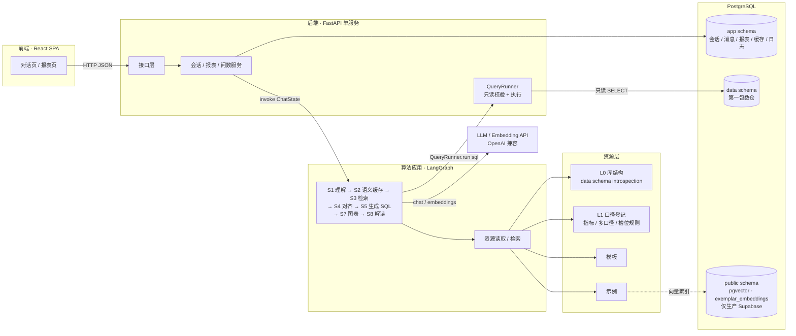
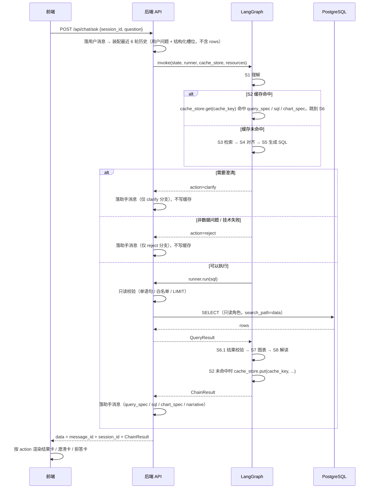
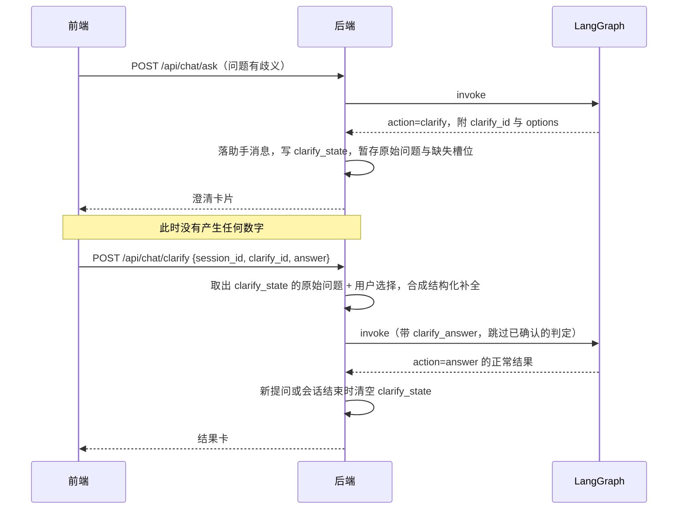
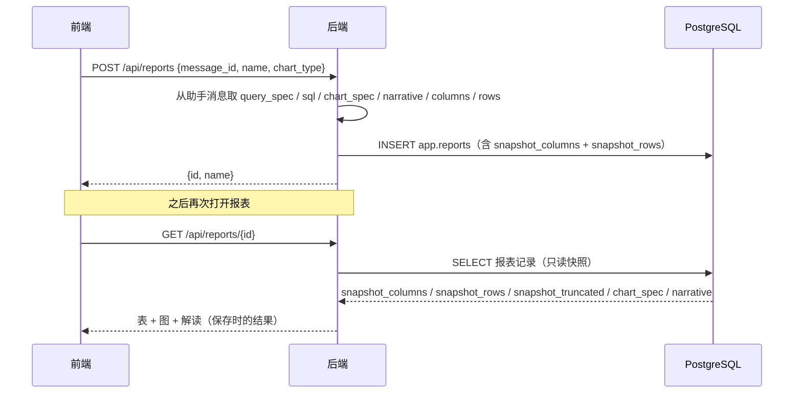

# ChatBI 平台 · SDD 总览

> 版本 v2.0 ｜ 关联 `docs/PRD.md` v0.6 ｜ 关联 `docs/测例.md` v1.2
>
> 本文是技术总览：技术方案一句话、逻辑架构图、四块职责边界、技术选型、功能落点对照表、非目标、仓库目录树、分方案职责与衔接、两种部署形态。改某一份分方案时，按「算法 → 后端 → 前端 → 总览」的顺序改，最后回到本文对齐衔接与对照表，不要把衔接散落到各分册里重复写。

---

## 0. 文档定位与改法约定

- **分工**：四份 SDD 互相用路径引用、不复制粘贴。本文（总览）负责「衔接与对照」；`SDD-算法应用.md` 是深度所在（S1~S8 问数链路、资源层、出口、QueryRunner 协议）；`SDD-后端.md` 负责「接口、存储、执行器、部署」；`SDD-前端.md` 负责「页面与交互落地」。
- **接口契约**：以 `SDD-后端.md` §2 为准；任何冲突按「算法 → 后端 → 前端 → 总览」顺序对齐，不得反向修改上游。
- **算法链路**：以 `SDD-算法应用.md` 为准；后端只写如何调用、如何执行、如何落库，不重新定义 S1~S8。
- **执行协议**：算法不直连数据库，执行 SQL 通过 `QueryRunner`，缓存读写通过 `CacheStore`，资源读取通过 `ResourceProvider`；协议由 `SDD-算法应用.md` §8.2 / §8.4 定义，后端负责实现，不得改协议形状。
- **交接数据结构**：一次问数的返回体 `ChainResult` 由 `SDD-算法应用.md` §6.4 写死（`action` + `result` / `clarify` / `reject`）；后端只补 `message_id` / `session_id` 并把 `trace` 剥离到 `query_logs`，前端按 `action` 渲染。
- **决策标注**：写死、不再讨论的技术决策在正文用 `【决策】` 开头，便于逐条挑战与修改；没有标注的属于实现细节，可以改。

---

## 1. 技术方案一句话

系统由前端（React SPA）、后端（FastAPI 单服务）、算法应用（LangGraph 问数链路）、数据（PostgreSQL，应用库＋数据库两 schema）四块构成：一次问数：前端发问题 → 后端调用算法链路 → 链路理解（S1） → 语义缓存（S2，命中走快路径） → 检索（S3） → 对齐（S4） → 生成 SQL（S5） → 后端执行（S6） → 出图表（S7） → 一句解读（S8） → 后端落库对话记录并返回 ChainResult → 前端按 action 渲染；主链路只硬依赖 L0 库结构，字典/模板/示例都是可选增强（有则更好，无则降级、不拒答）。真跑不出来才拒答（非数据问题 / 理解失败 / SQL 生成失败 / 执行失败）；空结果如实返回空表照常 answer；澄清是可选增强出口（L1 开启且登记多口径 / 必填槽位规则时）。

> 本段是四份 SDD 的锚点：后文所有设计都按它展开，任何设计与之冲突，以本段为准。

---

## 2. 逻辑架构图



**读图要点**

- **前端只和后端 API 说话**，不直连算法、不直连库。
- **算法不直连库做查询**：需要执行 SQL 时回调后端注入的 `QueryRunner`（`SDD-算法应用.md` §8.2）；缓存读写通过 `CacheStore`，资源读取通过 `ResourceProvider`（§8.4）。算法只消费注入的资源 / 缓存 / 执行结果，调 LLM / Embedding。
- **本地开发用 Docker 内置 Postgres**（两 schema：`app` + `data`），S3 检索无 pgvector 自动降级 lexical 纯关键词通道。
- **生产推荐用 Supabase**：一个项目即一份 Postgres，承载 `app` + `data` schema，外加 `public` schema 挂 pgvector 扩展存 S3 示例的向量索引（`exemplar_embeddings` 表）。LLM / Embedding API、pgvector、业务表全部在这一份 Supabase 里，零额外基础设施。
- **LLM 和 Embedding 都是外部商业化 API**，走 OpenAI 兼容接口，通过 `.env` 的三元组 `BASE_URL / API_KEY / MODEL` 配置（`SDD-后端.md` §6），切换厂商只改 env 不改代码。

---

## 3. 四块职责边界

| 块 | 负责 | 不该做的事 |
| :--- | :--- | :--- |
| 前端 | 页面、交互、按 `action` 渲染；按 `result.chart` 出图 | 不拼 SQL、不判断图表类型、不推断口径、不直连算法与库 |
| 后端 | 接口、存储、QueryRunner 执行、部署；补 `message_id` / `session_id`、剥离 `trace` 后包装响应 | 不做语义理解与 SQL 生成；不把业务口径写死在代码里 |
| 算法应用 | S1~S8 的全部智能链路、资源读取、出口判定 | 不持有数据库连接、不直接执行 SQL、不做报表 CRUD |
| 数据与资源层 | 定义「能问什么、口径是什么、数据在哪」 | 不包含行业外的特殊逻辑 |

一条硬边界：**SQL 只有后端执行**。算法产出 SQL 字符串，交给 `QueryRunner`；执行结果（rows / 错误码）回传算法，由算法决定继续、重试还是走出口。

---

## 4. 技术选型（写死一版）

| 层 | 选型 | 为什么适合这条链路 |
| :--- | :--- | :--- |
| 前端 | React 18 + TypeScript + Vite + Ant Design 5 + ECharts 5 + Zustand | 对话流是消息数组渲染；AntD 覆盖表单、列表、确认框；ECharts 只吃 `result.chart` |
| 后端 | Python 3.11 + FastAPI + SQLAlchemy 2.0 + Pydantic v2 + psycopg | 与算法同语言；Pydantic 作为接口契约单一来源 |
| 算法编排 | LangGraph | 需要条件边（澄清 / 拒答）、缓存命中短路、S5↔S6 回跳重试与可持久化状态 |
| 模型接入 | LiteLLM | 统一 OpenAI 兼容接口，换厂商只改 env |
| 数据库 | PostgreSQL 16（`app` + `data` 两 schema） | 一份实例承载应用数据与数仓，Compose 起一个容器即可；生产可整体换成 Supabase |
| 检索 | pgvector（生产）/ lexical 关键词（本地） | 有向量则语义召回，没有则关键词召回，**两条路都不影响主链路可用** |
| 部署 | Docker Compose（db + api + web） | 满足「一条命令起来、浏览器能用」；生产切 Supabase 只改连接串 |

> 【决策】选型写死一版。理由不止「流行」：每一条都对应链路上的一个具体约束，改选型要先改本节。

### 4.1 决策清单（为什么选、改了影响谁）

> 这张表是「选型为什么这么定」的单一来源，覆盖四份 SDD 里已写死的选型与边界（不只主框架）。**改任何一条决策前，先看「影响文档」列**，再按 §11 的顺序（算法 → 后端 → 前端 → 总览）回改，避免只改一处留下歧义。

| 编号 | 决策 | 理由 | 影响文档 |
| :--- | :--- | :--- | :--- |
| D1 | 后端 Python 3.11 + FastAPI + SQLAlchemy 2.0 + Pydantic v2，单体不拆微服务 | 本版规模不需要多服务；降低 Docker 拓扑与运维复杂度；与算法同语言，Pydantic 作为接口契约单一来源 | 后端、总览 |
| D2 | 算法用 LangGraph | 澄清 / 拒答 / 执行分支 + 共享 State，`StateGraph` 原生支持，是此模式的事实标准 | 算法应用 |
| D3 | 主链路只硬依赖 L0 库结构（自动抽取）；L1 字典 / 模板 / 示例是可选增强，缺则降级、不拒答 | 先保证通用流程跑得起来；字典 / 模板 / 示例提升质量，不是入场券 | 算法应用、`docs/metrics-dict.md` |
| D4 | 算法不直连库查询，经后端 `QueryRunner` 执行；缓存 / 资源经 `CacheStore` / `ResourceProvider` 注入 | 查数执行、超时、连接都归后端；算法纯逻辑、可单测 | 总览、算法应用、后端 |
| D5 | 报表存「结果快照」，再打开不重查 | 对齐 PRD（不重新提问、不重新查询）；快照是报表内容的唯一事实源 | 总览、后端、前端 |
| D6 | 前端只按后端 `result.chart` 出图，不在前端判断图表类型 | 图表决策集中在 S7 一处，避免双端逻辑漂移；前端只做 ECharts 适配 | 前端、总览 |
| D7 | LLM 用 OpenAI 兼容 API（LiteLLM 接入），可配模型，不绑定单一厂商 | 国内可访问、可切换；换厂商只改 `*_BASE_URL` / `*_API_KEY` / `*_MODEL` | 算法应用、后端 env |
| D8 | 数据库用 PostgreSQL 16 单实例，`app` + `data` 两 schema，生产可整体换 Supabase | 一份实例承载应用数据与数仓，Compose 起一个容器即可；不给演示加额外基础设施 | 后端、算法应用、总览 |
| D9 | 检索用 pgvector（生产）/ lexical 关键词（本地）双通道，启动探测、无向量自动降级 | 有向量走语义召回，没有也不影响主链路可用；本地不装扩展也能跑 | 算法应用、后端、总览 |
| D10 | 语义缓存只存 `query_spec` / `sql` / `chart_spec`，不存 rows / narrative；`cache_key` 含 `l1_version` + `schema_version` + `template_version`，TTL 7 天 | 数字会随数据变，口径与 SQL 相对稳定；L1 / 库结构 / 模板任一变化就自动失效 | 算法应用、后端、总览 |
| D11 | SQL 执行硬闸：单条只读 SELECT + `data` schema 表白名单 + `LIMIT`（`MAX_ROWS=1000`）+ 5s 超时 + 独立只读角色 / 连接 | SQL 由模型生成，执行侧必须有一道硬闸；只读角色兜底防越权 | 后端、算法应用、总览 |
| D12 | 图表只出 `bar` / `line`，S7 固定判定顺序（空结果 → 两期对比 → 时间序列 → 类别维度 → 单值），单值 `x_field=null`；本版不做饼图 | 判定顺序唯一才没有歧义；本版图表只服务对比 / 趋势 / 分布三类 | 算法应用、前端、总览 |
| D13 | 解读只出一句 `narrative`，不做多句报告、归因、预测 | 控制幻觉与调用成本；本版定位是查数，不是分析报告 | 算法应用、前端、总览 |
| D14 | 多轮上下文只带最近 6 轮，用户问题 + 结构化槽位摘要，不含 rows | 追问能继承口径，又不把大结果塞进 prompt | 算法应用、后端、总览 |
| D15 | 接口统一响应包 `{code, message, data, trace_id}`；`ChainResult` 由算法定义，后端只补 `message_id` / `session_id` 并剥离 `trace` | 契约单一来源，避免算法与后端各说一套；`trace` 落 `query_logs` 不进响应 | 后端、前端、算法应用、总览 |
| D16 | 前端用 React 18 + TypeScript + Vite + Ant Design 5 + ECharts 5 + Zustand | 对话流本质是消息数组渲染；AntD 覆盖表单 / 列表 / 确认框；Zustand 只管当前会话 + 报表列表 | 前端、总览 |
| D17 | 部署用 Docker Compose（db + api + web），一条命令起；生产切 Supabase 只换连接串 | 满足 F8「一条命令起来、浏览器能用」；不引入 K8s / CI/CD 全链路 | 后端、总览 |
| D18 | 鉴权本版固定 `demo` 用户，表带 `user_id`，`core/deps.py` 预留 `get_current_user()` | F11 暂缓，但不把多用户的门焊死；后续接登录不用改表结构 | 后端、前端、总览 |
| D19 | 链路固定 S1~S8 八步，不做 ReAct 自主规划 / 多 Agent 编排；失败按固定出口收口 | 演示要可解释、可复现；固定链路才能定位每一步问题，也避免模型自由发挥 | 算法应用、总览 |

> 判断一条决策是否该动：先问「它影响哪几份文档」，再问「有没有更小代价的替代」。只影响总览表述的，可以只改总览；影响到 `ChainResult`、接口报文或页面字段的，必须按 §11 顺序逐层回改。

---

## 5. 与 PRD 对照表（F1~F11 落点）

> **主责** = 该部分对此功能承担设计主线；**配合** = 围绕主责的契约做实现。**本版演示要有的，三部分必须都对得上。**

PRD 共 F1~F11：F1~F8 本版演示要有，F9~F11 本版暂缓。

| PRD | 功能 | 主责 | 配合 | 本版演示 | 技术落点 |
| :--- | :--- | :--- | :--- | :--- | :--- |
| F1 | 对话问数 | 算法（S1~S8 智能链路） | 前端（对话页 + 结果区）、后端（ask 接口 + QueryRunner 执行 + 落库） | 要有 | 链路跑通至 `action=answer`；前端按 `ChainResult` 渲染表 / 图 / 解读；空结果走同一出口（`rows=[]`）；多轮追问由 S1 继承结构化槽位 |
| F2 | 澄清 | 算法（S4 对齐判定 + 澄清出口，可选增强） | 前端（选项 UI）、后端（clarify 接口 + 重入链路） | 要有 | L1 开启且命中多口径 / 缺必填槽位 → `action=clarify`，确认前不出数；L1 未开启或未命中则按 L0 结构尽力作答、不澄清 |
| F3 | 拒答 | 算法（S1 范围判定；S5 / S6 失败出口） | 前端（拒答卡）、后端（错误码透传） | 要有 | 非数据问题 → `reject`（out_of_scope / detail_export / no_data / write_op）；理解 / 生成 / 执行失败 → `reject` 且 `retryable=true`（intent_parse_failed / sql_generate_failed / sql_execute_failed / timeout）；全程无数字 |
| F4 | 对比分析 | 算法（S1 对比槽位 + S5 单条 SQL） | 后端（QueryRunner 单次执行）、前端（两行对比表 + 柱状图） | 要有 | 同比 / 环比 / 双时段由同一 `query_spec.comparison` 表达；结果固定 `period` + 指标列两行，变化率只在 `narrative`；S6.1 只校验两期结构齐全，仅一期有数据给 `validation.warnings` 不 reject；日均走 `daily_avg` |
| F5 | 一键存成报表 | 后端（reports 写库 + 快照） | 前端（保存弹窗）、算法（提供 `query_spec` / `sql` / `chart_spec`） | 要有 | 从助手消息取三件套落 `app.reports`；同名返回 `409`；保存时写 `snapshot_columns` + `snapshot_rows` + `snapshot_truncated`，快照即报表内容的唯一来源 |
| F6 | 已存报表管理 | 后端（reports CRUD + 快照读取） | 前端（列表 / 行内改名 / 删除确认） | 要有 | `GET /api/reports/{id}` 直接读 `snapshot_columns` + `snapshot_rows` + `snapshot_truncated` + `chart_spec` + `narrative`；不执行 SQL、不调算法、不重新查询 |
| F7 | 对话记录 | 后端（sessions / messages 读写） | 前端（左侧栏 + 回看） | 要有 | 消息落 `app.messages`（`action` / `query_spec` / `sql` / `chart_spec` 分列）；回看不重新计算 |
| F8 | 一键部署 | 后端（Compose + env + seed） | — | 要有 | `docker compose up` 起 db + api + web；生产切 Supabase 只改连接串（`DATABASE_URL` / `DATABASE_RO_URL`）；`/api/health` 探活 |
| F9 | 口径可验证 | — | — | 暂缓 | 预留：结果卡片增加条件复述行与 SQL 折叠块，本版不实现 |
| F10 | 效果评测 | — | — | 暂缓 | 预留：`eval/` 目录直接复用《测例》18 条，本版不实现 runner |
| F11 | 登录与鉴权 | 后端（预留 `get_current_user`） | 前端（用户位预留） | 暂缓 | 预留：身份注入点已在 `core/deps.py`，表已带 `user_id`，本版恒为 `demo` |

> 本表是四份文档的「功能落点索引」：任何功能在本表找不到落点，说明 SDD 漏了，回到对应分册补。技术落点中的 S1~S8 与 `ChainResult` 见 `docs/SDD-算法应用.md`，接口与 QueryRunner 实现见 `docs/SDD-后端.md`，页面落地见 `docs/SDD-前端.md`。

---

## 6. 非目标

对齐 PRD 的 Out 与暂缓。本节分两段：**先列暂缓**（平台需要、本版不做，架构上留预留位），**再列确定不做**（不属于本产品方向，不留半成品）。

### 6.1 暂缓（平台需要，本版不做）

| 暂缓项 | 本版边界 | 预留位 |
| :--- | :--- | :--- |
| 查询条件复述、SQL 展开查看（F9） | 结果卡片只有表 / 图 / 解读 | 结果卡片预留复述行与 SQL 折叠块 |
| 评测 runner（F10） | 只留 `eval/` 空目录与测例引用 | `eval/` 直接复用《测例》18 条 |
| 登录鉴权 / 多用户权限 / 行列级 RBAC / 多租户隔离 / 报表分享（F11） | 单用户 `demo`，报表仅个人可见 | 表带 `user_id`，`core/deps.py` 留鉴权注入点 |

### 6.2 确定不做（不属于本产品方向）

**【决策】以下在本版不实现、不留半成品**：

| 不做 | 说明 |
| :--- | :--- |
| 完整商业化 BI 中台 | 无仪表盘从零搭建、无报表编排 / 分发、无权限中台 / 多租户 / 计费 |
| 归因、因果推断、趋势预测 / 推演 | 只做数据对照；解读严格一句，不给追因与行动建议（C10） |
| 多句长解读、自动分析报告 | 每张结果卡只有一句 `narrative` |
| 生产级模型后训练、多模型自动选择编排 | 固定一条 S1~S8 链路 + 一个可配模型；换模型只改 env |
| K8s 与生产级 CI/CD 全链路 | Docker Compose 即满足 F8 |
| 跨工具 / 跨源拉数、外部附件上传问答 | 只查 `data` schema 内的 5 张表，不解析上传文件 |
| 无 L0 库结构的裸链问答 | 数据接入（L0 自动抽取）是唯一前提；L1 / 模板 / 示例未配置时链路照常跑，质量降级但不拒答 |
| 明细数据导出 / 行级数据下钻 | S1 判定为非数据问题，QueryRunner 再拦一道（C12） |
| 跨会话全文检索 / 搜索 / 导出 | 只按时间回看会话列表，不做全文检索与导出 |
| 报表成员协作、订阅、定时推送 | 报表分享随 F11 暂缓；本版报表仅个人可见，不做团队协作与主动推送 |
| 流式输出 | 一次性返回，不做 SSE / WebSocket |
| 移动端适配 / 主题切换 / 国际化 | 只做桌面端 |

> 本地不装 pgvector 不是「不做」，而是**自动降级**：S3 走 lexical 通道，主链路功能不减。

---

## 7. 仓库目录树草案

```
4-ChatBI/
├─ docker-compose.yml
├─ .env.example
├─ README.md
├─ docs/
│  ├─ PRD.md
│  ├─ 测例.md
│  ├─ 调研纪要.md
│  ├─ SDD-总览.md            ← 本文件
│  ├─ SDD-前端.md
│  ├─ SDD-后端.md
│  ├─ SDD-算法应用.md
│  └─ metrics-dict.md         （P6 产出：指标口径实体）
├─ harness/                   （P5 产出：AGENTS.md + specs）
├─ backend/
│  ├─ app/
│  │  ├─ main.py              应用入口、路由挂载
│  │  ├─ core/                配置、日志、统一异常、依赖注入
│  │  ├─ api/                 chat.py / sessions.py / reports.py / health.py
│  │  ├─ services/            chat_service / session_service / report_service
│  │  ├─ agent/               S1~S8 链路
│  │  │  ├─ graph.py / state.py / llm.py
│  │  │  ├─ nodes/            understand / cache / retrieve / align / gen_sql / execute / validate / chart / narrate
│  │  │  └─ prompts/
│  │  ├─ resources/           L0 读取（调 query/introspection）/ L1 loader / 模板 / 示例检索
│  │  ├─ query/               sql_guard / runner（QueryRunner 实现）/ cache_store（CacheStore 实现）/ introspection（L0 只读元数据）
│  │  ├─ storage/             models / db / repositories
│  │  └─ schemas/             Pydantic 接口模型
│  ├─ semantics/              L1：指标口径 / 同义词 / 多口径登记
│  ├─ templates/              SQL 模板（同比 / 环比 / 趋势 / TopN）
│  ├─ exemplars/              Q→SQL 示例（S3 的检索语料）
│  ├─ seed/                   schema.sql / data/*.csv / seed.py
│  ├─ tests/
│  ├─ requirements.txt / Dockerfile
├─ frontend/
│  ├─ src/
│  │  ├─ main.tsx / App.tsx
│  │  ├─ pages/               ChatPage / ReportsPage / ReportViewPage
│  │  ├─ components/          MessageList / ResultCard / ChartView / ClarifyCard / RejectCard / SaveReportModal
│  │  ├─ api/                 client.ts / chat.ts / reports.ts
│  │  ├─ store/               chatStore / reportStore
│  │  └─ types/
│  ├─ index.html / vite.config.ts / package.json / tsconfig.json
│  └─ Dockerfile / nginx.conf
├─ eval/                      （F10 暂缓，仅占位）
└─ infra/                     db 初始化脚本：init.sql 只建 app / data schema、只读角色与授权（data 表由 seed/schema.sql 建）
```

目录与模块一一对应：`agent/` 对应算法分册，`api/ + services/ + query/ + storage/` 对应后端分册，`pages/ + components/` 对应前端分册。

---

## 8. 三份分方案的路径与职责

| 文档 | 路径 | 负责什么 | 不负责什么 |
| :--- | :--- | :--- | :--- |
| 前端技术方案 | `docs/SDD-前端.md` | 页面结构、交互实现、接口调用、图表渲染、前端状态 | 不定义接口语义（以后端为准）、不定义口径、不超出 PRD 交互明细 |
| 后端技术方案 | `docs/SDD-后端.md` | 服务拆分、接口清单、QueryRunner 实现、存储模型、部署 | 不定义 S1~S8 链路（以算法为准） |
| 算法应用方案 | `docs/SDD-算法应用.md` | S1~S8 链路、资源层与降级、出口、状态字段、QueryRunner 协议、编排框架 | 不定义接口报文（以后端为准）、不定义页面 |

冲突时的裁决顺序与改法见 §0；本节只列各文档的负责 / 不负责范围。

---

## 9. 三部分怎么衔接

> 本节是唯一写清「跨模块怎么走」的地方。三份分册只写自己那段，不在此重复。

### 9.1 一次完整问数



关键交接物：

| 交接点 | 传什么 | 由谁定义 |
| :--- | :--- | :--- |
| 前端 → 后端 | `session_id`、`question` | 后端 §2 |
| 后端 → 算法 | 完整 `ChatState`（含 `history`）+ 通过 config 注入的 `runner` / `cache_store` / `resources` | 算法 §6.2、§8.2、§8.4 |
| 算法 → 后端 | 填充后的 `ChatState`，出口字段抽成 `ChainResult` | 算法 §6.2、§6.4 |
| 算法 → 后端（执行） | `sql` + `params` + `timeout_ms` + `max_rows` | 算法 §8.2 |
| 后端 → 算法（执行） | `QueryResult`（`columns` / `rows` / `row_count` / `truncated` / `elapsed_ms` / `error_code` / `message`） | 算法 §8.2 |
| 算法 ↔ 缓存 | `CacheStore.get(cache_key)` / `CacheStore.put(cache_key, ...)`，读写 `app.semantic_cache` | 算法 §3 S2、§8.4；后端 §3.5 |
| 算法 → 资源 | `ResourceProvider.l0()` / `l1()` / `templates()` / `exemplars()` | 算法 §8.4；后端 §3.6 |
| 后端 → 前端 | `message_id` + `session_id` + `ChainResult`（`action` + `result` / `clarify` / `reject`） | `ChainResult` 见算法 §6.4，包装见后端 §2 |

**为什么后端要落 `query_spec` 和 `sql`**：F5 存报表时要靠它们复用，不重新走 S1~S5。

**缓存写回只有 S2 一处**：只有 `action=answer` 且 `rows` 非空的未命中路径由算法在链路内 `cache_store.put(...)`（只存 `query_spec` / `sql` / `chart_spec`，不存 rows / narrative）；`clarify` / `reject` / 空结果不写缓存，后端也不做统一缓存写回。

### 9.2 一次澄清



要点：

- **澄清前不出数**：`action=clarify` 时 `result` 必须为空，后端序列化层强制。
- 澄清答案以**结构化字段**回填（`clarify_answer`），不是拼成一句自然语言再猜一遍。
- 澄清只在 L1 开启且登记了多口径 / 必填槽位规则时触发；关闭 L1 时降级为按 L0 结构尽力作答（演示与验收 profile 一律开启 L1，见算法 §3.3）。
- `clarify_state` 固定结构 `{clarify_id, original_question, missing, options, expires_at}`（后端 §2.2、§4.2）；用户放弃该问题时前端直接发新问题，后端清空 `clarify_state`。

### 9.3 一次存报表与再次打开



**再次打开为什么不重新走 S1~S5、也不重查**：报表的语义是「保存那一刻的结果」。报表记录里已经存了 `snapshot_columns` / `snapshot_rows` / `chart_spec` / `narrative`，重开直接读快照即可；不执行 SQL、不调算法、不重新提问，同一张报表每次打开内容一致。

| 落库字段 | 作用 |
| :--- | :--- |
| `question` | 来源问题，列表展示用 |
| `query_spec` | 结构化口径，仅溯源 / 复现，重开不读 |
| `sql` | 固化只读 SQL，仅溯源 / 复现，重开不执行 |
| `chart_spec` | 图表配置（类型 / x / series） |
| `narrative` | 保存时的一句解读 |
| `snapshot_columns` | 保存时的列定义，报表表头的唯一来源 |
| `snapshot_rows` | 保存时的结果快照，报表数据的唯一来源 |
| `snapshot_truncated` | 保存时是否因 `MAX_ROWS` 截断，重开复用该标记 |

---

## 10. 两种部署形态

**【决策】** 同一份代码、同一套 env 结构，只换连接串（`DATABASE_URL` / `DATABASE_RO_URL` / `DATABASE_META_URL`）与向量能力，不做两套分支。

| 项 | 本地开发 / 验收 | 生产（推荐） |
| :--- | :--- | :--- |
| 数据库 | Docker Compose 内置 `postgres:16` | Supabase 项目（一份 Postgres） |
| schema | `app` + `data` | `app` + `data` + `public`（pgvector） |
| 向量检索 | 无 pgvector，S3 自动降级 lexical | `public.exemplar_embeddings` 做向量召回 |
| 模型 | 外部 LLM / Embedding API（OpenAI 兼容） | 同上，换三元组即可 |
| 起服务 | `docker compose up` | 部署 api / web 两个容器，指向 Supabase 连接串 |
| 数据初始化 | 首次启动跑 `seed/seed.py`（幂等） | 同上，或作为一次性 Job |
| 连接串 | `DATABASE_URL`（读写）/ `DATABASE_RO_URL`（QueryRunner 只读）/ `DATABASE_META_URL`（可选，L0 introspection 只读，缺省回落 `DATABASE_RO_URL`） | 同上，指向 Supabase 对应角色 |

两种形态的切换只改 `.env`（`DATABASE_URL`、`DATABASE_RO_URL`、`DATABASE_META_URL`、`EMBEDDING_*`），应用代码不判断环境；pgvector 是否存在由启动探测决定，探测不到就走 lexical。

---

## 11. 变更顺序（具体到章节）

> 总原则见 §0 与文首摘要：**算法 → 后端 → 前端 → 总览**，不得反向修改上游。

1. **改链路、状态字段、出口、执行协议**：先 `SDD-算法应用.md`，再后端对应实现。
2. **改接口报文、存储模型、QueryRunner / CacheStore / Introspection 实现、部署**：在算法定稿后改 `SDD-后端.md`（§2 接口、§3 实现、§4 存储、§5 数据、§6 部署）。
3. **改页面、交互、前端类型**：在后端定稿后改 `SDD-前端.md`（§4 功能实现、§5 接口视图、§6 图表、§8 状态）。
4. **改衔接、功能落点、目录树、时序、部署对照**：最后回本文改 §5 落点表、§7 目录树、§9 时序与交接物、§10 部署形态。
5. **新增功能**：先确认 PRD 是否确有该功能；没有则不加。PRD 确有变更时，仍按「算法 → 后端 → 前端 → 总览」回改 SDD，不跳级。
