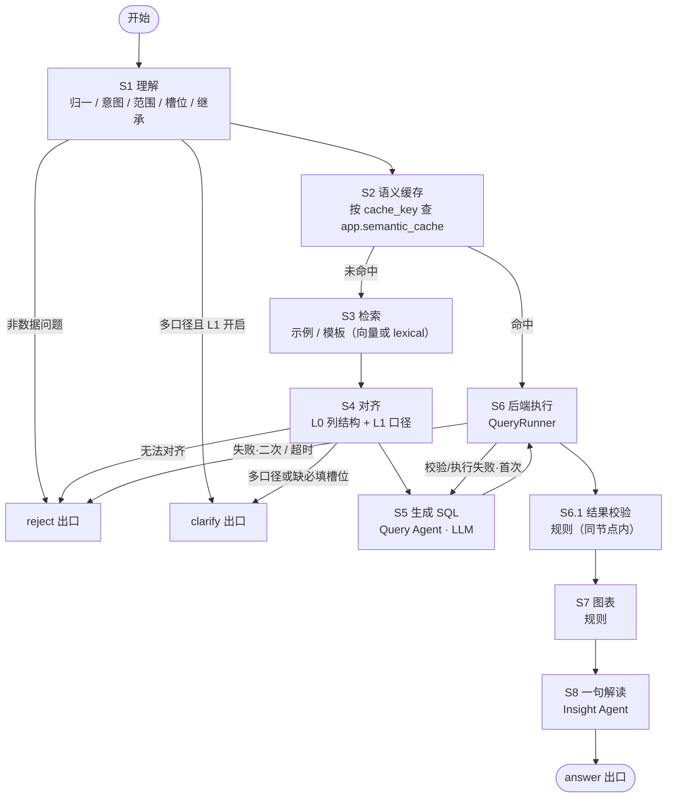

# ChatBI 平台 · SDD 算法应用方案（迭代版本 v01）

> **迭代版本说明**（本块仅存在于版本快照中，转正时替换为正式文档头）
>
> - **版本**：v01（全流程走读版）｜ **基线**：`docs/SDD-算法应用.md` v2.0 ｜ 关联 `docs/PRD.md` v0.6 ｜ 关联 `docs/测例.md` v1.2 ｜ 关联 `docs/SDD-总览.md` §1、§2、§9
> - **本版变更**：在「总链路」与「每一步的输入/输出/去向」之间新增 §2《一次真实请求的全流程走读》，用测例 C01 把 S1~S8 每一步的输入 / 输出 / 设计原因串讲一遍；原 §2~§10 顺延为 §3~§11，小节号同步顺延（如原 §6.4 → §7.4）。
> - **契约零改动声明**：本版不改 `ChatState`、`ChainResult`、`QueryRunner` / `CacheStore` / `ResourceProvider` 协议、S1~S8 步骤定义与任何失败码——只新增解释性章节。
> - **若本版转正**（替换 `docs/SDD-算法应用.md`），需按 §11 同步更新另外三份文档对算法章节号的引用：
>
>   | 原引用（三份文档中出现） | 转正后改为 |
>   | :--- | :--- |
>   | 算法 §6.2（ChatState） | 算法 §7.2 |
>   | 算法 §6.4（ChainResult） | 算法 §7.4 |
>   | 算法 §6.5（缓存键） | 算法 §7.5 |
>   | 算法 §8.2（QueryRunner 协议） | 算法 §9.2 |
>   | 算法 §8.4（注入协议） | 算法 §9.4 |

---

## 1. 总链路（写死八步）

```
S1 理解 → S2 语义缓存 → S3 检索 → S4 对齐 → S5 生成 SQL
→ S6 后端执行（S6.1 结果校验）→ S7 图表 → S8 一句解读
```



三条与旧版不同的硬约束：

1. **算法不直连库**：S6 只负责「调 `runner`」，SQL 的执行与只读校验都在后端（§9.2）。
2. **缓存命中走快路径**：跳过 S3 / S4 / S5，直接 S6 执行 → S7 / S8。缓存只复用口径与 SQL，不复用数字。
3. **空结果不是出口**：查询成功但 `rows=[]`，照样 `action=answer`，返回空表。

---

## 2. 一次真实请求的全流程走读

> 本章的作用是把 §1 的八步框图「落到地上」：用一个真实测例，把每一步在干什么、输入输出是什么、为什么这么设计串一遍。看懂本章，S1~S8 对你就不再是黑盒；各步骤的完整规则定义在 §3，本章只讲「做什么与为什么」。

### 2.1 先认识几个角色

| 角色 | 在一次问数里干什么 | 明确不干什么 |
| :--- | :--- | :--- |
| 用户 | 在对话框输入一句自然语言 | — |
| 前端 | 把问题发给后端；把返回的表 / 图 / 一句话画出来 | 不理解语义、不判断图表类型、不碰库 |
| 后端 | 总调度：收请求 → 调算法链路 → 替算法执行 SQL → 落库 → 包装响应 | 不做语义理解、不生成 SQL |
| 算法链路（本章主角） | S1~S8：听懂问题 → 查缓存 → 找参考 → 对齐口径 → 写 SQL → 要数据 → 选图表 → 说结论 | 不持有数据库连接，SQL 一律交给后端执行 |
| 数据库（`data` schema） | 只做一件事：被后端用只读账号执行 SELECT，返回行 | 不直接给算法用 |
| 大模型 API | 只在 S1（理解）、S5（写 SQL）、S8（解读）三个节点出场 | 其余步骤全是写死规则，不请模型 |

一句话记住分工：**模型只负责「语言」的部分——听懂、写 SQL、说人话；所有「碰数据」的动作（执行、校验、选图、缓存）都由规则与后端完成，且模型的每一步产出都会被下一步的规则检验。**

### 2.2 例题设定

用户在对话框输入：

> **这次双 11 大促的总 GMV 是多少？和去年同期比涨了多少？**

对应测例 **C01**（核心用例）。本例的背景设定：

- 时间口径：大促期 = 2026-11-01 ~ 11-11，去年同期 = 2025-11-01 ~ 11-11；
- L0 数据范围（`dim_date` 最早 / 最晚）：2025-10-01 ~ 2026-11-11；
- GMV 的 L1 口径（字典写死）：支付成功金额，`SUM(pay_amount) WHERE order_status='paid'`（不含取消与退款）；
- 期望产出：两行对比表 + 分组柱状图 + 一句解读。

> 注：测例清单里 C01 的期望形态写的「单行表」是旧表述；算法与前端已统一为「两行 period 对比表」（见 §6），转正时需同步修正测例文件，以本文为准。

### 2.3 S1 理解——把「人话」翻译成结构化清单

**这一步在干什么**：S1 是翻译官。它把一句口语拆成五个标准格式的「槽位」：查什么指标、按什么维度、带什么过滤、看哪个时间窗、和谁对比。后面所有步骤只认这份结构化清单，不再回头看原句。

**输入（本例）**：

- `question`：「这次双 11 大促的总 GMV 是多少？和去年同期比涨了多少？」
- `history`：[]（首轮对话，没有历史）
- `clarify_answer`：null（本轮不是澄清回填）
- L0 数据范围：2025-10-01 ~ 2026-11-11（用于判断问的时间窗有没有数）
- L1 多口径词表：本例涉及的「GMV」只登记了一个口径，无需澄清

**输出（本例）**：

```json
{
  "normalized_question": "2026年双11大促（11-01~11-11）总GMV是多少？去年同期是多少？",
  "intent": "data_question",
  "slots": {
    "metrics": ["gmv"],
    "dimensions": [],
    "filters": [],
    "time_range": {"start": "2026-11-01", "end": "2026-11-11"},
    "comparison": {"type": "yoy", "base": "去年同期"}
  },
  "inherited": {}
}
```

**为什么这么设计**：

1. **为什么不拿原句直接干活**：后面每一步（缓存、对齐、写 SQL）都需要确定性的输入。原句是自然语言，同一件事一百个人有一百种说法；槽位是标准件，塞进流水线才不会每步都要重新猜人话。
2. **为什么槽位只有五类**：查数场景的问法维度就这五个（指标 / 维度 / 过滤 / 时间窗 / 对比）。枚举意味着模型只能「填空」不能「作文」，填了枚举之外的东西立刻能发现。
3. **为什么 `temperature=0`**：同一句话永远产出同一份槽位——演示可复现、评测可对答案。这是整条链路「不飘」的第一锚点。
4. **为什么规则优先于模型**：改数（`write_op`）、导明细（`detail_export`）、竞品（`out_of_scope`）、超时间范围（`no_data`）这四类问题的答案是恒定的「说不」，用关键词硬匹配比指望模型理解更可靠——测例 C11 / C12 / C18 / C13 靠的就是这层兜底。
5. **为什么要 `inherited`（首轮为空）**：多轮追问时（C17），第二轮「那转化率呢？」要沿用第一轮的时间窗与维度。继承的是结构化槽位，而不是把聊天记录整段塞给模型——这是追问稳定性的来源。

**出错怎么办**：命中危险词 → 直接 `reject` 出口；分类输出非法枚举 → 重试 1 次，仍非法 → `reject`（`intent_parse_failed`）；槽位缺失（比如没说看什么指标）→ 不在本步拦截，交给 S4 判定是否值得反问。

**本例走向**：五类槽位齐全，进 S2。

### 2.4 S2 语义缓存——先看这道题「上次是怎么算的」

**这一步在干什么**：S2 拿「问题 + 口径 + 三个版本号」算一个指纹（`cache_key`），去缓存表里查有没有存过这道题的 `query_spec` / `sql` / `chart_spec` 三件套。命中就跳过 S3 / S4 / S5 直接执行；未命中就老老实实走全流程。

**输入（本例）**：`normalized_question` + `inherited={}` + `l1_version`（字典文件指纹）+ `schema_version`（库结构快照指纹）+ `template_version`（模板文件指纹）。指纹公式见 §7.5。

**输出（本例）**：`cache_hit=false`（第一次问，缓存里没有），继续 S3。`cache_key` 形如 `a3f9c2d1…`（sha256，64 位十六进制）。

**为什么这么设计**：

1. **为什么键里要掺三个版本号**：字典改了（口径变了）、表结构改了（列没了）、模板改了（写法变了），旧 SQL 都可能失效。版本号掺进指纹，任一变化旧键自动失配，不需要人工清缓存。
2. **为什么只缓存「怎么算」，不缓存「算出来多少」**：数据每天都在变。缓存复用的是口径与 SQL（相对稳定），数字永远现查——避免「昨天的数字今天照抄」。
3. **为什么 `reject` / `clarify` / 空结果不写缓存**：没成立的问题缓存下来就是错误答案复读机；空结果写缓存会让「今天没数」在有效期内一直「没数」。
4. **为什么命中后还要重新执行 SQL**：缓存三件套里没有 rows——数字永远是执行时刻的，不是缓存时刻的。

**出错怎么办**：缓存读写异常 → 记日志、按未命中处理，主链路照跑。缓存是提速手段，不是命脉。

**本例走向**：未命中，进 S3。

### 2.5 S3 检索——翻一翻例题本和模板库

**这一步在干什么**：S3 去「例题本」（历史 Q→SQL 标准答案对）和「模板库」（常见问法的 SQL 骨架）里，召回和本题最相似的几条，作为参考塞给 S4 / S5。生产环境用向量相似度（Embedding API），本地没装 pgvector 就用关键词重合打分，链路不变。

**输入（本例）**：`normalized_question` + `slots` + L1 同义词（GMV 的同义词：成交额、销售额）。

**输出（本例）**：召回 2 条相似示例（如「大促期 GMV 同比怎么写」「环比两期对比」）+ 命中 1 个模板（「两期对比模板」），存进 `retrieved`。

**为什么这么设计**：

1. **为什么不让模型裸写 SQL**：见过标准写法的模型（few-shot）比从零写的稳得多，写法也更贴我们的习惯。模板与示例的全部价值就在这里：把「每次即兴发挥」变成「对着参考写」。
2. **为什么检索结果只是提示、不是答案**：例题是「别的题」的答案，直接抄可能抄错口径。拍板的永远是 S4（对齐）和 S5（生成），检索只提供参考。
3. **为什么检索为空不报错**：它是增强项不是必需品。没有参考，S4 / S5 照常干活（对应 §4.3 降级矩阵）。

**本例走向**：带着 2 条参考进 S4。

### 2.6 S4 对齐——把口语钉到真实存在的表和列上

**这一步在干什么**：S4 是全链路的「对答案」环节。它把槽位里的每个词，逐一钉到 ① L1 字典里登记过的指标键、② L0 里真实存在的表和列上，并确定指标公式、维度列、过滤列、时间列。**只允许用已存在的键与列，不允许现编。**

**输入（本例）**：`normalized_question` + `slots` + `retrieved` + L0 列结构（`dwd_order`：`order_id / order_date / channel / category / sku_id / pay_amount / order_status / is_new_customer`）+ L1 字典（GMV = `SUM(pay_amount) WHERE order_status='paid'`）。

**输出（本例）**——`aligned` 与 `query_spec`：

```json
{
  "aligned": {
    "metrics": ["gmv"],
    "dimensions": [],
    "filters": [{"field": "order_status", "op": "=", "value": "paid"}],
    "tables": ["data.dwd_order"],
    "unmatched": [],
    "degraded": false
  },
  "query_spec": {
    "metrics": ["gmv"],
    "dimensions": [],
    "filters": [{"field": "order_status", "op": "=", "value": "paid"}],
    "time_range": {"start": "2026-11-01", "end": "2026-11-11"},
    "comparison": {"type": "yoy", "base_range": {"start": "2025-11-01", "end": "2025-11-11"}},
    "granularity": "total",
    "order_by": {"field": "gmv", "direction": "desc"},
    "limit": null
  }
}
```

**为什么这么设计**：

1. **为什么「只允许已存在的键与列」是铁律**：模型最常见的错误就是编一个不存在的列名、或者自创一个口径。钉死在字典上，它编不出来——这是防幻觉最硬的一道闸，比任何 prompt 技巧都可靠。
2. **为什么 `query_spec` 是「唯一口径事实来源」**：缓存键用它（§7.5）、存报表用它（F5）、评测对答案也用它。一份结构三处消费，才不会出现「算法一套口径、报表另一套口径」。
3. **为什么这里也可能触发澄清**：如果一个词登记了多个口径（比如「退货率」既可按单数也可按金额），猜错比不答更糟——宁可反问一句让用户点选。测例 C09 / C19 走的就是这条路。
4. **为什么 L1 缺失还能继续**：没有字典就按 L0 列名与注释尽力对齐，标记 `degraded=true`，由 S8 在解读里如实说明「按 XX 列统计」——降级，但不说谎。

**本例走向**：GMV 口径唯一、槽位齐全，对齐成功，进 S5。

### 2.7 S5 生成 SQL——强模型按「标准件」写一条查询

**这一步在干什么**：Query Agent（强模型）拿着 `query_spec` + 用到的表结构 + 字典公式 + S3 找来的参考写法，写出**一条**只读 SELECT。对比类问题的硬要求：两期数据必须在同一条 SQL 里算出，不允许跑两条。

**输出（本例，示意 SQL，实际以 L1 公式与 L0 列为准）**：

```sql
WITH cur AS (
    SELECT SUM(pay_amount) AS gmv
    FROM data.dwd_order
    WHERE order_status = 'paid'
      AND order_date >= DATE '2026-11-01'
      AND order_date <  DATE '2026-11-12'
),
prev AS (
    SELECT SUM(pay_amount) AS gmv
    FROM data.dwd_order
    WHERE order_status = 'paid'
      AND order_date >= DATE '2025-11-01'
      AND order_date <  DATE '2025-11-12'
)
SELECT '本期'      AS period, gmv FROM cur
UNION ALL
SELECT '去年同期'  AS period, gmv FROM prev
```

**为什么这么设计**：

1. **为什么对比必须一条 SQL**：如果两期分两条查，两条之间的过滤条件、口径可能不一致，数字就漂了。一条 SQL 里两期共用同一套条件，结构上就漂不了——这是对比可信度的根。
2. **为什么结果固定两行（period + 指标列）**：图表规则（§8）和前端渲染都只认这一个形状。形状固定，谁都不用猜、不用特判。
3. **为什么 `temperature=0` 且只许出代码块**：SQL 是要被执行的，不是拿来读的。解释性文字只会增加解析出错的机会。
4. **为什么写完不直接信**：S5 的产出会被 S6 的五道安检检验，被拒就带错误信息重写一次（只一次）——模型的产出永远要过规则闸门。

**出错怎么办**：SQL 被后端安检拒绝（`SQL_REJECTED`）→ 带错误信息重写 1 次；仍被拒 → `reject`（`sql_generate_failed`）。

### 2.8 S6 后端执行——五道安检、一次执行、四条校验（含 S6.1）

**这一步在干什么**：算法把 SQL 交给后端注入的 `QueryRunner`（协议见 §9.2），自己全程不碰数据库。后端先安检、再执行、执行完立刻做结果校验（S6.1），三件事都在这一个节点里。

**安检五道（都在执行前）**：

| 道次 | 检查什么 | 防什么 |
| :--- | :--- | :--- |
| 1 | 是不是单条只读 SELECT / WITH | 防多语句夹带 UPDATE / DELETE |
| 2 | 表是否都在 `data` schema 白名单里 | 防读到应用表或系统表 |
| 3 | 自动追加 `LIMIT`（上限 1000 行） | 防一次拖出百万行拖垮前端 |
| 4 | 5 秒超时，到点直接掐 | 防慢查询占死连接 |
| 5 | 用独立只读账号执行 | 前四道全漏了，账号本身也写不了库 |

**执行结果（本例）**：

```json
{
  "columns": [
    {"key": "period", "title": "周期", "type": "string"},
    {"key": "gmv", "title": "GMV", "type": "number"}
  ],
  "rows": [
    {"period": "本期", "gmv": 12840000},
    {"period": "去年同期", "gmv": 11210000}
  ],
  "row_count": 2,
  "truncated": false,
  "elapsed_ms": 230,
  "error_code": null,
  "message": null
}
```

**S6.1 结果校验（纯规则，不用模型）**：对本例逐条过——

1. 列结构与 `query_spec` 匹配？（period + gmv，✓）
2. 对比类具备两期结构？（`comparison` 非空且含 `period` 列，✓）
3. 数值列整体 NULL？GMV 出现负数？（否，✓）
4. 两期都有数据？（都有，✓）

**为什么这么设计**：

1. **为什么安检这么多道**：SQL 是模型写的，模型会犯错、也可能被话术诱导。执行口是最后一道门，闸宁多勿少；只读账号是「上面全漏了也写不了库」的兜底。
2. **为什么校验不用模型**：「形状对不对」是确定性判断，规则零成本、零误差；没必要为它引入模型看走眼的风险。
3. **为什么失败回 S5 重写而不是直接报错**：列名打错、漏条件这类小毛病，带错误信息重写一次能救回大半；但只救一次——第二次还不对说明不是笔误，继续救只会掩盖问题。
4. **为什么 S6.1 结构不一致时不重生成**：spec 与 SQL 对不上，说明链路里有一处脱节，重生成只是换一种方式错；停下来报错（`sql_execute_failed`）让问题显形。
5. **为什么空结果也算成功**：「库里今天确实没数」是合法的业务事实，如实给空表（照走 answer 出口）比编一句「约等于 0」诚实。

**本例走向**：校验全过，进 S7。

### 2.9 S7 图表——查表选图，命中即停

**这一步在干什么**：S7 看结果的「形状」选图表类型，纯规则、零模型。判定顺序写死：空结果 → 两期对比 → 时间序列 → 类别维度 → 单值，命中即停。

**本例的判定过程**：

1. 空结果？否（2 行）；
2. 两期对比？`comparison` 非空 → **命中**，出分组柱状图，停止判定。

**输出（本例）**：

```json
{"type": "bar", "x_field": "period", "series": [{"key": "gmv", "name": "GMV"}]}
```

**为什么这么设计**：

1. **为什么是规则不是模型**：选图就是查表。模型来做又慢，还会今天出折线明天出柱状；规则百分百可复现，演示时图型不会飘。
2. **为什么顺序写死、命中即停**：一条结果可能同时符合多条规则（比如按天的两期对比既是时间序列又是两期对比）。不排优先级就会输出不稳定；排了顺序，任何数据永远只有一个判定结果。
3. **为什么本版不做饼图**：占比类（`_ratio` / `_share`）也先给柱状图。图表类型越少，前端适配与验收口径越稳（决策 D12），后续要加再议。

**本例走向**：进 S8。

### 2.10 S8 一句解读——独立模型，只对查出来的数说话

**这一步在干什么**：Insight Agent（中档模型，**独立于写 SQL 的那个**）拿着「问题 + 查出来的数」，说一句不超过 60 字的人话。它看不到库、看不到 SQL、看不到链路过程——物理上断绝它编数据的可能。

**输入（本例）**：`normalized_question` + `query_spec` + rows 摘要（两行）+ `chart_spec`。

**输出（本例）**：

> 本期大促 GMV 1284 万，去年同期 1121 万，上涨 14.5%。

（注：「上涨 14.5%」是把输入里的两个数字直接相除得到的比较结论，属于「引用并比较输入数字」，不是凭空推算的新数字。）

**为什么这么设计**：

1. **为什么解读 Agent 是独立的、且看不到库**：职责上，解读只对结果负责；权限上，没有库结构、没有连接，它想编也编不出来——这是「禁越权」的物理实现，不是靠 prompt 约束。
2. **为什么只许一句、不许归因、不许建议**：一允许解释「为什么」，模型就开始编故事（测例 C10 明确拒掉因果推断）。本版定位是查数，不是分析报告；控制篇幅也同时控制了幻觉面积。
3. **为什么限 60 字**：解读是锦上添花，长了必然注水。
4. **为什么解读失败不连累整单**：数字都对、就差一句话，用模板兜一句（取最大 / 最小值的固定句式），保证正常结果不因解读挂掉而失败。

**本例走向**：组装 `result`，走 **answer 出口**。

### 2.11 出口之后：后端落库、缓存写回与前端渲染

链路内部到 S8 为止，剩下的动作在链路外：

1. **算法交出 `ChainResult`**（§7.4）：`action=answer` + `result`（columns / rows / chart / narrative / truncated）+ `trace`（每步耗时与备注，本版不回传前端）。
2. **后端接手**：补 `message_id` / `session_id`；把 `trace` 剥离落 `query_logs.trace`；对话与结果落 `app` schema；包装成统一响应包 `{code, message, data, trace_id}` 返回。
3. **缓存写回**：`action=answer` 且 `rows` 非空 → `cache_store.put(cache_key, {query_spec, sql, chart_spec})`——下次同题命中快路径。
4. **前端渲染**：按 `action=answer` 渲染——表格吃 `result.columns / rows`，ECharts 只吃 `result.chart`（**不自己判断图表类型**，决策 D6），`narrative` 展示在图下；`truncated=true` 时提示「仅展示前 1000 行」（本例为 false）。

### 2.12 快路径：同一个问题再问一次

假如用户十分钟后原样再问一遍：

```
S1（照跑，产出同样的槽位）→ S2（算出同样的 cache_key → 命中）
→ 拿回 query_spec / sql / chart_spec → 直接跳 S6 执行
→ S6.1 校验 → S7 → S8
```

- **跳过的是** S3 / S4 / S5（检索、对齐、写 SQL）——这三步是最花时间也最不确定的；
- **没有跳过的是** S6（SQL 重新执行，数字是现在的）与 S8（解读重新生成）；
- **S1 为什么照跑**：`cache_key` 的原料（normalized_question + inherited）就是 S1 的产出，不跑就没有键可比。

一句话：**缓存省的是「理解与写 SQL」的时间，不是把昨天的答案原样端上来。**

### 2.13 两条岔路：澄清卡与拒答卡怎么产生

判别逻辑一句话：**能答、但缺信息 → 澄清；怎么问都答不了 → 拒答。**

**澄清（以测例 C09「这次大促表现怎么样？」为例）**：

- S1 抽不出具体指标 → S4 发现缺必填槽位 → 出 `clarify` 卡：

```json
{
  "action": "clarify",
  "clarify": {
    "clarify_id": "c_01",
    "question": "想看哪个指标？",
    "options": [
      {"label": "GMV", "value": "gmv"},
      {"label": "转化率", "value": "conversion_rate"},
      {"label": "客单价", "value": "aov"},
      {"label": "退货率", "value": "return_rate"}
    ],
    "allow_free_text": true,
    "missing": ["metric"]
  }
}
```

- 设计要点：一次只问一个槽位类别（先问指标，下一轮再问基准，不混问）；选项全部来自 L1 字典合法键，**用户点选等于一次结构化对齐**，不再经过自然语言理解；确认前 `result` 必为 null，不出数。

**拒答（以测例 C11「帮我查一下竞品今年双 11 的 GMV」为例）**：

- S1 关键词命中「竞品」→ 直接 `reject`：`reason_code=out_of_scope`，message 与替代问法来自**模板**，不经模型——所以任何拒答里都不可能出现编造的数字。

两条岔路的完整报文与触发条件见 §5。

### 2.14 全程回顾：模型用在哪、规则守在哪

| 步骤 | 用大模型吗 | 一句话作用 | 本例产出 | 失败去向 |
| :--- | :--- | :--- | :--- | :--- |
| S1 理解 | 是（小模型，temperature=0） | 人话 → 结构化槽位 | metrics=[gmv]、大促期、同比 | 危险词 → reject；非法输出重试 1 次 |
| S2 语义缓存 | 否 | 查「这道题上次怎么算的」 | 未命中 | 缓存坏了当未命中 |
| S3 检索 | 否（生产走 Embedding） | 找相似例题与模板 | 2 条示例 + 1 个模板 | 空 / 挂 → 照常继续 |
| S4 对齐 | 部分（多口径候选时让模型挑） | 把词钉到真表真列 | query_spec | 缺槽位 → clarify；无法对齐 → reject |
| S5 生成 SQL | 是（强模型） | 写一条只读 SELECT | 两期对比 SQL | 被拒重写 1 次 → sql_generate_failed |
| S6 执行 + S6.1 校验 | 否（后端规则） | 五道安检 → 执行 → 校验 | 两行结果 | 重写 1 次 → reject；超时 → timeout |
| S7 图表 | 否 | 按形状查表选图 | bar | 默认 bar 兜底 |
| S8 解读 | 是（中档模型） | 一句人话 | 14.5% 那句 | 模板兜底 |

三条贯穿全章的设计原则，也是「不黑盒」的机制保证：

1. **模型只出现在「语言」环节**（听懂 / 写 SQL / 说人话），8 步里 5 步是写死规则——规则可单测、可复现、可归责。
2. **模型的每一步产出，都会被下一步的规则验收**：S1 的槽位被 S4 钉到真实存在的表列；S5 的 SQL 被 S6 五道安检过闸；S8 的一句话被 60 字与「只准引用输入数字」双约束限死。模型没有机会把错误带进最终结果。
3. **每个节点都有可检查的中间产物**（slots → query_spec → SQL → QueryResult → chart_spec → narrative）：出了问题能定位到具体一步的具体产物，而不是一句「AI 算错了」。这也是评测（F10）与排障能成立的前提。

---

## 3. 每一步的输入 / 输出 / 去向

### S1 理解

| 项 | 内容 |
| :--- | :--- |
| **谁做** | LLM 分类 + 规则兜底 |
| **输入** | `question`、`clarify_answer`（本轮为澄清回填时传）、最近 6 轮 `history`（用户问题 + 结构化槽位摘要，不含 rows）、L0 的数据范围（`dim_date` 最早 / 最晚日期）、L1 的多口径词表（只用于判断问题里的指标是否登记了多个口径） |
| **做什么** | ① 归一问题（补指代、拆多问）；② 判定意图；③ 判定是否非数据问题；④ 抽取槽位；⑤ 从上一轮 `query_spec` 继承缺失槽位 |
| **输出** | `normalized_question`、`intent`、`slots`（metrics / dimensions / filters / time_range / comparison）、`inherited` |
| **规则兜底** | 命中写操作词（改 / 删 / 更新 / 插入）→ `write_op`；命中「导出 / 明细 / 每一单」→ `detail_export`；命中竞品 / 同行 / 外部 → `out_of_scope`；时间窗早于数据起始日期 → `no_data`。规则优先于模型 |
| **成功去哪** | S2 |
| **失败去哪** | 非数据问题 → `action=reject`；多口径且 L1 开启 → `action=clarify`；缺必填槽位交由 S4 判定 |
| **模型参数** | `temperature=0`，结构化输出（JSON schema 约束），只允许枚举值 |

> 多轮追问的稳定性来自「继承结构化槽位」，不是把历史对话拼成一大段文字喂给模型（C17）。

### S2 语义缓存

| 项 | 内容 |
| :--- | :--- |
| **谁做** | 规则（纯代码） |
| **输入** | `normalized_question` + `inherited` + `l1_version` + `schema_version` + `template_version`，计算 `cache_key`（§7.5） |
| **做什么** | 通过后端注入的 `cache_store.get(cache_key)` 查缓存（**不直连库**）；有效期内且版本一致则命中 |
| **命中输出** | `cache_hit=true`，取回 `query_spec` / `sql` / `chart_spec`，**跳到 S6** |
| **未命中输出** | `cache_hit=false`，继续 S3 |
| **写回时机** | 仅 `action=answer` 且 `rows` 非空时，通过 `cache_store.put(cache_key, {query_spec, sql, chart_spec})` 写回；`reject` / `clarify` 不写缓存 |
| **失效条件** | 超过 TTL（默认 7 天）、`l1_version` 变化、`schema_version` 变化、`template_version` 变化 |

**缓存里不存什么**：不存 `rows`、不存 `narrative`。命中后仍要重新执行、重新生成解读，避免「昨天的数字今天照抄」。

`cache_store` 与 `runner` 同级，由后端在 `config["configurable"]` 注入（§9.4）；算法不 import 数据库模块。

### S3 检索

| 项 | 内容 |
| :--- | :--- |
| **谁做** | 向量检索（生产）/ lexical 关键词检索（本地降级） |
| **输入** | `normalized_question` + `slots` + L1 同义词 |
| **做什么** | 从示例库（Q→SQL 对）与模板库召回 top-k：向量通道用 Embedding + 余弦相似度；无 pgvector 时走关键词重合打分 |
| **输出** | `retrieved`：示例列表（问题 / `query_spec` / SQL / 相似度）+ 命中的模板名 |
| **去哪** | S4、S5（作为提示，不直接决定答案） |
| **失败 / 空** | 检索为空不报错、不拒答，S4 / S5 照常进行 |

**检索结果只是增强**：它能让 SQL 更像「我们习惯的写法」，但不能替代 S4 对齐与 S5 生成，也不能被当作答案直接返回。

### S4 对齐

| 项 | 内容 |
| :--- | :--- |
| **谁做** | L0 结构检索（规则）+ L1 口径匹配（规则 + LLM 选择） |
| **输入** | `normalized_question`、`slots`、`clarify_answer`（若有）、`retrieved`、L0 的列结构与注释、L1 的指标 / 同义词 / 多口径 |
| **做什么** | 把口语映射到①L1 指标键 ②L0 表与列；确定指标公式、维度列、过滤列、时间列。**只允许选已存在的键与列，不允许新建** |
| **输出** | `aligned`：`metrics[]`、`dimensions[]`、`filters[]`、`tables[]`、`unmatched[]` |
| **成功去哪** | S5 |
| **澄清条件** | L1 开启，且①同一词登记了多个口径 ②缺必填槽位（时间窗 / 对比基准）→ `action=clarify`（§5.2） |
| **拒答条件** | L0 里根本没有对应列、且无法用现有列表达 → `action=reject`（`out_of_scope`） |
| **L1 关闭时** | 不澄清，按 L0 列名与注释尽力对齐；对齐结果记录在 `aligned.degraded=true`，由 S8 在解读中说明口径来源 |

> 【决策】演示与验收 profile 一律开启 L1。关闭 L1 只用于「无字典冷启动」的技术验证，不作为验收口径——澄清验收（C09 / C19）依赖 L1。

### S5 生成 SQL

| 项 | 内容 |
| :--- | :--- |
| **谁做** | LLM（Query Agent） |
| **输入** | `aligned` + 相关表的 L0 结构摘要（只含用到的表）+ L1 指标公式 + S3 的示例与模板（top-k） |
| **输出** | `sql`：单条只读 `SELECT`（可含 `WITH`） |
| **成功去哪** | S6 |
| **失败去哪** | S6 返回 `SQL_REJECTED` / `SQL_FAILED` → 带错误信息重生成一次；再次 `SQL_REJECTED` → `sql_generate_failed`，再次 `SQL_FAILED` → `sql_execute_failed` |
| **模型参数** | `temperature=0`；只取代码块内容；禁止解释性文字 |
| **禁止** | 多条语句、白名单外的表、`SELECT *` 无聚合的明细、字符串拼接用户输入 |

### S6 后端执行（S6.1 结果校验）

| 项 | 内容 |
| :--- | :--- |
| **谁做** | 后端 `QueryRunner`（算法只发起调用） |
| **输入** | `sql`、可选 `params`、`timeout_ms`、`max_rows` |
| **输出** | `QueryResult`：`columns` / `rows` / `row_count` / `truncated` / `elapsed_ms` / `error_code` / `message` |
| **成功去哪** | S6.1 → S7 |
| **失败去哪** | 首次 `SQL_REJECTED` / `SQL_FAILED` → 回 S5 重生成；二次仍失败 → `action=reject`（`SQL_REJECTED` → `sql_generate_failed`，`SQL_FAILED` → `sql_execute_failed`）；超时 → `timeout` |

**S6.1 结果校验（同节点内的规则子步骤，不新增编号）**

1. 列数、列名是否与 `query_spec` 请求的指标 / 维度匹配；
2. 对比类是否具备两期结构（`query_spec.comparison` 非空且结果含 `period` 列）；两期是否都有数据由第 5 条判定；
3. 数值列是否整体为 `NULL`、GMV 类是否出现不可能为负的值 → 记 `validation.warnings`，继续 S7 / S8，不 reject；
4. `rows=[]` → 直接进入 S7，标记空结果（不调用 S8 生成结论句）；
5. 对比类只有一期有数据（另一期值为 `NULL` 或缺失）→ 记 `validation.warnings`，继续 S7 / S8，不 reject。

> 结构不一致（缺列、列名不匹配）→ `action=reject`（`sql_execute_failed`，`retryable=true`）。**不把结构不对的结果强行展示。**
> `rows=[]` → `answer` + 空表（同一出口）；仅一期有数据 / 数值残缺 → `answer` + `validation.warnings`，由 S8 在解读中说明「对比期无数据」。

### S7 图表

| 项 | 内容 |
| :--- | :--- |
| **谁做** | 规则 |
| **输入** | `columns`、`query_spec`、`rows` |
| **判定顺序** | 空结果 → 两期对比 → 时间序列 → 类别维度 → 单值；命中即停，避免一条规则同时命中 |
| **做什么** | 空结果 → `chart=null`；两期对比 → 分组 `bar`；时间字段 → `line`；类别维度 → `bar`；单值 → `bar` 且 `x_field=null` |
| **输出** | `chart_spec = {type, x_field, series[]}`；单值时 `x_field=null`，前端按固定类目「当前值」渲染 |
| **失败去哪** | 无匹配规则 → 默认 `bar`，series 取第一个数值列 |

### S8 一句解读

| 项 | 内容 |
| :--- | :--- |
| **谁做** | LLM（Insight Agent，独立 Agent，只看数据不看库） |
| **输入** | `normalized_question`、`query_spec`、`rows` 摘要（最多 20 行）、`chart_spec`、`validation.warnings`、`aligned.degraded`（L1 降级时） |
| **输出** | `narrative`：**一句**业务解读，不超过 60 字 |
| **约束** | ① 只能引用输入里出现的数字，不得推算新数字；② 不写原因归因、不写建议；③ `rows=[]` 时不调用，`narrative=""` |
| **失败去哪** | 模型调用失败 → 规则模板兜底（取第一行最大 / 最小值的模板句），保证正常结果不因解读失败而失败 |

---

## 4. 资源层：L0 / L1 / 模板 / 示例

**主链路只硬依赖 L0。** 其余三项是可选增强：有则更准，无则降级，**不因此拒答**。

### 4.1 L0 库结构（硬依赖）

| 项 | 内容 |
| :--- | :--- |
| 是什么 | `data` schema 的表、列、类型、注释，运行时从 `information_schema` 读取 |
| 读取方式 | 后端 `resources` 层经 `query/introspection` 用只读元数据连接读取 `information_schema`，经 `resources.l0()` 注入；**不经过 QueryRunner 的 data 表白名单** |
| 谁用 | S1（数据范围）、S4（对齐候选）、S5（相关表结构） |
| 版本 | 结构快照哈希记为 `schema_version`，变化时让 S2 缓存失效 |
| 缺失时 | 不可用——没有库结构就无法生成 SQL，启动自检失败 |

### 4.2 L1 口径登记（可选增强）

| 项 | 内容 |
| :--- | :--- |
| 是什么 | 指标键、同义词、公式、**多口径登记**、必填槽位规则、时间窗定义（`backend/semantics/*.yaml`） |
| 谁用 | S1（识别意图与槽位）、S4（对齐口径）、S5（注入公式）、S8（口径说明） |
| 版本 | 文件指纹记为 `l1_version` |
| 缺失时 | 不澄清、按列名尽力对齐；解读只能引用列名，不能声称业务口径 |

### 4.3 资源与降级矩阵

| 资源 | 有 | 无 |
| :--- | :--- | :--- |
| L0 库结构 | 正常 | 启动失败（硬依赖） |
| L1 口径 | 可对齐、可澄清、可说明口径 | 按列名尽力对齐；不澄清；解读降级为「按某列统计」 |
| 模板 | S5 优先套用模板，写法稳定 | S5 完全依赖模型生成 |
| 示例 | S3 召回，S5 few-shot 增强 | 检索为空，链路照常 |
| pgvector | 向量召回 | 自动切 lexical 关键词召回，链路照常 |

> 【决策】演示与验收 profile 开启 L0 + L1 + 模板 + 示例；本地不装 pgvector 只影响 S3 通道，不影响 S1~S8 的其他步骤。

---

## 5. 三个出口

**【决策】对外只有三个 `action`：`answer` / `clarify` / `reject`。** 没有独立的 `empty` 与 `error`：

- 空结果 → `answer`（空表）；
- SQL 生成失败、执行失败、超时 → `reject`（用 `reason_code` 区分，`retryable=true`）。

### 5.1 answer 出口

```json
{
  "action": "answer",
  "result": {
    "columns": [
      {"key": "period", "title": "周期", "type": "string"},
      {"key": "gmv", "title": "GMV", "type": "number"}
    ],
    "rows": [
      {"period": "2026 大促期", "gmv": 12840000},
      {"period": "2025 大促期", "gmv": 11210000}
    ],
    "chart": {"type": "bar", "x_field": "period", "series": [{"key": "gmv", "name": "GMV"}]},
    "narrative": "今年大促 GMV 较去年同期上涨 14.5%。",
    "truncated": false
  },
  "clarify": null,
  "reject": null
}
```

空结果时：`rows=[]`、`chart=null`、`narrative=""`，`action` 仍为 `answer`。前端按 `rows.length === 0` 渲染空态文案。

### 5.2 clarify 出口

触发点：S1（多口径）与 S4（多口径 / 缺必填槽位）。**只在 L1 开启且登记了对应规则时触发。**

```json
{
  "action": "clarify",
  "result": null,
  "clarify": {
    "clarify_id": "c_01",
    "question": "想看哪个指标？",
    "options": [
      {"label": "GMV", "value": "gmv"},
      {"label": "转化率", "value": "conversion_rate"},
      {"label": "客单价", "value": "aov"},
      {"label": "退货率", "value": "return_rate"}
    ],
    "allow_free_text": true,
    "missing": ["metric"]
  },
  "reject": null
}
```

设计规则：

1. **一次只问一个槽位类别**（`missing` 只记一类：`metric` / `time_range` / `baseline` / `caliber`）。若同时缺指标与基准，先问指标，下一轮再问基准，不在一张卡里混问。
2. 选项必须来自 L1 的合法键，用户点选即等于一次结构化对齐，不再经过自然语言理解。
3. **`result` 必须为 null** —— 确认前不出数，后端序列化层二次校验。
4. 因果类问题（C10）不走 clarify 给原因，只给 2~3 个可查的对照问法（由 `reject.suggestions` 承载）。

对应测例：C09（缺指标 / 基准）、C19（缺时间窗）、C10（因果 → 对照问法）。

### 5.3 reject 出口

```json
{
  "action": "reject",
  "result": null,
  "clarify": null,
  "reject": {
    "reason_code": "out_of_scope",
    "message": "系统没有竞品数据，只能查本平台内的经营数据。",
    "suggestions": [
      {"label": "看本品渠道结构", "question": "分渠道看大促期的 GMV 结构"}
    ],
    "retryable": false
  }
}
```

`reason_code` 与判定位置：

| reason_code | 判定位置 | 对应测例 | retryable |
| :--- | :--- | :--- | :--- |
| `out_of_scope` | S1 / S4（外部 / 竞品 / 库结构无法表达） | C11 | false |
| `detail_export` | S1（明细 / 导出 / 行级） | C12 | false |
| `no_data` | S1（超出 `data` 的时间范围） | C13 | false |
| `write_op` | S1（改数 / 删数 / 写库） | C18 | false |
| `intent_parse_failed` | S1（分类输出非法枚举，重试 1 次后仍非法） | — | true |
| `sql_generate_failed` | S5（`SQL_REJECTED` 后重生成 1 次，仍被拒） | — | true |
| `sql_execute_failed` | S6（`SQL_FAILED` 后重生成 1 次仍失败）/ S6.1（结构不一致） | — | true |
| `timeout` | S6 | — | true |

**失败码边界**：`SQL_REJECTED`（只读校验拒绝）只走 `sql_generate_failed`；`SQL_FAILED`（数据库执行报错）只走 `sql_execute_failed`；`S6.1` 结构不一致固定 `sql_execute_failed`，且**不自动重生成 SQL**，`retryable=true` 仅表示用户可手动重试。

**铁律**：业务类拒答（前四类）的 `message` 与 `suggestions` 来自模板，不经模型自由生成；任何拒答响应中不得包含计算得出的数字。

---

## 6. 对比类问题的走法

对比不是「再查一次」，而是在同一条链路上多一个槽位。

| 对比类型 | `query_spec.comparison` | SQL 形态 | 图表 |
| :--- | :--- | :--- | :--- |
| 同比 | `{type: "yoy", base: "去年同期"}` | 条件聚合 + `CASE WHEN` 或两个 CTE 合并 | 分组柱状 |
| 环比 | `{type: "mom", base: "上一个等长周期"}` | 同上 | 分组柱状 |
| 前后时段 | `{type: "prev_period", base: "大促前一周"}` | 同上 | 分组柱状 |
| 无对比 | `null` | 单期聚合 | 按 S7 规则 |

与普通取数的三点不同：

1. **S1 要多解析一个「对比期」槽位**；解析失败且用户未给基准 → clarify（C09 的「和什么比」）。
2. **S5 生成的 SQL 必须是单条**（含两期数据），由后端一次执行，避免两期口径漂移。
3. **S6.1 要校验两期结构**；缺列或列名不匹配 → 校验不通过；只有一期有数据 → 记 `warnings`，解读里必须说明「对比期无数据」，不得静默，也不得 reject；`rows=[]` 走空结果出口（`answer` + 空表）。

**对比结果固定形状**：S5 生成对比类 SQL 时固定返回 **2 行**——`period` 列（本期 / 对比期标签）+ 指标列（如 `gmv`）；S7 与前端只认 `x_field="period"` 与指标 `series`，差值 / 变化率只出现在 `narrative`，不额外返回列，也不由前端计算。

**日均归一化**：`query_spec` 带 `granularity: "daily_avg"`，SQL 用「总额 ÷ 天数」，`days` 取自 `dim_date` 计数，避免 11 天 vs 12 天直接比总额（C06）。

---

## 7. 模块拆分与交接字段

### 7.1 为什么拆成两个 Agent

| Agent | 负责步骤 | 拿什么 | 产什么 |
| :--- | :--- | :--- | :--- |
| **Query Agent** | S1~S7（S7 为规则侧） | 问题、历史、L0 / L1 / 模板 / 示例、QueryRunner、CacheStore | `query_spec`、`sql`、`rows`、`chart_spec` |
| **Insight Agent** | S8 | 问题、`query_spec`、`rows` 摘要、`chart_spec` | `narrative` |

拆开的三个理由：

1. **职责失败互不污染**：SQL 错了走 reject，不会让解读 Agent「圆场」编出一个说法。
2. **禁止越权**：Insight Agent 的上下文里没有库结构、没有数据库连接，物理上无法查库。
3. **可分别迭代**：改 Prompt 只影响一个 Agent，评测时能定位是取数错还是解读错。

同一个 LangGraph 图内两个节点，不拆成两个进程、两次 HTTP。

### 7.2 `ChatState` 字段（写死）

```python
class ChatState(TypedDict):
    # 输入
    session_id: str
    question: str                      # 用户原始问题
    history: list[dict]                # [{role, content, query_spec}]
    clarify_answer: dict | None        # 澄清确认后回填

    # S1 产物
    normalized_question: str           # 归一后的问题
    intent: str                        # data_question | non_data_question
    slots: dict                        # {metrics, dimensions, filters, time_range, comparison}
    inherited: dict                    # 从历史继承的槽位

    # S2 / S3 产物
    cache_key: str
    cache_hit: bool
    retrieved: list[dict]              # 示例候选 [{question, sql, query_spec, score}]
    templates_used: list[str]

    # S4 / S5 产物
    aligned: dict                      # {metrics[], dimensions[], filters[], tables[], unmatched[], degraded}
    query_spec: dict                   # 见 §7.3
    sql: str                           # S5
    sql_error: str | None              # S6 回传，供重生成
    retry_count: int                   # S6 重试计数（上限 1）

    # S6 产物
    columns: list[dict]                # [{key, title, type}]
    rows: list[dict]
    truncated: bool
    validation: dict                   # S6.1 {ok, warnings[]}

    # S7 / S8 产物
    chart_spec: dict | None            # 空结果为 None
    narrative: str                     # 空结果为 ""

    # 出口
    action: str                        # answer | clarify | reject
    result: dict | None
    clarify: dict | None
    clarify_id: str | None             # clarify 出口时生成，后端按它暂存/回填
    reject: dict | None
    trace: list[dict]                  # 每步 {node, elapsed_ms, note}
```

> `runner` / `cache_store` / `resources` 不进 `ChatState`：它们是可调用对象，不能进 checkpointer。执行时通过 `config["configurable"]` 注入（§7.6 / §9.4）。

### 7.3 `query_spec` 结构

```json
{
  "metrics": ["gmv"],
  "dimensions": ["channel"],
  "filters": [{"field": "promo_name", "op": "=", "value": "双11"}],
  "time_range": {"start": "2026-11-01", "end": "2026-11-11"},
  "comparison": {"type": "yoy", "base_range": {"start": "2025-11-01", "end": "2025-11-11"}},
  "granularity": "total",
  "order_by": {"field": "gmv", "direction": "desc"},
  "limit": null
}
```

这份 `query_spec` 是**唯一口径事实来源**：S2 缓存键、F5 存报表、评测核对都用它，前端不接触它。

### 7.4 `ChainResult`（一次问数的返回体，写死）

算法链路对外只交出这一个结构。后端在它外层补 `message_id` / `session_id` 后作为接口 `data` 返回，前端按 `action` 选卡片渲染。**四份文档都不允许往里增删字段。**

```python
class ChainResult(TypedDict):
    action: Literal["answer", "clarify", "reject"]

    result: dict | None      # action=answer：{columns, rows, chart, narrative, truncated}；空结果为 rows=[]、chart=null、narrative=""
    clarify: dict | None     # action=clarify：{clarify_id, question, options[], allow_free_text, missing[]}
    reject: dict | None      # action=reject：{reason_code, message, suggestions[], retryable}

    trace: list[dict]        # 每步 {node, elapsed_ms, note}；本版不回传前端，由后端剥离后落 query_logs.trace
```

互斥规则（与后端 §2.1 的校验表同源）：

| action | `result` | `clarify` | `reject` |
| :--- | :--- | :--- | :--- |
| `answer` | 有 | null | null |
| `clarify` | null | 有 | null |
| `reject` | null | null | 有 |

- `result` 内部字段含义见 §5.1，`chart` 的取值规则见 §8。
- 后端组装响应时只做「加 `message_id` / `session_id`，并把 `trace` 剥离到 `query_logs.trace`」这一件事，其余字段名不改、不填默认值；`clarify` / `reject` 状态下 `result` 非空视为算法 bug，序列化层直接抛 500。

### 7.5 语义缓存键

```
cache_key = sha256(
    normalized_question
  + json.dumps(inherited, sort_keys=True)   # 即 ChatState.inherited
  + l1_version          # semantics/ 文件指纹
  + schema_version      # information_schema 快照指纹
  + template_version    # templates/ 文件指纹
)
```

- **只对 `action=answer` 且 `rows` 非空的请求写缓存**；拒答、澄清、空结果都不写。
- 缓存内容只有 `query_spec` / `sql` / `chart_spec`，不含 rows / narrative。
- TTL 默认 7 天；`l1_version` / `schema_version` / `template_version` 任一变化，旧键自然失效（不需要主动清表）。

### 7.6 编排框架：LangGraph

**【决策】写死用 LangGraph**，理由对得上这条链路的三个具体需求：

| 需求 | LangGraph 怎么解决 | 替代方案的问题 |
| :--- | :--- | :--- |
| 三个出口与缓存短路 | `add_conditional_edges` 直接表达 answer / clarify / reject 与 S2→S6 跳转 | 链式 LCEL 只能用异常或分支函数模拟，状态难读 |
| S5 与 S6 之间带错误回跳一次 | 条件边回到 `gen_sql` 节点 | ReAct Agent 会自己决定循环次数，不可控 |
| 多轮对话要保存中间状态 | checkpointer 按 `thread_id=session_id` 持久化 | 自研状态对象要重写序列化与恢复 |

执行器注入：

```python
graph.invoke(
    state,
    config={"configurable": {
        "runner": pg_query_runner,
        "cache_store": pg_cache_store,
        "resources": file_resource_provider,
    }},  # 均不进入 checkpointer
)
```

`runner` / `cache_store` / `resources` 必须由调用方（后端 `services/chat_service.py`）注入，算法模块不 import 任何数据库模块。模型接入统一走 LiteLLM，`agent/llm.py` 暴露 `chat_json()` / `chat_text()` / `embed()`，任务与模型的对应关系写在配置里（分类用小模型、生成 SQL 用强模型、解读用中档模型、Embedding 用 embeddings 模型）。

---

## 8. 图表配置规则（S7 的展开）

| 数据形态 | 判定条件 | chart_spec |
| :--- | :--- | :--- |
| 时间序列 | `columns` 含 `date` / `stat_date` 类型字段 | `{type:"line", x_field:"date", series:[数值列]}` |
| 类别对比 | 含维度列（channel / category）+ 1 个数值列 | `{type:"bar", x_field:"channel", series:[数值列]}` |
| 两期对比 | `comparison` 非空（结构两期；仅一期有数据也按此出图） | `{type:"bar", x_field:"period", series:[数值列]}` |
| 单值指标 | 仅 1 行 1 数值列 | `{type:"bar", x_field:null, series:[数值列]}`，前端固定类目「当前值」 |
| 空结果 | `rows=[]` | `null`（前端只渲染空态） |
| 占比类 | 指标名含 `_ratio` / `_share` | 仍用 `bar`（本版不做饼图） |

**判定顺序**：空结果 → 两期对比 → 时间序列 → 类别维度 → 单值；命中即停，避免一条数据同时命中多条规则。

前端只按此渲染（前端 §6）。**图表类型判断只在这一处发生。**

---

## 9. 与后端的执行协议：QueryRunner / CacheStore / ResourceProvider

### 9.1 边界

- **算法不持有连接串、不 import 数据库驱动、不执行 SQL**；
- 后端在调用链路时注入三个可调用对象：`runner`、`cache_store`、`resources`；
- 算法只消费 `QueryResult` / 缓存值 / 资源快照，不感知连接池、schema、权限细节；
- 执行协议是四份文档里唯一的「算法 ↔ 后端」运行期契约，形状改动必须先改本节。

### 9.2 协议（写死）

```python
class QueryRunner(Protocol):
    def run(
        self,
        sql: str,
        *,
        params: dict | None = None,
        timeout_ms: int | None = None,     # 缺省用后端配置 QUERY_TIMEOUT_MS
        max_rows: int | None = None,       # 缺省用后端配置 MAX_ROWS
    ) -> QueryResult: ...


class QueryResult(TypedDict):
    columns: list[dict]      # [{key, title, type}]，type ∈ number|string|date
    rows: list[dict]         # 已归一化，键与 columns.key 对齐
    row_count: int
    truncated: bool
    elapsed_ms: int
    error_code: Literal["SQL_REJECTED", "SQL_FAILED", "QUERY_TIMEOUT"] | None
    message: str | None      # 仅 error_code 非空时有值
```

约定：

| 约定 | 说明 |
| :--- | :--- |
| 输入只读 | `sql` 必须是单条 `SELECT` / `WITH`；校验责任在后端，算法不重复实现 |
| 幂等 | 同一 `sql` 多次调用结果一致（只读，无副作用） |
| 错误不抛异常 | 失败通过 `error_code` 返回，算法据此决定重试或出口，不依赖 try/except 分支 |
| 不返回连接信息 | 不暴露连接串、执行计划、堆栈 |
| 空结果合法 | `error_code=null` 且 `rows=[]` 是正常结果，不是失败 |

### 9.3 失败与重试策略（写死）

| 场景 | 策略 |
| :--- | :--- |
| S1 分类输出非法枚举 | 重试 1 次；仍非法 → `reject`（`intent_parse_failed`），不猜 |
| S4 搜索不到列 / 指标 | 按矩阵降级；仍无法对齐 → `reject`（`out_of_scope`） |
| S5 生成后 `SQL_REJECTED` | 带 `message` 回 S5 重生成，**只重试 1 次** |
| S6 执行报错 `SQL_FAILED` | 同上，仅 1 次 |
| S6 超时 `QUERY_TIMEOUT` | 不重试，直接 `reject`（`timeout`，`retryable=true`） |
| S6.1 结构不一致 | 不重生成 SQL，直接 `reject`（`sql_execute_failed`）：说明 spec 与 SQL 已脱节，重试只会掩盖问题 |
| S8 解读失败 | 规则模板兜底出一句，不让正常结果因解读失败而失败 |
| S3 检索失败 / 为空 | 不重试、不报错，继续 S4 |
| S2 缓存读写异常 | 记日志后按未命中处理，**缓存故障不影响主链路** |

**禁止**：无限自我修复循环、模型自行决定重试、失败时返回「部分正确」的结果。

### 9.4 资源与缓存注入协议（写死）

```python
class ResourceProvider(Protocol):
    def l0(self) -> dict: ...              # {tables, columns, data_range, schema_version}
    def l1(self) -> dict: ...              # 指标/同义词/多口径/模板，来自 backend/semantics
    def templates(self) -> list[dict]: ...
    def exemplars(self) -> list[dict]: ...


class CacheStore(Protocol):
    def get(self, key: str) -> dict | None: ...   # {query_spec, sql, chart_spec} | None
    def put(self, key: str, value: dict) -> None: ...
```

- `resources.l0()` 由后端 `resources` 层通过只读元数据连接读取 `information_schema` 得到，**不经过 QueryRunner 的 data 表白名单**；L0 失败则启动自检失败，L1 / 模板 / 示例缺失则按 §4 的降级矩阵处理。
- `cache_store` 由后端实现并注入；算法不直接访问 `app.semantic_cache`，读 / 写 / 失效语义见 §3 S2 与 §7.5。
- 三个协议都不进 `ChatState`、不进 checkpointer；只在调用 `graph.invoke()` 时通过 `config["configurable"]` 传入。

---

## 10. 第一包测例怎么被这条链路支撑

| 测例 | 主要落在哪几步 | 判定点 |
| :--- | :--- | :--- |
| C01 同比 | S1→S2→S3→S4→S5→S6→S7→S8 | S1 解析 `yoy`；S5 单条 SQL 含两期；S6.1 两行 |
| C02 分渠道 | S4（维度对齐）→S5 | 维度为 `channel`，排序按 GMV 降序 |
| C03 转化率 | S4（指标 + 分母口径）→S5→S8 | S5 分母取 `dwd_traffic.uv`；S8 说明口径 |
| C04 客单价 | S4（派生指标）→S5 | AOV 由规则展开为 `gmv/orders`，不交给模型自由发挥 |
| C05 退货率 Top5 | S4→S5（`limit=5`） | S5 写入 `limit`；按 `return_rate` 排序 |
| C06 日均对比 | S1（`granularity=daily_avg`）→S5 | SQL 做日均归一化 |
| C07 按天趋势 | S1→S5→S7 | S7 判定为 `line` |
| C08 新老客 | S4（`is_new_customer` 维度）→S5 | 合计校验 |
| C09 表现怎么样 | S1→S4→**clarify** | S4 识别缺指标与基准，`missing=["metric"]` |
| C10 为什么掉了 | S1→**reject** | 判定为因果请求，只给对照问法（`suggestions`） |
| C11 竞品 | S1→**reject** | 规则命中「竞品」，`reason_code=out_of_scope` |
| C12 明细导出 | S1→**reject** | `reason_code=detail_export` |
| C13 超范围日期 | S1→**reject** | 与 L0 的 `dim_date` 范围比较，`no_data` |
| C15 退款占比 | S4→S5 | 按退款发生时间归期 |
| C16 环比 | S1（`mom`）→S5 | 相邻等长周期 |
| C17 多轮追问 | S1（继承槽位）→其余正常 | 第二轮 `inherited` 含 `time_range` 与 `dimensions` |
| C18 改数 | S1→**reject** | 规则命中写操作词，`write_op` |
| C19 缺时间窗 | S4→**clarify** | `missing=["time_range"]`，给候选 |

**分布**：正常链路 11 条，澄清 2 条，拒答 5 条（含 C10 走 reject 的对照问法）。出口不是补丁，是链路的一半。

---

## 11. 本文件与其他三份的边界

| 事项 | 归谁 |
| :--- | :--- |
| S1~S8 节点、状态字段、出口、资源层、QueryRunner 协议 | 本文 |
| 接口报文、表结构、QueryRunner 实现、部署 | `docs/SDD-后端.md` |
| 结果卡渲染、澄清选项交互、图表适配 | `docs/SDD-前端.md` |
| 功能落点索引、跨模块时序 | `docs/SDD-总览.md` §5、§9 |

改 `ChatState`、`ChainResult` 或 `QueryRunner` 时，必须同时检查后端 §2 / §3 与前端 §5 的类型定义——这是四份文档唯一的强耦合点。
